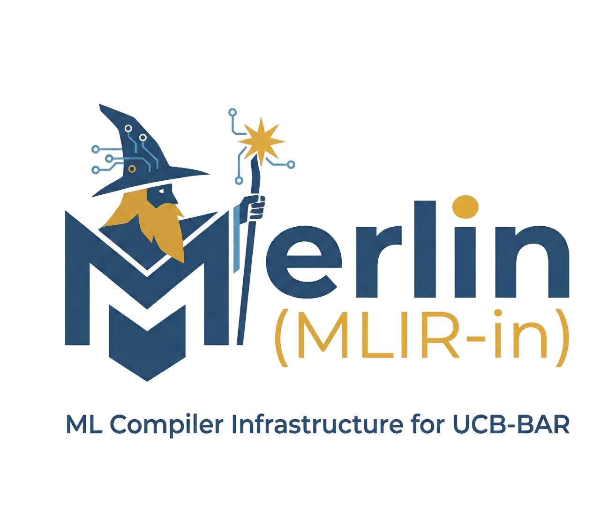

<p align="center">
  
</p>

<h1 align="center">merlin</h1>

<p align="center">
  A compiler-generation framework: <b>derive tests and develop correct, efficient target compilers</b>
  with shared transformations and out-of-tree target support.
</p>

> **Early development.** merlin is under active development; expect rough edges and APIs that may
> change. Bugfixes and PRs are welcome — please discuss significant changes in the
> [issue tracker](https://github.com/ucb-bar/merlin/issues) before starting work.

Start with the [contributor guide](docs/guides/compiler_contributions.md) for code entry points,
the [experiment catalog](experiments/README.md) for available workflows,
the [repository map](docs/reference/repo_structure.md) to find code, or the
[docs hub](docs/README.md) for compiler, mining, DSE and hardware-specific guides.
Hardware results apply to their recorded revisions and prerequisites, not every fresh installation.

For the joint correctness/performance experiment, see the
[artifact evaluation guide](docs/guides/artifact_evaluation.md) and
[compiler optimization surfaces](docs/reference/compiler_optimization_workflow.md).
The artifact branch is a release candidate; clean-machine and hardware reproduction
are not yet qualified.

The current joint experiment combines correctness and performance development in
one evolving compiler session using the native Phase 1 infrastructure. Historical
Phase 1/Phase 2 names remain in the module layout and standalone workflows:

| Work on | Code |
| --- | --- |
| Hardware-guided test generation (Phase 0) | [Test generation](packages/merlin-experiments/src/merlin_experiments/phase0/) |
| Compiler authoring and joint evaluation (Phase 1 infrastructure) | [Compiler-generation workflow](packages/merlin-experiments/src/merlin_experiments/phase1/) |
| Separate retained-compiler optimization workflow (Phase 2) | [Optimization workflow](packages/merlin-experiments/src/merlin_experiments/phase2/) |
| Shared compiler infrastructure | [Compiler core](src/merlin/) |

The [catalog](experiments/catalog.yaml) indexes target definitions in
[`examples/<target>/experiment.yaml`](examples/README.md) and generic templates in
`experiments/`; definitions do not live alongside engine code.
Generated target backends belong out of tree. Some native controllers still await migration;
the [repository map](docs/reference/repo_structure.md) identifies those locations explicitly.

## Quick start

merlin uses [uv](https://docs.astral.sh/uv/):

```bash
uv venv
uv pip install -e '.[dev,xdsl,targetgen]'
.venv/bin/merlin --help
```

For phase definitions and experiment tooling, install the optional experiment distribution:

```bash
uv pip install -e packages/merlin-experiments
.venv/bin/merlin experiment list
```

Listing, inspection and preflight do not launch agents. Execution requires the definition's
declared inputs, toolchains and budgets; phase-2 catalog entries are templates until those inputs
are supplied. Use `.venv/bin/merlin` or `uv run --no-sync` after installing extensions so a
root-only sync does not remove them. See [setup](docs/guides/getting_started.md) for other packages.

(Without uv: `pip install -e '.[dev,xdsl,targetgen]'` — `targetgen` supplies `jsonschema`, which the contract-validation tests import, so `[dev,xdsl]` alone does not run the suite.)

Then inspect a runnable example. [`examples/triton/`](examples/triton/README.md) starts from a stock
`@triton.jit` kernel. Its preflight identifies which lowering and hardware-certification stages are
available; the local lowering stages need the optional pinned Triton dependency, while RTL
certification needs an external simulator:

```bash
examples/triton/run.sh preflight
```

**Cloning & submodules.** The Python package needs no submodules. The only tracked optional heavy
tree is `third_party/llvm-project` (the multi-GB LLVM monorepo). Cross-framework baselines are
independent external checkouts, selected with `MERLIN_EXT_*` paths; they are not vendored. A plain
`git clone` is enough to start. Initialize LLVM only for tasks that need it, e.g.
`git submodule update --init --depth 1 third_party/llvm-project`.

`merlin` groups experiment, compile, target, storage and verification entrypoints. Specialized
console scripts remain available from their owning distributions; the generated
[CLI reference](docs/reference/cli.md) lists their modules and package ownership.

## Choose your path

- **Compile / run models** → [`docs/guides/getting_started.md`](docs/guides/getting_started.md)
- **Bring up new hardware** → [`docs/guides/adding_a_target.md`](docs/guides/adding_a_target.md), [`docs/reference/architecture.md`](docs/reference/architecture.md)
- **Mine kernels / improve the compiler** → [`docs/guides/kernel_mining.md`](docs/guides/kernel_mining.md)
- **Design-space exploration** → [`docs/guides/dse.md`](docs/guides/dse.md)

## How it's organized

The main workflow is phase-based:

| Phase | Purpose | Definition / entry point |
| --- | --- | --- |
| 0 | Hardware-guided test generation: derive executable coverage contracts (capsules) | `experiments/catalog.yaml` → `merlin experiment` |
| 1 | Functional compiler generation: construct, repair and evaluate a frozen reusable backend | Same experiment definition, phase `1` |
| 2 | Performance optimization: improve reusable compiler rules, then measure the frozen result | Separate `measured_claims` and `model_portfolio` policies |

Start with [`experiments/README.md`](experiments/README.md) for the catalog and CLI.
Phase engines retain their grading and hardware checks; a successful process is not
itself a correctness or performance claim. See the
[repository structure](docs/reference/repo_structure.md) for package ownership and
remaining compatibility paths.

Supporting workstreams coordinate through **shared schemas** (`merlin/schemas/`):

1. **TargetGen / dialect generation** — ISA/docs/RTL → target contract → dialect plan → scaffold
   (`src/merlin/targetgen/`, `merlin/targets/`).
2. **Kernel abstraction mining** — external kernels → kernel records → abstraction candidates →
   policy rules (`src/merlin/kernels/`, `src/merlin/rvvgen/`, `packages/merlin-mining/`).
3. **Design-pressure & DSE** — workloads → design-pressure reports → candidate contracts → variant
   comparison (`packages/merlin-dse/src/merlin/`).

See [`docs/design/parallel_workstreams.md`](docs/design/parallel_workstreams.md).

**Two compiler planes.** xDSL (Python) is the default prototyping plane
(`src/merlin/xdsl_dialects/`); MLIR/C++ is the eventual stable plane
(see [`docs/design/compiler_plane.md`](docs/design/compiler_plane.md)). Core dialects —
`contract`, `schedule`, `interface`, `runtime` (see
[`docs/reference/core_dialects.md`](docs/reference/core_dialects.md)); DSE search spaces and
kernel-derived policies stay as schemas/YAML/JSON.

## Repository at a glance

| Path | What's there |
|---|---|
| `src/merlin/` | Shared compiler IR, scheduling, capture contracts, target/toolchain resolution and runtime primitives |
| `packages/` | Separately installable research distributions; phase orchestration starts in `merlin-experiments` |
| `examples/` | Target experiment definitions, authored `phase0/recipe.yaml` inputs and walkthroughs; not generated corpora or private answers |
| `experiments/` | Single experiment catalog, generic templates, and curated reference inputs; retained synthesis inputs live in `reference-data/phase0/` |
| `merlin/` | Schemas, tests, native runtime, and legacy engine/resource trees during migration; `python/merlin` is a compatibility symlink |
| `docs/` | Durable docs — `reference/` (code-derived), `guides/` (how-to), `design/` (rationale); start at [`docs/README.md`](docs/README.md) |
| `build_tools/` | Toolchains, scripts, structure/docs/artifact-layout gates, git hooks |
| `third_party/` | Optional pinned LLVM submodule; cross-framework baseline sources are separately selected external checkouts |
| `out/` | All generated output — `out/{runs,artifacts,build}` (gitignored except tracked scaffolding + curated reports) |

For a target study, start at its example definition, not at an output folder.
The definition selects the recipe, descriptor, OOT support and reference inputs;
the run freezes those inputs and records generated products. See the
[Phase 0 walkthrough](examples/gemmini/phase0/README.md) and
[reviewed corpus handoff](experiments/README.md#reviewed-phase-0-handoff).
The [target workflow maps](examples/README.md#target-experiment-inputs) connect
Phase 0/1 inputs, Phase 2 handoffs and whole-model inspection. Legacy external
resource dependencies and target-specific deployment qualification remain explicit
prerequisites; documentation alone does not make these self-contained examples.

Every directory carries an `AGENT.md` describing its purpose and constraints — read it before
working there. Contributors: see [`CONTRIBUTING.md`](CONTRIBUTING.md).

## License

Apache-2.0 — see [`LICENSE`](LICENSE). Logos and artwork are separately licensed (LICENSE appendix).
