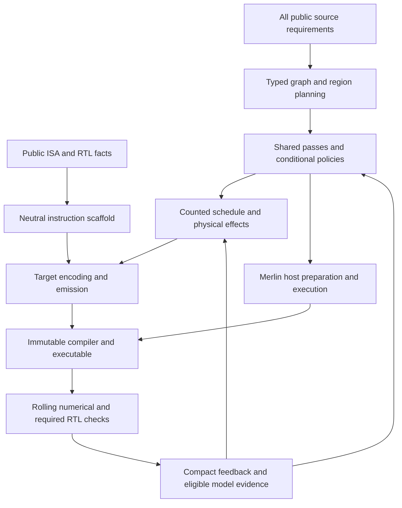

# Compiler construction and representation study

The research question is which abstractions, representations and transformations
help agents develop a correct, generalizable, performant compiler with less work.
A faster known-case kernel, an available API or a declared optimization is not
enough to answer it. Comparisons below are proposed studies, not launched runs.

## Construct capabilities, evaluate continuously

Derive the initial capability inventory from every admitted public case. Keep
numerical policy, operations, layouts, shape regimes and connected graph structure
visible before authoring. Grouping organizes implementation; it cannot replace
individual case obligations. Capsule and model names are traceability only.



Build a complete lowering path for a small capability early, then expand semantic
coverage while its immutable executions proceed. Do not wait for the entire
compiler before the first executable. Assign independent helpers graph, schedule
and host-lowering work behind shared interfaces; integrate into one compiler.
Keep a known working checkpoint and test the boundaries changed by each merge.

The backend directory starts empty for a new construction run. The offline
study and automatic author share the admitted public inputs, sandbox, compiler
library, action client, immutable execution requests and feedback. Offline
operator decisions are recorded as replayable actions, never as extra privileged
compiler APIs. A retained compiler may be an explicitly separate infrastructure
control; it cannot establish fresh construction or enter the new author seed.
Reusable instruction generation belongs in Merlin and takes public declarations
as data, without requiring the existing target compiler repository.

Organize parallel construction by frontend/source semantics, graph grouping,
schedule/storage, target lowering/emission and host execution. Readiness gates
only admit tests for executable capabilities. They do not pause other authoring
or require completion of the whole compiler before testing. Multiple immutable
snapshots may execute while their authors continue editing. A shared ABI failure
defers its affected requests; it does not invalidate unrelated capability work.

For the selected joint corpus, the public denominator is 250: 153 original
correctness, 20 calibration and 77 scalability/performance cases. Original
physical obligations remain mandatory, including their declared expected-refusal
semantics. Calibration witnesses are selected for unresolved mechanisms; large
development cases use Spike. All three cohorts may advance concurrently.
Hidden and complete-model validation remain separate obligations.

Primary performance effort goes to scalability cases. Original small cases have
low performance priority and remain useful regressions and eligible model
evidence. Passing implementations may be optimized; correctness is preserved
through exact-source checks, not by forbidding changes to passing code.

## Representation boundaries and evidence

Reuse the existing graph, counted scheduling and instruction representations.
Introduce a new dialect only when a decision must survive, be verified and be
transformed across lowering boundaries.

| Boundary | Mechanism | Required evidence |
| --- | --- | --- |
| Public ISA to instruction operations | Explicit ISA declaration and generated types/encoders | Independent encoding check; unknown semantics/effects remain explicit |
| Graph to legal regions | Liveness, numerical policies, grouping and fusion discovery | Every externally visible output and other consumer preserved |
| Alternatives to transformed IR | `PipelineSession`, `PassSpec`, semantic predicates, `evaluate_variants` | Consumed transformed artifact, actual pass records and independent correctness |
| Counted schedule to execution | Target-owned storage, configuration and completion effects | Legal dependencies, capacities, overlap and executable behavior |
| Host preparation to inference | Merlin-owned preparation and ownership lifecycle | One-time versus repeated work, invalidation and safe storage reuse |
| Performance selection | Matched scope, model epoch and structural roofline | Qualified estimates within domain; physical validation separately reported |

Keep the same generic instruction generator available to matched study arms.
For an empty-backend construction study, the author invokes it after admission
using the selected public declarations; generated target files are author-run
outputs. It supplies no tensor compiler, operand packing, schedule or optimized
kernel. A separately selected pre-generated scaffold is a different study input
and must not be described as an empty initial backend. Neither route may import
an extractor or implementation from an existing target compiler. Public-source
extraction must pin its inputs and refuse unsupported syntax instead of inferring
instruction semantics from names.

Pass variant evaluation enumerates explicit legal alternatives on private IR and
publishes each completed artifact. Machine search should handle parameter trials;
agents propose or improve algorithms, applicability and search spaces. Neither
an `applied` receipt nor successful compilation is a numerical or timing verdict.

`evaluate_variants(..., prefix=(...))` applies common registered transformations
once ahead of alternative exploration. Each alternative clones the prepared IR
and starts a fresh pass session; analyses containing references into the previous
IR are discarded and rederived. This is reuse of actual compiler transformations,
not merely task grouping. Agents can improve the common preparation, individual
passes, branch predicates or target realization independently while keeping the
same representation contracts. The [conditional pipeline guide](../guides/conditional_compiler_pipelines.md)
contains an executable-style example using the shared normalization pipeline.

Before fitting timing parameters, match external-memory behavior with the selected
FireSim configuration. Simplified functional memory and FASED timing are different
reference domains. Compare target-cycle request admission, response ordering and
backpressure, including initial state and runtime overrides. Preserve the deployed
hardware; change the software reference adapter. The strict qualification target
is at most 4% absolute relative error on every predeclared held-out case, with
complete case coverage. Final FireSim results remain independent of calibration.

## Token and feedback policy

The performance objective is lower complete-call and complete-model latency.
Utilization is diagnostic: padded or redundant work must not be rewarded for
keeping an engine busy. Keep useful arithmetic efficiency, issued work, modeled
resource occupancy and physically observed activity distinct. A structural peak
ratio is not a measured active-lane fraction or a promise of attainable speedup.

Resource activity must use the same execution window as its timing denominator.
Clip intervals crossing the window boundaries, normalize by resource capacity,
and report overlap without adding concurrent engine times. Keep bandwidth per
memory boundary, host feeding and synchronization inside the call scope, and
one-time preparation separate. Whole-trace bookings cannot supply windowed
utilization; missing producer evidence remains unknown. Report exact model epoch
and physical/model/structural provenance with every metric. Simulator-side
observation should avoid perturbing the guest's instruction stream.

Pass profiles separately report transformation and framework host time. These
measure development overhead, not target execution. Common-prefix costs are
reported once separately from per-variant work. Profiling adds no extra verifier
or IR traversal, and time values do not enter semantic identity.

New joint sessions record an aggregate soft target of 40,000,000 tokens: 32,000,000
working budget and 8,000,000 integration/repair reserve. Input includes cached
input; output includes reasoning. Count the lead and every descendant helper,
excluding copied parent history from helper usage. This is token traffic, not
billing. Missing usage is unknown and incomplete totals are lower bounds.

The installed controller accepts `--author-token-target` and
`--author-token-reserve`; launch configuration uses `author.token_target` and
`author.token_reserve`. The recorded selection survives resume. Explicit drift
requires a new run; historical runs without a selection gain no invented budget.
Crossing the target reports an overrun and narrows redundant exploration; it
does not stop necessary correctness/performance work or change qualification.

Use the canonical operator live accounting command outside the read-only run:

```sh
python -m merlin_experiments.phase1.telemetry.author_agents \
  --run-dir "$RUN_DIR" --out "$OPERATOR_DIR/author-usage.json"
```

Each refresh records all-author usage and the soft-budget state. Final timing
reports also include it. Preparation/review and separate study runs require their
own visible accounting; they are not hidden inside the author-run denominator.

Fresh inventory-bearing runs use a compact round brief: class denominators,
separate reported/L2/L3 passes, snapshot identity, three shared failure groups,
scoped performance priorities and bounded approach notes. Full redacted records
remain on disk. Give helpers capability-specific briefs and references; avoid
copying the whole history, API catalog or result collection into every turn.

## Readiness and subsequent comparisons

Infrastructure acceptance requires a real consumed pass transformation, independently
checked instruction encoding, all public inventory entries, immutable source
attribution, correct resume behavior and representative end-to-end execution.
Synthetic infrastructure tests establish their tested behavior, not complete
target readiness. Missing native memory equivalence, candidate execution or
timing qualification must remain explicit outstanding gates.

Keep the following milestones separate. Preparing a launch command or completing
a tooling replay cannot mark the later milestones complete.

| Milestone | Required observation | What it permits |
| --- | --- | --- |
| Input and execution admission | Empty initial backend, selected public declarations/library, protected evaluator, complete case inventory and working action transport | Begin bounded construction; no compiler correctness claim |
| First executable capability | Newly authored emission consumed by target lowering, linked executable, actual Spike execution and complete numerical comparison through the ordinary broker | Admit more cases that use this capability while independent construction continues |
| Required physical checks | Required gSIM cases with matching hardware identity and complete numerical checks; reuse only matching evidence | Credit the individual physical obligations and admit eligible public calibration evidence |
| Model qualification | Complete scope accounting, declared calibration domain and independent held-out error results | Use qualified estimates within that domain; outside it retain provisional or unknown status |
| Corpus completion | Every selected case meets its own numerical and engine obligations at the qualifying compiler identity | Claim corpus completion, not full-model completion |
| Complete-model validation | Frozen compiler compiles complete selected models; complete outputs and whole-execution boundaries are checked | Claim those model results separately from connected-region results |
| Final hardware comparison | Frozen inputs/compiler and unchanged selected FireSim configuration; independent numerical checks and matched timing scopes | Report physical performance; do not feed private comparison results into the same authoring/calibration run |

The first-executable milestone is deliberately inside construction: an empty
backend cannot already pass it before the author creates a compiler. Establish
it cheaply before broad affected testing, rather than spending the full campaign
on repeated shared ABI failures. An operator prototype may establish that the
ordinary path supports a mechanism, but its target code is not a seed for the
fresh author. Log its public actions and isolate it as a separate study.

Do not wait for model qualification to implement lowering or explore legal
optimization candidates. Provisional estimates and structural bounds can inform
exploration with their limitations visible. Qualification changes the strength
of timing claims, not permission to keep constructing the compiler. Likewise,
fusion and pipeline improvements are experiment work: a correct unfused path
must remain available while new transformations are developed and evaluated.

Select final validation scope explicitly. The controller's `capsules` scope
returns before complete-model validation even if a private model specification
was supplied. A capsule-scoped campaign therefore needs a separately selected
full-model evaluation of its frozen compiler. Connected public regions never
substitute for that evaluation. A final report must retain this outstanding work
until the complete models have actually executed and passed.

Once ready, freeze definitions for these comparisons before running them:

| Comparison | Isolated question |
| --- | --- |
| Existing workflow versus capability-organized construction | Does seeing all public requirements and implementing semantic families reduce repeated repair? |
| Same algorithms with source-oriented versus typed/composable access | Does the representation improve agent effectiveness independently of supplied algorithms? |
| Fixed library versus editable shared passes | Does compiler co-evolution improve performance and generalization? |

Keep hardware facts, neutral scaffolding, public examples, independent checking,
model versions, budgets and agent limits matched as appropriate. Declare existing
measured scheduling defaults as supplied priors. Private coworker kernels and
private comparison scores are excluded from author inputs. Generic suggestions
need independent public ISA/RTL/compiler justification.

Measure time/tokens to first executable and complete coverage, invalid candidate
rate, reusable pass changes, large-case performance, integration repairs and
generalization to withheld shapes/graphs. Rescore comparable final compilers with
the same observer version. An interface that adds overhead, helps only correctness,
or merely exposes better supplied algorithms is a valid negative or narrower finding.
