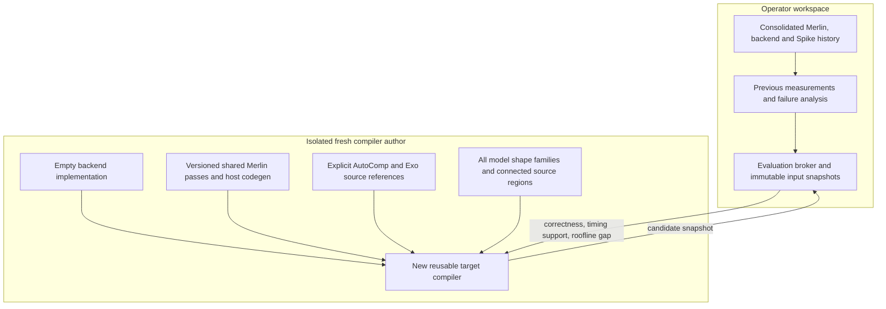
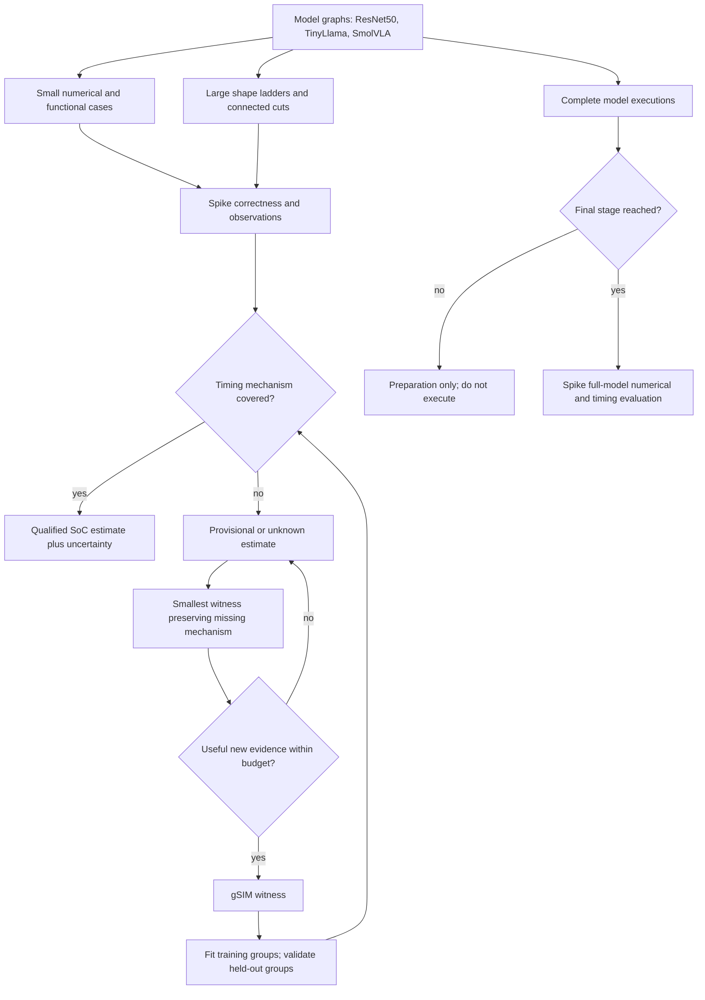
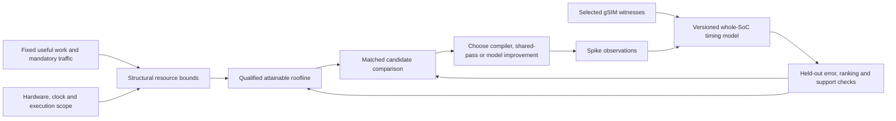
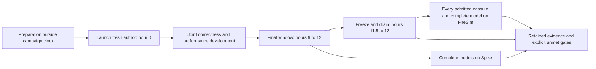
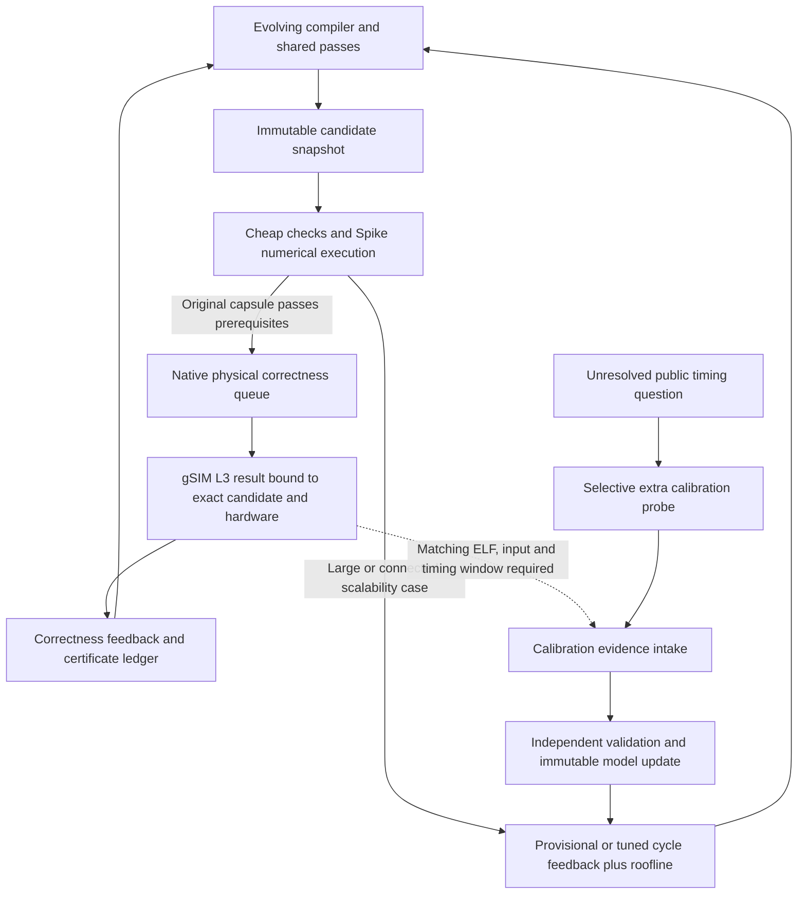

# Joint compiler campaign execution and fresh backend boundary

The current joint workflow reuses the native Phase 1 authoring and evaluation
infrastructure, exposing correctness and performance development in one evolving
compiler session. Selected source/library/runtime identities determine which
mechanisms execute. The design below states routing and acceptance requirements;
it is not a claim that a campaign completed them. The consolidated
repositories retain previous work; the fresh compiler author starts with an
**empty backend implementation**. In the native author workspace this is the
empty `submission/` directory in which the new OOT backend is authored.

## Fresh author boundary

No prior backend sources, compiler snapshots, target schedules, heuristics or Git
history are mounted in the author workspace. Launch does not select
`--seed-submission` or `--qualify-submission`. The initial submission must contain
no implementation files. Resuming that new run preserves its own author work;
it does not import a historical compiler.

The supplied AutoComp archive and the two Exo files under
`apps/gemmini/src/exo` are explicitly allowed read-only references. Pin source
revision, file hashes and license text. References live outside the submission
and are distinct from a compiler seed. Their instruction choices and scheduling
assumptions must satisfy this campaign's selected target and numerical contracts.

Shared Merlin transforms, scheduling dialect APIs and host generation remain
available. The author selects pass order and must consume the transformed IR.
Importing a pass or emitting an unused pass receipt is insufficient. Shared
algorithms stay in Merlin; device legality and target lowering belong in OOT.

Keep the native Phase 1 author loop, parallel helpers, background grading,
compiler snapshots and exact-input caches. Merge performance observations into
that loop. The compiler remains editable after numerical success: pass ordering,
fusion, tiling, layout, buffering, asynchronous scheduling and shape-dependent
heuristics evolve together. Changes to shared library implementations require a
new reviewed immutable library export and explicit campaign epoch; do not mutate
the evaluator or a running epoch's library in place.

## Capsule and model routing

Expose all shape families immediately, including TinyLlama prefill and the full
carried-state decode chain. Development uses extracted regions and their
compositions. Preserve typed live-ins/live-outs, layout, quantization, aliasing,
state and fusion boundaries. Check extraction against the original computation.

Large development cases run through the Spike endpoint. They do not need a
full-size gSIM run before the author may use them. Unknown timing creates a
separate operator-side bridge request. A reduced witness must preserve the
missing queue, cache, reuse, spill or resource-contention regime; reducing its
size until the problem disappears does not qualify the large case.

| Case role | Engine during development | Physical measurement policy |
| --- | --- | --- |
| Original 153 correctness capsules | Spike and required gSIM | Retain both obligations; reuse only matching qualified evidence |
| Calibration training witnesses | Spike plus selected gSIM | Fit only the declared training groups |
| Calibration validation witnesses | Spike plus selected gSIM | Withhold labels from fitting |
| Large capsules and connected cuts | Spike | gSIM uses separate reduced bridge cases |
| Complete models | No early target execution | Final stage: Spike, then frozen FireSim validation |
| Final physical validation | FireSim | Every admitted capsule and complete model, with explicit pending coverage |

The selected campaign policy supplies gSIM concurrency, timeouts and budgets.
Additional calibration witnesses are chosen by missing mechanism coverage and
expected effect on a compiler decision. That selection does not remove the
original correctness corpus's required gSIM obligations. Exhaustion or timeout
leaves the affected obligation pending while other development continues.
Reuse evidence only under matching source, compiler,
binary, numerical, simulator, hardware and evaluator identities.

## Conditional capsule gates and evidence reuse

The corpus is an obligation inventory, not a queue to execute after every edit.
Separate selecting an advisory experiment from certifying a compiler snapshot.
A family or capsule hint can prioritize work but cannot waive a correctness gate.

| Change or event | Required development work | Escalation condition |
| --- | --- | --- |
| No compiler, executable, input, hardware or evaluator change | Reuse matching evidence; do not launch another background grade | A missing obligation or explicitly requested new observation |
| Local lowering, tiling or heuristic edit | Named affected cases: one cheap numerical witness, relevant tails/layouts, and the target medium/large Spike case | Failed check, changed shape branch, or a newly exercised resource regime |
| Fusion, layout or buffer-lifetime edit | Producer–consumer and shared-input cuts, alias/lifetime and numerical boundary cases, then a larger connected Spike case | Changed live-ins/outs, packing ownership, quantization seam or async completion |
| Shared lowering, ABI, host runtime, quantization or unknown-impact edit | Representative checks across affected families, including tails and connected boundaries | Before promotion, complete all affected obligations; unknown dependencies require broad cheap coverage |
| Candidate passes focused checks and improves performance | Medium/large Spike comparison under the same model version and measurement scope | Promote only after correctness coverage is complete or exact reusable evidence establishes it |
| Model prices or scheduling semantics change | Re-score both contenders and public validation cases under the new version | Run gSIM only for an unanswered mechanism/parameter question; numerical evidence is independently keyed |
| New hardware/configuration or simulator identity | Invalidate affected physical evidence; inspect configuration and select a small bridge | New physical calibration is necessary only where prior evidence no longer applies |
| Candidate milestone or final freeze | Complete required cheap correctness coverage; preserve explicit missing/failed obligations | Final independent FireSim validation uses the unchanged selected configuration |

Author-requested checks should start with a few named cases and grow to
answer a concrete uncertainty. Automatic joint grading queues unresolved cases
through the existing dependency-aware scheduler. Its admission window is bounded;
the automatic queue is no longer limited to 16 cases. The separate author hint
accepts up to 16 names and cannot remove required cases from the obligation roster.
Select cases by semantic and resource regime, not size alone: ragged dimensions,
accumulator overflow/rounding, broadcast/stride, fused boundaries, reuse/spilling,
queue pressure, and host conversion can require different witnesses. The smallest
and largest members do not cover all middle regimes. Keep both representative
ResNet50 regions and TinyLlama projection/attention/cache boundaries in milestone
coverage. Large cases still require numerical correctness on Spike before their
performance can rank a candidate; they are never timing-only unchecked programs.

Evidence has separate identities for compiler analysis/build, functional execution,
modeled performance, and physical timing. A source edit may require rebuilding or
rechecking pass realization without requiring another physical measurement when
the resulting executable, inputs, hardware and judge are identical. A timing-model
revision makes previous estimates historical; it does not itself invalidate a
physical observation. Re-score from a retained trace only when it contains all
inputs required by the new model, otherwise replay Spike. Failed or unmeasured
cases remain failed or pending; skipped cases never become passing coverage.

Before a gSIM request, require: cheap correctness, an explicit unresolved question,
an evidence-cache miss, a witness preserving the mechanism, and remaining budget.
Use independent training and validation groups for model acceptance. After a
successful fit, focus new gSIM on unsupported regimes or residuals capable of
changing candidate ranking; do not periodically rerun every small capsule.

### Rolling development queue

Keep each execution attached to an immutable compiler snapshot. Queue admission,
execution, completed numerical evidence, qualified timing and final coverage are
separate states. A selected or deferred case contributes no passing coverage.

- Admit ready cases as workers finish, using the same shared CPU pool as author
  requests, compilation and other experiment work. No CPU is permanently assigned
  to a particular role.
- Start the default 300-second admission window after queue preparation. Keep the
  original campaign deadline and per-case timeout. Closing the window stops new
  admissions while started work drains.
- Order by actual prior admissions, original-correctness priority and useful
  witness coverage. Count a case only when it starts; selecting a large backlog
  must not falsely record attempts. Untouched calibration cases must eventually
  precede repeated failures.
- Use recorded build and active simulation wall time from matching L2/Spike
  history for scheduling. These costs are private infrastructure observations;
  they do not qualify target performance or supply timing-model coefficients.
  Missing cost data remains unknown. Allow an expensive first eligible case so
  a case larger than an admission window cannot starve forever.
- Retain per-case feedback as it completes. When a new snapshot has no results,
  preserve the previous actionable failure separately with its original source
  digest; it is not a verdict on the new compiler.
- Reuse correctness only through the existing exact source, input, runtime and
  evaluator identities. Queue priority cannot weaken a check or turn a skipped
  engine into a pass.

The joint lifecycle permits at most two snapshot owners. After the older admission
window closes, a second owner may admit work while the older jobs drain. Both use
the existing CPU leases. Exact in-flight case identities exclude duplicate work;
a stable compiler can therefore progress through disjoint pending cases. Only
the newest owner writes live progress and verdicts. Each owner retains its own
archived evidence and scratch directory, and shutdown joins both owners. This
implementation must be selected through a new evaluator epoch before it affects
an already-running campaign.

Implementation status: native joint grading already uses bounded advisory smoke,
affected-family hints, Spike defaults and separately budgeted gSIM witnesses.
The selected launcher enables source-change admission for background grades.
Native build/tier caches support exact-identity reuse; a compiler-source change
alone is not permission to carry a verdict. Exact named selfchecks are supported.
Automatic dependency-derived capsule selection and automatic milestone promotion
are not implemented: current family hints are advisory and full milestone coverage
is operator-selected. Integration now also admits bounded exact capsule hints (1–16 public development
IDs) so middle regimes and known failures can be targeted; this extension is not
automatically selected by an already-running evaluator. None of these hints
constitute proof that an omitted capsule is unaffected.

## Roofline and cycle model

The initial model structure comes from the selected RTL extraction and its
configuration: array geometry, memory sizes and banking, and any corroborated
queue, port, dependency and CPU/cache facts. Pin the extracted facts and source
configuration with the model. Fields absent from the extraction remain explicit
assumptions or unknowns; a generic default is not an RTL-derived fact. Refuse
configuration contradictions instead of compensating for them with fitted prices.

Use cycle-accurate gSIM observations of that selected configuration to calibrate
uncertain timing costs. Preserve the same executable, input, clock domain and
measurement window when comparing Spike and gSIM. This calibration describes the
simulated configuration; transferring it to FireSim requires separate matched
evidence for the SoC and memory system.

The first correct emitted programs need at most two diagnostic measurements:
an aligned integer contraction, then a small convolution only if its host packing
adds a missing mechanism. Other permitted witnesses are conditional on the
observed program: transfers, tails, residency/overlap and larger host packing.
This is a whitelist, not an instruction to run every case. Inspect emitted
commands and memory behavior before claiming a source shape exercises a spill,
double buffering or overlap.

Before every physical request, record the unresolved parameter or schedule
decision, the matching evidence already available, and why this witness can
resolve it. Skip the request if existing evidence answers it or the remaining
uncertainty cannot change the compiler decision. Reuse exact matching measurements.
An unexplained residual can indicate a missing mechanism; do not automatically
fit another coefficient to absorb it. The existing calibration planner determines
how many independent points a proposed fit requires; two diagnostic runs do not
qualify a multi-parameter model. Freeze every fitted model as a new evaluator and
compare both compiler candidates under that version.

Construct structural bounds at intake. Keep structural lower bounds, attainable
rates, modeled cycles and physical observations distinct. The objective is
estimated whole-SoC cycles over the selected execution scope, including host
arithmetic and packing, CPU dependencies and FP work, cache/memory contention,
commands and queues, DMA, compute, readout and completion. Model overlap without
double-counting shared resources. Instruction count alone is not physical time.

### Simple reorder-buffer queuing model

Model accelerator commands as events with admission, dependency readiness,
resource issue and completion times. Bind reservation/queue capacities and
ordering rules to the selected RTL. Distinguish Gemmini reservation entries,
controller queues and DMA trackers; they have separate lifetimes. Rocket issues
instructions as a scalar in-order core and has no speculative CPU reorder buffer
in this model. CPU stalls and accelerator overlap still interact through command
admission, memory contention and synchronization.

For each command, wait for a free reservation entry, enforce data, buffer,
configuration and ordering dependencies, then issue when the required controller
and resources permit. Release each resource at its own RTL-defined event; do not
assume every resource stays occupied until final command completion. Maintain
independent completion events so a waiting load need not serialize unrelated
compute or stores where the hardware permits overlap. Unknown arbitration or
service costs remain explicit assumptions pending calibration.

This model must distinguish dependency stalls, queue backpressure, bank or memory
contention and lack of independent work. A fixed cost per instruction cannot
establish the benefit of pipelining. Scheduling candidates should vary buffer
assignment/reuse, legal load/compute/store interleaving, prefetch distance and
pipeline depth through the shared scheduling dialect. Buffer reuse must wait for
all outstanding readers and writers; configuration changes and fences retain
their semantic ordering requirements.

Use a few matched small/medium emitted-program pairs to test these mechanisms:
serialized versus legal interleaved execution; one versus two live tile buffers;
and an outstanding-command ladder across an extracted capacity boundary. Inspect
the actual command trace before selecting a pair. Hold arithmetic and numerical
outputs fixed. Keep at least one independent schedule/source group out of fitting
and validate its ordering. Shape-only ladders do not prove queue saturation or
overlap. The first two diagnostic runs are not sufficient to qualify this model.

New automatic calibration rounds use the v2 strict profile: absolute relative
cycle error at most 4% for every declared held-out case, complete held-out
prediction coverage, and at least 90% ordering agreement for materially separated
pairs. Missing or non-finite predictions remain in the denominator. The historical
v1 p95-at-most-30% gate remains historical evidence; it cannot activate a new
strict round. Preserve held-out source groups and do not extend a fit beyond its
supported feature regime merely by renaming it. Both candidate arms use the same
evaluator version and matched execution conditions.

The development target is at least 30% of the qualified attainable roofline and
cycles at most 1.10 times a matched software-library baseline wherever one is
available. Useful work, rather than padded or redundant work, determines
utilization. Missing timing support or a missing baseline remains explicit.
Correctness and actual shared-pass execution remain mandatory.

## Timeline and final claims

The campaign lasts twelve hours from fresh-author launch. The default final
window is three hours; begin it at hour eight if four hours are needed. Complete
models first execute on Spike in that final window. Freeze compiler and
evaluation identities for the last thirty minutes and drain owned jobs. The
frozen final FireSim campaign covers every admitted capsule and complete model;
its physical execution may extend beyond the authoring clock.

Use the existing unmodified `firechip.chip.FireSim.FireSimGemminiRocketConfig`,
including its regular scalar in-order Rocket, selected clocks, caches and memory
configuration. Do not change hardware to improve a score. Establish correspondence
between the deployed image and the selected build/configuration before dispatch;
a wrapper name alone is insufficient. Full models require complete-chain images,
including carried state, rather than isolated stage executables.

Retain an explicit coverage row for every final candidate and required matched
library baseline. Missing images, measurements or deployed-build correspondence
remain pending or blocked. Estimates remain labeled estimates until measured.
Report functional failures,
unsupported timing, missing comparisons and incomplete physical runs directly;
do not turn them into successful acceptance claims. Development-exposed models
are not unseen validation workloads.

## Compiler access and co-evolution

The user selected an editable generic Merlin compiler library, in addition to an
empty target backend. The author should explore existing passes and dialects when
useful, choose pass order and parameters, compare valid kernel alternatives, and
turn useful discoveries into reusable transformations or shape heuristics. There
is no requirement to traverse every dialect or prototype pipeline.

The initial broader export has 396 reviewed members and 366 public modules. Its
immutable baseline is distinct from the candidate-owned editable copy. Each
request must snapshot both backend and compiler-library changes, execute the
candidate implementation in the sandbox, and bind the result to that combined
source identity. The trusted evaluator, numerical references, timing selection,
resource policy, and private reference benchmarks remain outside candidate edit
and data access. Candidate pass code must never become a host-trusted import.

Useful layers include the contract, schedule, interface and runtime dialects;
instruction-level Kernel IR; DispatchProgram and GlobalPlan; stream and arena
planning; and descriptive CCA/DSE records. Production passes and prototype
pipelines keep their separate status. Imports, declarations and pass receipts do
not establish a useful transformation: selected IR must drive actual emission,
and independent numerical and offload checks remain necessary.

## Original correctness and selective calibration are separate

The corrected fresh campaign retains all153 original public capsule physical
correctness obligations. After a snapshot passes the cheap declared checks and
Spike numerical execution, the native promotion broker schedules its required
L3/gSIM check. Six original small-model capsules are part of that roster; they
must not disappear through the separate full-target model window. Exact native
execution identities control certificate reuse and in-flight deduplication.
Author edits can continue while the frozen snapshot is tested. Failed, timed-out
and unrun physical checks remain outstanding. Expected refusals preserve their
original contracts and do not become fabricated physical executions.

The original-correctness queue has its own budget under the campaign deadline
and the same shared20CPU leases as compilation, Spike and author tools. The
four-worker-hour calibration allowance does not restrict original correctness.
Additional calibration probes remain selective and independently bounded.
A gSIM correctness result is reusable as a timing label only after its executable,
inputs, hardware and measurement scope match the model observation; a numerical
pass alone is insufficient. The calibration intake adapter must establish this
join rather than infer it from a shared capsule name.

The public total remains250 (153 original +20 calibration +77 scalability).
Larger scalability cases use Spike during development; separately selected small
host diagnostics remain eligible physical witnesses. Eight hidden capsules and
six full-target model programs are additional final obligations. Final FireSim
uses the unchanged deployment; it is not silently substituted for a missing
original L3 certificate.

## Automatic calibration during development

The operator service should observe completed, numerically valid candidate
snapshots and select sparse gSIM witnesses for unresolved model costs or candidate
rankings. It reuses matching observations, preserves exact executable/input/scope
identity, and keeps RTL topology fixed. Initially, fit only a small identifiable
set of supported timing parameters; replay native estimates over archived ELFs.
Training and held-out source/schedule groups are fixed before seeing their labels.

An update requires useful held-out accuracy and ranking evidence, explicit validity
domain, and no unacceptable regression relative to the incumbent on the same
observations. Sparse calibration can remain narrowly provisional. It cannot claim
broad whole-SoC qualification simply because a fit exists. Promotion publishes a
new immutable model selection, drains old evaluator-bound work and preserves the
compiler, original clock and physical-measurement ledger. Contenders must be
re-scored under the same new model. The measurement whitelist and worker budgets
still apply; private coworker/reference profiling is not calibration training data.

This automatic service and editable-library execution are integration work in
progress. As of this update, the fresh compiler author has not started. The last
startup reached isolation and oracle checks but refused a missing formal-toolchain
selection. The available original toolchain is now selected for the corrected
release; the existing sealed release is not edited in place.

## Continuous timing-model epochs

The operator can run `python -m merlin_experiments.phase1.joint_calibration_owner`
with `--selection`, `--selection-sha256`, `--native-owner`, `--output`, and
`--calibration-output`. It adopts an already launched native process; it cannot
start an initial author. `--once` checks adoption without starting any process.

The owner starts the existing calibration watcher after the original authoring
clock starts. An accepted immutable model requests the existing native drain.
Only after the frozen checkpoint is verified and the original PID exits does the
owner start the same native command with a new run ID, private Codex home,
`--joint-epoch`, and performance-selection pin. CPU slots, policy, library,
corpus, compiler lineage, physical budget, and original clock remain selected.
The watcher restarts with the same calibration evidence directory, preserving
held-source exclusions and measurement receipts.

The supervisor uses an exclusive lifetime lock and per-launch claims. It checks
original process arguments and kernel start identity, input pins, evaluator HEAD,
and clean tracked source before continuation. Ambiguous ownership or changed
inputs stop the supervisor for inspection; it never blindly retries a launch.
No reference baseline enters this calibration path. A generic operator owner
module may be run from a separately pinned operator checkout without editing an
active evaluator. The native evaluator still owns author/grader child cleanup.

