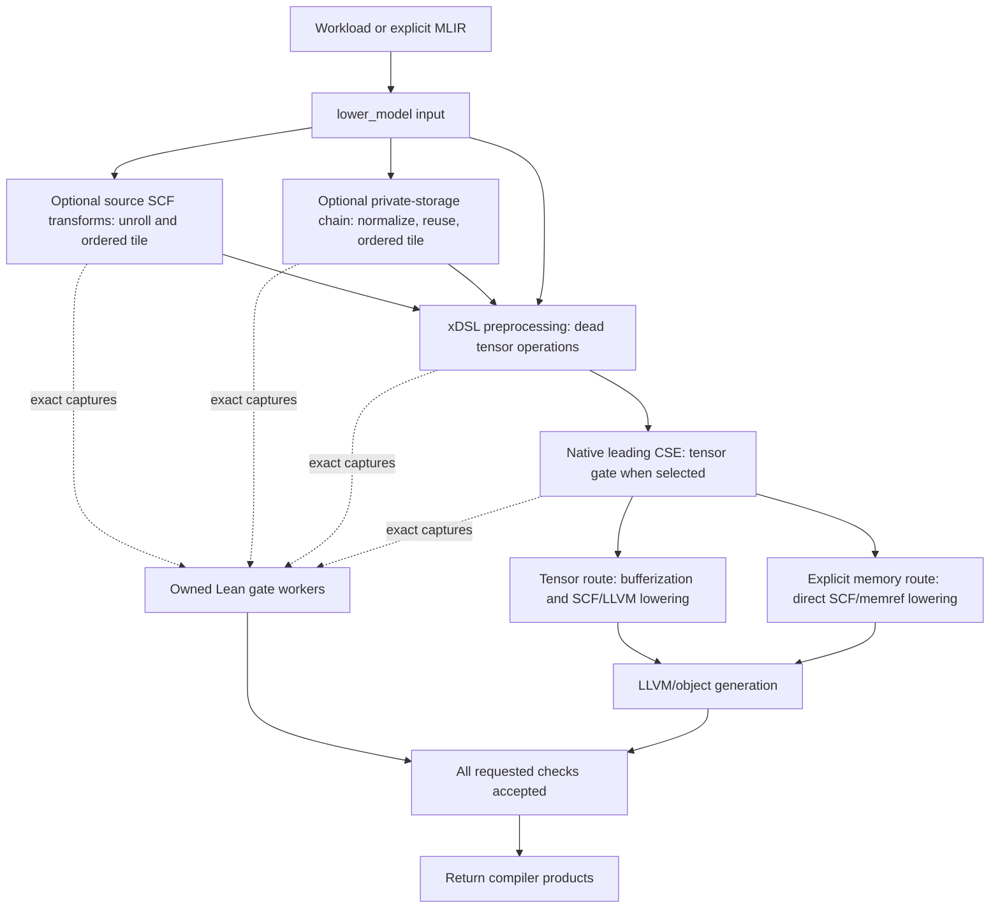

# Lean verification through the compiler stack

Select transformations to change the compiler's output. Select validation to
require a proof of their actual input/output boundaries. Both are opt-in.
`--validate-passes all` selects every registered check; it does not enable loop
or storage transformations. A selected, changing boundary that cannot be proved
stops compilation. An unchanged boundary needs no proof job.



The worker builds/checks proofs, audits their axioms and binds the result to the
actual captured bytes. Compilation may proceed concurrently, but its products
are returned only after the enclosing gate accepts. Failure quarantines emitted
LLVM, object and shared-library products. Each job retains `request.json`,
`verdict.json`, `worker.log` and its proof evidence.

| Registered check | Where it runs | Small example | Established relation |
| --- | --- | --- | --- |
| `prune_dead_pure_tensor_ops` | xDSL preprocessing, before native lowering | Erase an unused `tensor.empty` | Tensor-stage strict refinement on declared input types, with source support checked |
| `cse` | The build runner's leading tensor CSE | Two identical pure expressions share one result | Same tensor-stage strict refinement |
| `ordered_loop_unrolling` | Optional source SCF stage at `lower_model` entry | Two consecutive iterations become two ordered lanes | Same returned values, modeled errors and terminal world in the scalar/SCF interpretation |
| `ordered_loop_segmentation` | Optional source SCF stage; also the final step of the private-buffer chain | Visit `0..10` as ordered groups of three, retaining the short last group | Scalar route: same return/error/world relation; memory route: the complete chain's successful-observation relation |
| `buffer_reuse` | Optional source normalization→reuse→segmentation chain | Two initialized, nonoverlapping private lifetimes share storage | Same possible successful public observations, under the explicitly selected allocator model |

These are separate relations. A buffer success proof does not establish the
loop checker's error/world equality or finite-memory allocator behavior. No row
proves the downstream LLVM/object implementation or hardware execution.

## Tensor DCE and CSE

```sh
merlin-compile ... --validate-passes prune_dead_pure_tensor_ops,cse \
  --lean-sdk-bin /path/to/lean-4.35.0/bin
```

`pass_validation.observe` captures preprocessing pruning; `leading_cse` captures
the actual native runner's CSE boundary. `gate_checks.tensor_refinement` requires
`MerlinVerify.Check.TypedModule.check_sound`, source support and composed strict
refinement. The raw MLIR is exported through `torch_mlir` and round-tripped
through Lean. See [the gate guide](lean_pass_gate.md) for prerequisites.

## Ordered unrolling and tiling

For source SCF loops, select either transformation or both:

```sh
merlin-compile ... --loop-unroll-factor 2 --loop-tile-size 3 \
  --validate-passes ordered_loop_unrolling,ordered_loop_segmentation \
  --lean-sdk-bin /path/to/lean-4.35.0/bin
```

The Python compiler interface accepts the same explicit selection:

```python
from pathlib import Path
from merlin.llvmlower.lower import lower_model
from merlin.verify.compiler_transforms import Options

# Set MERLIN_VALIDATE_PASSES and MERLIN_LEAN_SDK_BIN, or pass an explicit
# PassValidation object. Transformation options alone do not request proofs.
result = lower_model(Path("source.mlir").read_text(), "out/build/loop-example",
                     targets=(), formal_transforms=Options(unroll_factor=2, tile_size=3))
```

For example, a loop that starts at 3, stops before 31 and advances by 2 has
fourteen iterations. Unroll factor two produces seven ordered groups. Tile size
three groups those into three segments of sizes three, three and one. The
carried accumulator flows through every lane and segment in the original order.

A complete source for that example is:

```mlir
builtin.module {
  func.func @forward(%x: i32, %y: i32) -> i32 {
    %lb = arith.constant 3 : index
    %ub = arith.constant 31 : index
    %st = arith.constant 2 : index
    %r = scf.for %i = %lb to %ub step %st iter_args(%c = %x) -> (i32) {
      %next = arith.addi %c, %y : i32
      scf.yield %next : i32
    }
    func.return %r : i32
  }
}
```

For inputs `7, -3`, the original and transformed versions both return `-35`.
Arithmetic wraps at the declared integer width; the Lean relation is quantified
over inputs, while native execution tests provide separate finite witnesses.

`compiler_transforms.apply` calls the existing Python transforms and captures
their complete stages. `compiler_loop_intake.prepare` independently projects
those buffers into the existing scalar/SCF model. `loop_transform_gate.check`
builds a fresh project closure and query, audits all generated theorem roots and
validates the live completion. The all-entry adjacent roots are
`Merlin.GraphGateProfileAdjacent.complete2` for unrolling and `complete3` for
segmentation. Both actual boundaries share one proof job when selected together.
An individual unroll job uses an auxiliary segmented program only to construct
the existing proof scaffold; its adjacent theorem covers the actual unrolled
compiler output, and the auxiliary output is never delivered.

The supported source domain has one changed top-level loop, two scalar entry
arguments, one to four word carries, a region-free body, static nonnegative
bounds, positive stride and index64. Unrolling supports factors 2..4 with a
nonempty bulk larger than the factor and no unroll remainder. Tiling supports
sizes 2..16 and short final segments. External calls retain the modeled state
and failure semantics. Dynamic/multidimensional tiling and arbitrary nesting
need additional bridges. The gate does not insert a loop-lowering pass to turn
arbitrary tensor programs into supported source SCF.

## Private buffer reuse

```sh
merlin-compile ... --loop-tile-size 2 \
  --buffer-reuse-allocator total_private_unobservable \
  --validate-passes buffer_reuse,ordered_loop_segmentation \
  --lean-sdk-bin /path/to/lean-4.35.0/bin
```

The equivalent options are
`Options(tile_size=2, buffer_allocator="total_private_unobservable")`.
This selection explicitly states the allocator model and requires tiling.
It is separate from source unrolling.

These inputs already own their `memref.alloc`/`memref.dealloc` lifetimes. The
adapter selects a direct scalar/SCF/memref-to-LLVM pipeline and disables automatic
tensor feature selection on that route. It does not run tensor ownership
inference on explicit frees. For an independent untransformed native baseline,
`Options(memory_source=True)` selects that same lowering without requesting
storage transformations. Explicit tensor features and vector/parallel schedules
are refused on this route.

The compiler retains four actual modules: original, shape-normalized, reused
and segmented. `buffer_reuse_intake.prepare_chain` reconstructs the memory plan
from all four and independently decodes the endpoints. `buffer_reuse_gate.check`
builds the factored query and audits the complete proof closure.
`GraphMemoryAfterEntries.every_definition` covers the complete supported entry
roster. The compiler adapter requires its fresh live completion before the
speculative gate accepts the chain.

All three transformations must change the IR in this initial complete-chain
route. Identity normalization or reuse needs a separate bridge; the adapter
does not manufacture changes to obtain a proof.

The current subset uses static rank-two integer buffers, sequential disjoint
private lifetimes and complete rectangular initialization. For example, two
separate `memref<3x2xi32>` allocations can reuse one slot when each is initialized
before reading and its lifetime ends before the next starts. Caller-visible
observations and supported unchanged functions are retained. Arbitrary escaping
pointers, asynchronous effects, external declarations and callers reaching the
changed kernel need additional proof routes. The allocator premise does not
establish finite capacity, native allocation failure or native allocator fidelity.

## Selecting and reviewing coverage

Environment equivalents are `MERLIN_LOOP_UNROLL_FACTOR`, `MERLIN_LOOP_TILE_SIZE`
and `MERLIN_BUFFER_REUSE_ALLOCATOR`. Proof selection remains
`MERLIN_VALIDATE_PASSES`; SDK and authoritative exporter selection remain
`MERLIN_LEAN_SDK_BIN` and `MERLIN_COMPILER_PYTHON`.

Use the check names appropriate to the input IR. `all` also demands the tensor
DCE/CSE checks if those boundaries change; scalar/SCF or memory inputs are not
automatically within the tensor checker's supported domain. Unsupported inputs
refuse rather than silently dropping a selected check.

The standalone loop and buffer APIs remain available for developer workflows.
Their raw reports describe those issuers' narrower scopes; the compiler's
`verdict.json` records enforcement at the integrated boundary. Historical
qualification and human approval are distinct from a new live proof. Quantization,
floating-point policy changes and later LLVM CSE are not additional registered
compiler gates. [The verification design](../design/merlin_lean_verification.md)
records the separate Lean-MLIR scalar integration and the policy to reuse suitable
upstream proof components before implementing new ones.

## Other available Lean interfaces

These interfaces have separate selections and are not extra names in
`--validate-passes`:

| Interface | Stack location | Example and scope |
| --- | --- | --- |
| `lean_checker.verify_scalar_transform` | Shared scalar transformation broker | Prove wrapping `x + 0` equals `x` under a pinned toolchain; `Foundation.lean` uses Lean-MLIR's dialect interface |
| `loop_transform_gate.transform` | Standalone producer→proof→consumer | Run the pinned unroll/segment producer and deliver only after its complete proof; see [direct loop checking](lean_loop_transform_gate.md) |
| `buffer_reuse_intake.prepare_chain` + `buffer_reuse_gate.check/deliver` | Standalone four-buffer memory boundary | Check initialized disjoint private lifetimes and guard a direct consumer; see [direct buffer checking](lean_buffer_reuse_gate.md) |
| `configuration_elision_intake.prepare` + `configuration_elision_gate.check/deliver` | Selected instruction/configuration IR | Delete a repeated constant setter only under its exact total-overwrite effect contract; preserve modeled errors and terminal state; see [configuration elision](lean_configuration_elision_gate.md) |

The configuration-elision proof is included from the upstream verification
branch. Its original ISA/effect facts and explicit producer selection remain
required; this integration does not infer hardware effects or silently enable
that developer API as a compiler gate.
