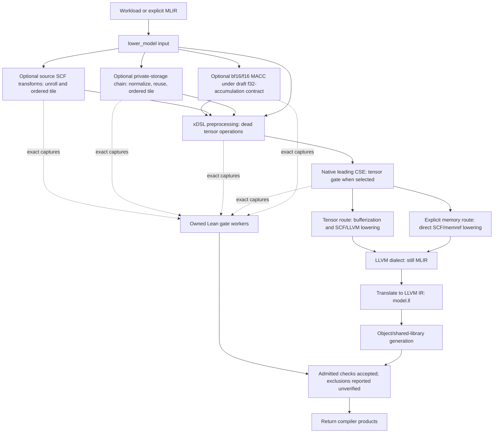

# Lean verification through the compiler stack

> Merlin validates actual compiler boundaries using checkers whose soundness is
> proved in Lean. For supported loop and configuration transformations, the proofs
> cover complete entries and preserve modeled outcomes and state, including
> failures and surrounding effects. Validation is enforced at the compiler
> boundary. For inputs admitted to a selected proof profile, products are released
> only after the required checks succeed. Inputs outside a profile use ordinary
> compilation and are explicitly listed as unverified.

These claims use each gate's declared IR, input domain and semantic/effect
contracts. Buffer reuse preserves possible successful public observations under
its explicit allocator model. Q/DQ source-model and MACC numerical-policy approval
remain separate from their checked compiler boundaries and component theorems.

The [numerical contract review packet](../design/qdq_macc_numerical_contract_review.md)
maps the new conditional Q/DQ definedness and initialized MACC component theorems
to the current, narrower compiler profiles. It records remaining integration and
approval work without changing the gates' claims.

Current qualification and remaining limits are in
the [integration handoff](../../out/artifacts/handoff/pass-verif-integration-20261028/README.md).
That handoff distinguishes retained evidence from checks on the current source.
The [completion plan](../design/lean_pass_integration_completion.md) defines the
remaining work to cover Merlin pass proofs and compiler integration through
output IR, leaving only explicit semantic contracts for human review.

Select transformations to change the compiler's output. Select validation to
require a proof of their actual input/output boundaries. Both are opt-in.
`--validate-passes all` selects DCE, CSE, loop and buffer checks. The explicit
`bf16_f32acc_draft_contract`, proposed-model `lower_quant_ext` and ISA-specific
`configuration_write_elision` / `configuration_loop_hoisting` checks stay outside `all`,
as does the logical `host_graph_fusion` profile.
Selecting checks does not enable transformations. The [bounded profile catalogue](lean_bounded_pass_profiles.md)
defines original-source admission and exclusions for each family. An excluded
source runs ordinary lowering and is logged as unverified at invocation end.
Once admitted, a changing boundary that cannot be checked stops compilation;
target failure cannot be relabeled as a source exclusion. An unchanged boundary
needs no proof job and earns zero proof credit.



The worker builds/checks proofs, audits their axioms and binds the result to the
actual captured bytes. Compilation may proceed concurrently, but its products
are returned only after the enclosing gate accepts. Failure quarantines emitted
LLVM, object and shared-library products. Each job retains `request.json`,
`verdict.json`, `worker.log` and its proof evidence.

The final `coverage.json` is written after worker join. It distinguishes verified,
unverified and unchanged boundaries, binds each verified row to its actual owned
job inputs, and lists explicit source exclusions. Compilation success with
unverified stages is not a whole-pipeline preservation theorem.

The directory name `llvmlower` includes both MLIR lowering and LLVM IR emission.
Unrolling, ordered tiling, buffer normalization/reuse, DCE, Q/DQ lowering, MACC and
the leading CSE operate on MLIR. xDSL is a Python implementation of that IR;
the native C++ CSE is also an MLIR pass. Configuration proofs additionally use
Merlin's scheduling `Kernel`/command IR at its actual consumers, including the
controlled C emitter. None of these is an LLVM IR rewrite proof.

The LLVM dialect (`llvm.func`, `llvm.load`, and related operations) is still
MLIR. Translation produces actual LLVM IR (`model.ll`), followed by object or
shared-library generation. The normal route translates in the runner; the
OpenMP route retains an LLVM-dialect module and invokes
`mlir-translate --mlir-to-llvmir`. Those downstream translations and LLVM
optimizations are outside the current Lean pass-proof boundary. Comparing
emitted `.ll` and executing native outputs provide finite regression evidence.

| Registered check | Where it runs | Small example | Established relation |
| --- | --- | --- | --- |
| `host_graph_fusion` (explicit only) | Actual host dispatch emission before preprocessing, on either compiler route | Group three connected integer tensor stages while retaining a producer result used elsewhere | Complete ordered public-result equality under common typed total pure actions |
| `prune_dead_pure_tensor_ops` | xDSL preprocessing, before native lowering | Erase an unused `tensor.empty` | Tensor-stage strict refinement on declared input types, with source support checked |
| `cse` | The build runner's leading tensor CSE | Two identical pure expressions share one result | Same tensor-stage strict refinement |
| `ordered_loop_unrolling` | Optional source SCF stage at `lower_model` entry | Two consecutive iterations become two ordered lanes | Same returned values, modeled errors and terminal world in the scalar/SCF interpretation |
| `ordered_loop_segmentation` | Optional source SCF stage; also the final step of the private-buffer chain | Visit `0..10` as ordered groups of three, retaining the short last group | Scalar route: same return/error/world relation; memory route: the complete chain's successful-observation relation |
| `buffer_reuse` | Optional source normalization→reuse chain, with optional initializer segmentation | Two initialized, nonoverlapping private lifetimes share storage | Same possible successful public observations, under the explicitly selected allocator model |
| `bf16_f32acc_draft_contract` (explicit only) | Actual `lower_bf16_matmul_f32acc`, including its optional compiler-entry invocation | Extend half operands, accumulate in f32, truncate once | Conformance to the draft numerical reference; numerical approval remains abstracted |
| `lower_quant_ext` (explicit only) | Actual xDSL Q/DQ pass or complete textual preprocessing | Expand Q/DQ into the specified ordered scalar operations | Strict typed refinement under the proposed Q/DQ source model; optional fresh original-source correspondence |
| `configuration_loop_hoisting` (explicit only) | Actual selected `hoist_loop_configuration` before its ordinary Kernel consumer | Move an invariant total setter before a positive counted loop | Whole partial outcome equality, including failures and terminal state, under indexed instruction/frame premises |
| `configuration_write_elision` (explicit only) | Original selected instruction IR or straight-line Kernel, before its ordinary consumer | Delete a repeated pure setter while retaining work and failure effects | Complete entry error/terminal-state preservation under the original ISA/effect model; no independent implementation approval |

These are separate relations. A buffer success proof does not establish the
loop checker's error/world equality or finite-memory allocator behavior. No row
proves the downstream LLVM/object implementation or hardware execution.

## Logical host graph fusion

Select `host_graph_fusion` through `PassValidation` or `MERLIN_VALIDATE_PASSES`.
The transformation remains selected separately through
`lower_model(..., graph_optimizations=contract, pass_validation=validation)`.
The contract's `fusion_groups` selects actual entry operation indices, including
tensor constructors. A selected fusion submits the actual module immediately
before outlining and the actual module after helper emission. The existing
speculative gate joins before compiler products can be returned and quarantines
products on failure. The same hook serves `textual=False` and `textual=True`.
Layout rewrites that precede this boundary need their own proof; this gate does
not compose a layout-prefix theorem or certify downstream lowering.

The independent projector expands actual private call definitions, binds formal
arguments and results to the actual caller SSA values, and reads every public
return. It does not accept the producer's fusion report as evidence.
`Merlin.HostGraphFusion.check_sound` specializes the existing
`GraphRegions.checkFusion_preserves_observers` theorem to the complete projected
program. The checked target can hide internal SSA values only while publishing
every result needed by the suffix or public return. Live-in port permutations
are allowed with their actual body bindings.

The profile requires one public single-block entry, positive static unencoded
byte-addressable integer tensors, identity-indexed parallel pointwise bodies,
initialized public inputs and unread destinations. One target call contains
2–128 stages; other entry-level calls contain at most one. Only the existing closed
integer scalar subset is admitted. Syntax guards bound IR bytes, nodes, expanded
operations and call depth; no tensor elements are enumerated. Floating-point,
reductions, dynamic shapes, poison modifiers, unknown effects and recursive or
external reachable calls refuse. Unused private definitions are syntax checked;
the theorem concerns the public entry, not equivalence of every private symbol.

The relation assumes common total deterministic pure typed tensor actions and
unobservable successful logical allocation. Parsing, SSA projection, canonical
scalar-body keys and ordinary private-call semantics are trusted. This is a
proof of logical dispatch grouping with complete public outputs, not a proof of
concrete MLIR arithmetic, physical buffers, allocation failures or native fusion.
The [assumption ledger](../../merlin/lean/LEDGER.md) records the boundary.

The standalone API is `compiler_host_graph_fusion.check_boundary(before, after,
destination, lean=...)`, followed by `deliver(completion)`. A live completion
binds the exact sources, ledger, canonical proof closure and tool products.
`replay(report_path, destination, lean=...)` uses the report only to locate its
unchanged IR pair and runs a fresh proof. Saved success fields and copied tokens
cannot authorize delivery. Direct API reports set `compiler_enforcement=False`;
only the canonical compiler worker sets it to true after checking the boundary.

The [qualification handoff](../../out/artifacts/audits/host-graph-fusion-20261029/README.md)
contains reproducible commands and paper wording. The executable example and
native/reference comparisons live in
`merlin/tests/ir/test_compiler_host_graph_fusion.py`.

## Tensor DCE and CSE

```sh
merlin-compile ... --validate-passes prune_dead_pure_tensor_ops,cse \
  --lean-sdk-bin /path/to/lean-4.35.0/bin
```

`pass_validation.observe` captures preprocessing pruning; `leading_cse` captures
the actual native runner's CSE boundary. `gate_checks.tensor_refinement` requires
`MerlinVerify.Check.TypedModule.check_sound`, source support and composed strict
refinement. The raw MLIR is exported through `torch_mlir` and round-tripped
through Lean. See [the gate guide](lean_pass_gate.md) for prerequisites.

## Ordered unrolling and tiling

For source SCF loops, select either transformation or both:

```sh
merlin-compile ... --loop-unroll-factor 2 --loop-tile-size 3 \
  --validate-passes ordered_loop_unrolling,ordered_loop_segmentation \
  --lean-sdk-bin /path/to/lean-4.35.0/bin
```

The Python compiler interface accepts the same explicit selection:

```python
from pathlib import Path
from merlin.llvmlower.lower import lower_model
from merlin.verify.compiler_transforms import Options

# Set MERLIN_VALIDATE_PASSES and MERLIN_LEAN_SDK_BIN, or pass an explicit
# PassValidation object. Transformation options alone do not request proofs.
result = lower_model(Path("source.mlir").read_text(), "out/build/loop-example",
                     targets=(), formal_transforms=Options(unroll_factor=2, tile_size=3))
```

Depth selection is one-based, with the outermost loop at depth one. For an
unchanged dynamic outer loop containing an eligible inner loop, use
`Options(unroll_factor=2, unroll_depth=2)` or
`--loop-unroll-factor 2 --loop-unroll-depth 2`.
`tile_depth` / `--loop-tile-depth` selects the depth at the actual tiling stage,
after any unrolling. Both default to one. Selecting a depth absent from the
actual module is identity: it submits no proof and earns no rewrite coverage.

```text
repeat n times:                  repeat n times:
  repeat 5 times:      →           repeat 2 groups of 2 lanes:
    carry += increment              carry += increment twice
                                  carry += increment
```

The public inner-depth unroll, tile and combined interfaces have real worker/
native qualification, including zero/negative/positive outer limits and wrapping
data. Whole-entry roots derive captured control facts from actual prefixes;
callers supply no inherited-control or source-success premise.

For example, a loop that starts at 3, stops before 31 and advances by 2 has
fourteen iterations. Unroll factor two produces seven ordered groups. Tile size
three groups those into three segments of sizes three, three and one. The
carried accumulator flows through every lane and segment in the original order.

A complete source for that example is:

```mlir
builtin.module {
  func.func @forward(%x: i32, %y: i32) -> i32 {
    %lb = arith.constant 3 : index
    %ub = arith.constant 31 : index
    %st = arith.constant 2 : index
    %r = scf.for %i = %lb to %ub step %st iter_args(%c = %x) -> (i32) {
      %next = arith.addi %c, %y : i32
      scf.yield %next : i32
    }
    func.return %r : i32
  }
}
```

For inputs `7, -3`, the original and transformed versions both return `-35`.
Arithmetic wraps at the declared integer width; the Lean relation is quantified
over inputs, while native execution tests provide separate finite witnesses.

`compiler_transforms.apply` calls the existing Python transforms and captures
their complete stages. `compiler_loop_intake.prepare` independently projects
those buffers into the existing scalar/SCF model. `loop_transform_gate.check`
builds a fresh project closure and query, audits all generated theorem roots and
validates the live completion. The all-entry adjacent roots are
`Merlin.GraphGateProfileAdjacent.complete2` for unrolling and `complete3` for
segmentation. Both actual boundaries share one proof job when selected together.
An individual unroll job uses an auxiliary segmented program only to construct
the existing proof scaffold; its adjacent theorem covers the actual unrolled
compiler output, and the auxiliary output is never delivered.

`loop_transform_gate.replay(report, lean=..., destination=..., consumer=...)`
reconstructs these compiler profiles, builds a new private proof closure and
delivers the exact target through the new live completion. It does not require
the historical producer checkout for current compiler captures. A separate
process can replay with no incoming completion authority; saved JSON is input
to a new check. The standalone pinned-producer workflow still takes its explicit
`reference` argument.

The source-SCF route supports multiple changed sibling loops per function at an
explicitly selected nesting depth,
scalar entry arguments and word carries without separate fixed arity caps
(including zero carries), static nonnegative bounds,
positive stride and index64. Scalar unroll factors and tile sizes are integers
at least two. Unrolling supports empty loops, complete inlining, no-tail bulk
and bulk-plus-remainder modes. Different function definitions can use different
modes; the final common-registry theorem restores every actual defined entry,
including supported unchanged dynamic-loop functions. All outer unroll modes
and standalone tiling preserve supported nested scalar loop bodies, including
dynamic inner controls and modeled external effects. Explicit selected-depth
proofs restore unchanged dynamic ancestors and the complete entry roster.
Tiling supports short final segments. Complete syntax,
expression/proof expansion, query-size, signed-index and runtime budgets still
apply. External calls retain the modeled state
and failure semantics. Actual prefix/suffix contexts, including partial external
calls, are composed around each selected rewrite. Local wrapper control equations
are derived from the actual prefix; they are absent from the final whole-entry
theorem. Combined unroll→tiling checks join the actual original, intermediate and
final buffers in one canonical job. A selected inner loop may itself retain
supported deeper loops. Controlled proof wrappers accept unchanged stride block
arguments while actual source projection retains its strict known-positive
stride check. An actual depth-two combined gate preserving a dynamic depth-three
body passes native boundary/wrap cases, independent-process fresh replay and
genuine Lean callee/stride mutation refusals. Untouched context must also fit
the scalar/SCF projection.
The gate does not insert a loop-lowering pass to turn
arbitrary tensor programs into supported source SCF.

Multiple changed function definitions are checked together. Exact unchanged
scalar stages are retained in the captures and omitted from positive rewrite
coverage; the proof covers the remaining actual adjacent changing stages.
Private compiled objects are frozen before auditing and checked for byte or
tree-membership changes again before delivery.

### Generic data around an ordered loop

The separate generic-value route keeps tensor/float payloads as arbitrary typed
values. Its initial bounded source has one selected top-level zero-carry SCF loop,
three actual constant controls immediately before it, one zero-result body event
using the IV and one captured data value, and one captured returned value.
The source/target capture retains the actual opaque prefix, callees, regions,
metadata, suffix and every other defined entry. Factor-two unrolling requires
an odd trip count at least three and fitting signed-index64 controls. More body
events, carried data or selected nesting require a broader profile.

For example, retain `r = prefix(x)`, unroll five ordered `tick(i, y)` calls into
two groups of two and one tail, then return `r`. `prefix` and `tick` can have
partial modeled behavior. The gate proves the complete operational entry
relation rather than assuming the prefix succeeds.

The interface remains `Options(unroll_factor=2)` plus the ordinary
`ordered_loop_unrolling` validation selector. Original-source admission chooses
the generic profile. Actual transformation output goes to the canonical
`compiler_loop_generic_refinement` worker, which checks complete typed captures,
per-occurrence control roles, raw control joins and the complete-entry roots.
Freshly audited proof objects issue an owned live completion; delivery uses the
exact checked output bytes. Saved JSON only locates inputs for a new check.

The installed UNROLL worker and fresh replay have independent qualification.
Generic TILE uses a separately bounded source/target adapter and is undergoing
its own qualification; a private proof does not enable a public claim by itself.
Generic UNROLL→TILE composition is excluded until there is a proved common-model
join. These operational claims use the explicit occurrence-aware projection
premise; they do not prove arbitrary opaque actions agree with concrete MLIR,
IEEE or native implementations.

## Private buffer reuse

```sh
merlin-compile ... --loop-tile-size 2 \
  --buffer-reuse-allocator total_private_unobservable \
  --validate-passes buffer_reuse,ordered_loop_segmentation \
  --lean-sdk-bin /path/to/lean-4.35.0/bin
```

The equivalent options are
`Options(tile_size=2, buffer_allocator="total_private_unobservable")`.
This selection explicitly states the allocator model. Tiling is optional:
`Options(buffer_allocator="total_private_unobservable")` checks the actual
three-buffer normalization→reuse chain and delivers its untiled output. When
requested, the private-buffer tile resource policy permits 2..65,536, with
actual signed-index64 safety checked separately.
It is separate from source unrolling.

These inputs already own their `memref.alloc`/`memref.dealloc` lifetimes. The
adapter selects a direct scalar/SCF/memref-to-LLVM pipeline and disables automatic
tensor feature selection on that route. It does not run tensor ownership
inference on explicit frees. For an independent untransformed native baseline,
`Options(memory_source=True)` selects that same lowering without requesting
storage transformations. Explicit tensor features and vector/parallel schedules
are refused on this route.

Default `--validate-passes all` also works within these memory profiles. A
separate ordinary-memory DCE checker validates actual dead index-constant
deletions after BUFFER; its source must join the original selected memory
epoch. Original live ownership also binds the actual native leading CSE pair,
upstream module, pipeline and runner. Exact unchanged CSE has zero jobs and
zero proof credit. Changed memory CSE runs with explicit unverified coverage;
missing or skip-only captures still refuse because they do not establish what
the compiler actually ran.
Both untiled and tile-size-32 tail cases pass actual default-`all` compiler
qualification. The DCE relation equates complete successful returned-value
and world outcomes, without an allocator or source-success premise; categorized
errors and downstream canonicalization/native fidelity remain separate.

The compiler retains three actual modules: original, shape-normalized and reused.
A fourth segmented module is captured only when tiling is requested.
`buffer_reuse_intake.prepare_chain` reconstructs an untrusted memory-plan hint
and independently decodes the endpoints. Untiled checking may construct an
auxiliary epoch hint; the theorem and delivery still bind the actual untiled
output. `buffer_reuse_gate.check`
builds the factored query and audits the complete proof closure.
`GraphMemoryAfterEntries.every_definition` covers the complete supported entry
roster. The compiler adapter requires its fresh live completion before the
speculative gate accepts the chain.

Normalization and reuse may be unchanged. The separate
`GraphLoopsShape.Identity` checker requires a typed complete module, zero shape
rewrite sites and identical complete source/normalized bindings. The original
positive normalization checker is unchanged. A one-to-one epoch/slot plan uses
the existing reuse theorem with every allocation/free binding intact. Such
stages appear in `unchanged`, rather than positive rewrite coverage. Initializer
segmentation is optional; both actual untiled and tiled chains have proof routes.

The current subset uses static rank-two i8/i16/i32/i64 buffers, sequential disjoint
private lifetimes and complete rectangular initialization. For example, two
separate `memref<3x2xi32>` allocations can reuse one slot when each is initialized
before reading and its lifetime ends before the next starts. Caller-visible
observations and supported unchanged functions are retained. Arbitrary escaping
pointers, asynchronous effects, external declarations and callers reaching the
changed kernel need additional proof routes. The allocator premise does not
establish finite capacity, native allocation failure or native allocator fidelity.

Independent qualification covers fresh untiled gates and exact delivery at each
admitted integer width. For i8, i16 and i64, 30 finite native observations include
the true untransformed source, modular overflow and high-bit values. These tests
qualify the existing width domain. The additive rank-one uniform-seed bridge
passes all 33 installed host/compiler/native/replay/mutation cases, with 250
roots and 2,545 audited theorems. Both public compiler routes have exact
delivery and finite native wrap checks; separate fresh-process replay checks
the corresponding raw chains. Actual one-loop and optional
tiled point-loop syntax use the same API; pure computed initializer prefixes
and rank-three source bridges remain engineering work. The [buffer guide](lean_buffer_reuse_gate.md)
describes the qualified profiles and remaining allocator/source boundaries.

## bf16/f16 MACC draft contract

```sh
merlin-compile ... --macc-f32acc \
  --validate-passes bf16_f32acc_draft_contract \
  --lean-sdk-bin /path/to/lean-4.35.0/bin
```

The Python transform choice is `Options(macc_f32acc=True)`; its environment
equivalent is `MERLIN_BF16_F32ACC=1`. The flag applies the existing
`lower_bf16_matmul_f32acc` at compiler entry. Its recorder also observes existing
call sites when they execute inside a validation scope. Preparation already
performed outside that scope requires its own captured boundary.

For a +0-initialized half-precision matrix product, the transformation is:

```text
bf16/f16 A, B
  → extend each operand to f32
  → accumulate in f32 in the original index/reduction order
  → truncate once to the original result format
```

`compiler_macc.check_boundary` exports and round-trips the complete actual
endpoints, checks equality to the source-derived draft reference, and checks
strict initialized-operand qualification at every recognized site. The positive
`Bf16F32AccBoundary.check_sound` theorem also requires a nonempty site set.
Fresh live completion and replay bind the exact bytes and checker evidence.
Local site wrappers preserve repeated SSA operands as one input and retain
copied initialization when that value is also a contraction input. The packing
lemmas prove unique identities, shared-operand correlation and frozen evaluator
binding; an alpha check binds target captures back to the actual source IDs.

The result is **draft-policy conformance**: `policy_reviewed=false`, numerical
policy verdict `abstracted`, and no original-source equivalence claim. The user
has explicitly retained this draft status pending independent review. `all`
excludes it. Matching bf16 or matching f16 operand/result formats are supported;
mixed source formats, nonzero initialization and incompatible named maps remain
refused. Generic mathematical lemmas do not broaden the source recognizer.

This does not establish whole-capture defined execution, IEEE/native fidelity,
or approved numerical accuracy. Combining options still requires each boundary
to meet its own intake domain; the scalar loop checker does not thereby accept
arbitrary tensor MACC programs.

## Q/DQ expansion under the proposed source model

Select `--validate-passes lower_quant_ext` to require a fresh proof of actual
Q/DQ lowering. It remains outside `all`. For example, an injected quantizer
multiply-to-add bug must stop compilation before products return. This reuses
the existing typed-module, source-support and chain-composition proofs.
`source_spec_approved=false` distinguishes proof acceptance from source-model
approval; quantizer definedness and framework/native fidelity remain separate.

An optional `--qdq-source-capture` binds the actual boundary to a freshly
reconstructed original PT2 graph, pinned producer and Torch payload. It requires
explicit source tools and complete capture artifacts, rather than a saved
`matched` flag. See [the Q/DQ gate guide](lean_qdq_gate.md) for the interfaces,
three distinct guarantees and source-domain limits.

## Selecting and reviewing coverage

Environment equivalents are `MERLIN_LOOP_UNROLL_FACTOR`, `MERLIN_LOOP_TILE_SIZE`
and `MERLIN_BUFFER_REUSE_ALLOCATOR`, with optional `MERLIN_LOOP_UNROLL_DEPTH`
and `MERLIN_LOOP_TILE_DEPTH`. Proof selection remains
`MERLIN_VALIDATE_PASSES`; SDK and authoritative exporter selection remain
`MERLIN_LEAN_SDK_BIN` and `MERLIN_COMPILER_PYTHON`.

Use the check names appropriate to the input IR. `all` also demands the tensor
DCE/CSE checks if those boundaries change; scalar/SCF or memory inputs are not
automatically within the tensor checker's supported domain. Unsupported inputs
refuse rather than silently dropping a selected check.

The standalone loop and buffer APIs remain available for developer workflows.
Their raw reports describe those issuers' narrower scopes; the compiler's
`verdict.json` records enforcement at the integrated boundary. Historical
qualification and human approval are distinct from a new live proof.
Approved numerical-policy changes and later LLVM CSE have no registered
compiler gates. The explicit Q/DQ and draft MACC checks retain their qualified
claims. [The verification design](../design/merlin_lean_verification.md)
records the separate Lean-MLIR scalar integration and the policy to reuse suitable
upstream proof components before implementing new ones.

## Other available Lean interfaces

These interfaces retain standalone selections and are not extra names in
`--validate-passes`:

| Interface | Stack location | Example and scope |
| --- | --- | --- |
| `lean_checker.verify_scalar_transform` | Shared scalar transformation broker | Prove wrapping `x + 0` equals `x` under a pinned toolchain; `Foundation.lean` uses Lean-MLIR's dialect interface |
| `loop_transform_gate.transform` | Standalone producer→proof→consumer | Run the pinned unroll/segment producer and deliver only after its complete proof; see [direct loop checking](lean_loop_transform_gate.md) |
| `buffer_reuse_intake.prepare_chain` + `buffer_reuse_gate.check/deliver` | Standalone three- or four-buffer memory boundary | Check initialized disjoint private lifetimes and guard a direct consumer; see [direct buffer checking](lean_buffer_reuse_gate.md) |
| `configuration_elision_intake.prepare` + `configuration_elision_gate.check/deliver` | Selected instruction/configuration IR | Delete a repeated constant setter only under its exact total-overwrite effect contract; preserve modeled errors and terminal state; see [configuration elision](lean_configuration_elision_gate.md) |
| `configuration_hoist_intake.prepare` + `configuration_hoist_gate.check/deliver` | Counted Kernel IR, after instruction/effect selection and before command emission | Move one invariant pure setter before a positive counted loop; preserve modeled success, failure and terminal state; see [scoped configuration hoisting](lean_configuration_hoist_gate.md) |

## Configuration writes and loop hoisting

Configuration APIs use explicit original selected ISA/effect facts. The compiler
selector `configuration_write_elision` guards `ConfigurationIRSelection.apply`
and the configuration stage of `compile_schedule`. Instruction IR may contain
complete function definitions or a closed bare module; Kernel elision currently
requires straight-line calls. An active original validation is joined, or the
owner can pass `pass_validation=validation` explicitly. The result stays held
until the canonical worker completes. Target scheduling and target emission
forward that original owner. Direct default producer hooks avoid importing the
verifier when inactive. Target scheduling/emission can import validation plumbing
when their options are selected; inactive validation launches no Lean proof.

```python
selection = ConfigurationIRSelection(selected_contracts, "caller-effect-contract-v1")
result = selection.apply(original_module, pass_validation=validation)
consume(result.module)  # the owned gate has joined before apply returns
```

Here `validation.passes` contains `configuration_write_elision`, and
`selected_contracts` comes from the original selected facts/software files.
The caller's effect-contract label is a premise, not independent qualification.
The older elision `prepare`/`check`/`deliver` API and fresh replay remain available.
The explicit `configuration_loop_hoisting` selector guards the real counted-
Kernel producer and joins its original owner before returning the result. It
requires `selected_contracts=...` on `hoist_loop_configuration`; the default
direct producer route remains verifier-free. V1 retains constant operands, V2
admits bounded retained IV-data expressions, and V3 supports multiple/overlapping
pure-setter prefixes. V4 composes those motions across multiple flat top-level
loops, binding each full command context and the exact complete final program.
Configuration dependencies remain literal; the explicit proposal adapter enables
IV-data candidates without changing the ordinary selected adapter.
An explicit original `ConfigurationCConsumer(index_bits=64)` additionally binds
the actual C emission domain, original selected contracts and checked products
through `result.emit_c(...)`. Its V5 profile admits positive extents through
2^63−1; huge cases are checked symbolically. Ordinary V1–V4 calls retain their
existing cap and schemas. See the [hoisting guide](lean_configuration_hoist_gate.md)
for the controlled API and independent replay. V6 additionally checks actual
nested positive counted loops and motions at multiple lexical levels, restoring
the parent IV environment for surrounding work. Its whole-entry theorem
preserves partial errors and terminal state under an all-environment Models
premise. All 78 installed pytest cases and five separate legacy reconstruction
checks pass, including original C64 emission, fresh replay, two genuine
mutation refusals and 27 finite native state/failure observations. The ordinary
one-million cap remains; the original C64 consumer separately admits symbolic
positive extents through 2^63−1.
Its state relation does not approve numerical policy or the selected
instruction implementation.

For example, under an effect contract where `work` preserves the configuration
fields, redundant-write elimination can turn:

```text
set configuration = (3, 5)
work
set configuration = (3, 5)
work
```

into one setter followed by both work calls. The first setter remains because
the initial configuration is unknown. A clobber or unknown/unordered effect
invalidates knowledge; a pulse or enqueue is not a pure setter.

Hoisting moves the setter in each iteration of a positive loop immediately
before that loop. Its new partial-execution theorem includes failing work and
surrounding calls. After any modeled failure, both versions retain the same
error and terminal state. V3 derives the whole prefix's last-write-wins assignment;
retained body writes may repeat its final values while keeping their other effects.
Conflicting writes/clobbers and nonempty completion/asynchronous annotations
refuse. V6 supports nested positive counted-Kernel commands; carried completion
fields and dynamic configuration effects remain outside its profile. Counted Kernel IR requires
positive extents; this differs from the source-SCF empty-loop case. A zero-trip loop
cannot be hoisted this way: the original executes no setter.

The bridges bind complete input/output IR, parser/producer origins and the
selected facts. Proof files come from the installed verification package's
canonical source tree. Root names/types, imports, process evidence and fresh
objects are audited before live delivery. Source inventories include the
`owned_children.py` helper used by process cleanup; changing it invalidates a
prepared request. Saved or copied completions grant no authority.

Use an interpreter with the producer's normal dependencies installed; isolated
producer capture intentionally ignores `PYTHONPATH`. The historical standalone elision intake stays
pinned to `4499eebb959c0f92cefd92cc6d80646ba66474ed`; standalone hoisting pins
`e0484f4886ae0780d0325cdfa998842b61bb647c` and its published source manifest.
The current compiler selectors instead bind the original live selected inputs;
they do not require those historical producer checkouts.
Neither qualification labels nor a software file's review status establish
native effects. Both relations remain conditional on the documented common
instruction/state interpretation and nonaliasing field mapping. Human contract
approval, hardware fidelity and composition with adjacent passes are separate.
