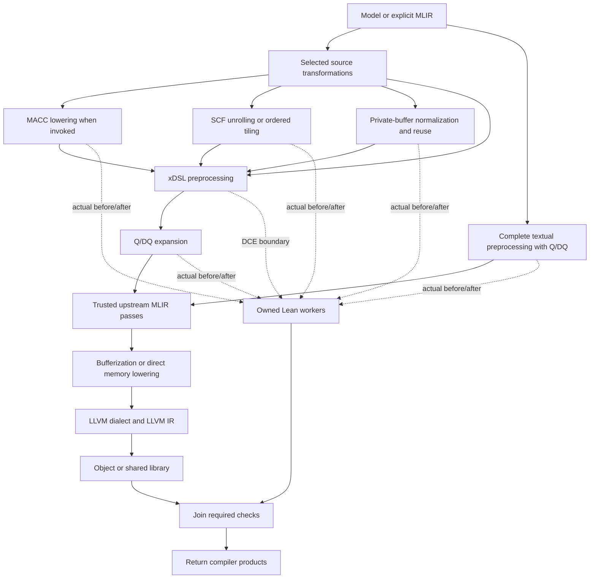

# Compiler gate overview and status

Merlin has **nine integrated compiler gates**. `--validate-passes all` enables
every one, including Q/DQ and bf16/f16 MACC. Each supported changing boundary
must pass its actual input/output check before compiler products return.
Incorrect supported rewrites, unavailable checks and broken source/tool bindings
block delivery.

Upstream MLIR canonicalization, CSE, elementwise fusion and named-op
generalization are trusted toolchain passes. They run normally and are outside
`--validate-passes`; the former `cse` selector and `verify_native_prefix` API
have been removed. Reusable operation semantics and normalization lemmas needed
by Merlin pass checks remain. See [verification scope](../design/verification_scope.md).

Use the [tutorial and supported profiles](lean_bounded_pass_profiles.md) for
setup, runnable examples, transformation options, coverage and replay. This page
is the overview and implementation status.

## Gate status

Every row below is implemented, registered in `pass_validation.CHECKS`, included
in `all`, and connected to its actual compiler producer or consumer.

| Check | Actual compiler boundary | Supported use |
| --- | --- | --- |
| `prune_dead_pure_tensor_ops` | xDSL preprocessing | Typed tensor DCE; separate ordinary-memory dead index-constant route |
| `ordered_loop_unrolling` | Source SCF transformation at compiler entry | Word/index loops, supported nesting/depths, and a separate generic-value singleton profile |
| `ordered_loop_segmentation` | Source SCF tiling and optional private-buffer initializer tiling | Ordered groups, tails, supported word-loop composition and generic singleton tiling |
| `buffer_reuse` | Actual normalization → reuse chain, optionally followed by initializer tiling | Initialized, nonescaping rank-one/rank-two integer private buffers |
| `lower_quant_ext` | Actual xDSL Q/DQ pass or complete textual preprocessing | Supported per-tensor Q/DQ and per-channel dequantization |
| `bf16_f32acc_draft_contract` | Actual `lower_bf16_matmul_f32acc`, including compiler-entry and existing calls inside validation | Supported bf16/f16 contractions under ordered f32 accumulation |
| `configuration_write_elision` | Original selected instruction-IR and straight-line Kernel consumers | Redundant configuration writes under the original ISA/effect contracts |
| `configuration_loop_hoisting` | Actual selected counted-Kernel producer and controlled C consumer | Supported flat/nested positive counted loops |
| `host_graph_fusion` | Actual emitted helper/call boundary on either compiler route | One fused region of supported pure integer pointwise stages |

Individual selectors restrict the gate set. Transformation options determine
which rewrites occur; validation observes those actual rewrites. Q/DQ expansion
already runs in ordinary preprocessing. The MACC f32-accumulation transformation
can be selected with `--macc-f32acc` or `Options(macc_f32acc=True)`; its gate
is already included in `all`.

## Where checks run

Configuration gates run at the selected scheduling/Kernel consumers before
emission. Host graph fusion runs at actual dispatch/helper emission before
preprocessing. They use the same original validation owner and delivery guard.

Workers retain the captured bytes, proof requests, verdicts and checker evidence.
Compilation can proceed while checks run, but the enclosing gate joins before
returning products. Failure quarantines emitted LLVM, object and shared-library
products.

## Q/DQ and MACC

Both compiler gates are active in `all` for their supported patterns. Neither
requires a policy-approval flag or an original-source capture to run.

Q/DQ checks the actual whole-module lowering on both routes, with typed
refinement, source support and composed per-entry checks. Optional original PT2
capture qualification adds source correspondence to that lowering proof.

MACC checks that the complete output matches its source-derived f32-accumulation
reference and that every recognized site satisfies the supported local
qualification. A positive check requires a nonempty site set. Wrong operand
wiring, initialization or arithmetic cannot pass merely because a producer
reports success.

The separate fields `source_spec_approved=false` and `policy_reviewed=false`
describe review of the numerical/source contracts. They do **not** disable
compiler gating. The MACC contract changes half-precision accumulation to
ordered f32 accumulation and one final truncation; its checked claim is
conformance to that contract.

## What the checks establish

| Family | Checked relation and explicit model |
| --- | --- |
| Tensor DCE and Q/DQ | Strict refinement on declared input types, with source support; optional definedness is reported separately |
| Word and generic-value loops | Complete modeled returned values, errors and terminal worlds under the corresponding typed/control/action interpretation |
| Private buffers | Equal possible successful public observations under total private unobservable logical allocation |
| MACC | Output/reference equality and site qualification under the f32-accumulation contract |
| Configuration | Complete modeled outcomes under the original selected ISA/effect and indexed environment premises |
| Host graph fusion | Ordered public-result equality under common typed total pure actions and successful logical allocation |

These gates check MLIR or Merlin scheduling IR. LLVM-dialect lowering,
translation to `model.ll`, LLVM optimization, linking and hardware behavior have
their own trust boundaries. Native output comparisons provide finite regression
evidence. The [assumption ledger](../../merlin/lean/LEDGER.md) and
[numerical contract review](../design/qdq_macc_numerical_contract_review.md)
record the operation meanings and review obligations.

## Coverage and qualification status

Final `coverage.json` binds verified boundaries to their actual owned requests,
input/output hashes and completed verdicts. It also distinguishes unchanged
boundaries and source-profile exclusions. See the
[supported profiles](lean_bounded_pass_profiles.md#supported-profiles) for
domains and resource limits. Gate availability and per-boundary proof coverage
are separate facts.

The retained suite contains 200 cases across all nine gates, including accepted
boundaries, deliberate corruption, product quarantine and fresh replay. Run
`python build_tools/scripts/run_lean_tests.py`; the runner enforces a ceiling of
200 cases. The earlier broad Python matrices were removed; historical campaigns
retain their dated evidence. See the [regression guide](lean_differential_tests.md).
The retained implementation entry points include:

- [MACC wiring](../../merlin/tests/ir/test_compiler_macc.py) and
  [Q/DQ integration](../../merlin/tests/ir/test_compiler_qdq.py).
- [Word loops](../../merlin/tests/ir/test_compiler_formal_transforms.py),
  [generic UNROLL](../../merlin/tests/ir/test_compiler_loop_generic.py) and
  [generic TILE](../../merlin/tests/ir/test_compiler_formal_transforms.py).
- [Private buffers](../../merlin/tests/ir/test_compiler_buffer_untiled.py),
  [configuration](../../merlin/tests/ir/test_compiler_configuration.py) and
  [host fusion](../../merlin/tests/ir/test_compiler_host_graph_fusion.py).
- The [sixteen full-size kernel campaign](../../merlin/tests/ir/kernel_benchmark_handoff_campaign.py)
  and the [complete-model campaign](../../merlin/tests/ir/larger_model_campaign.py)
  compare ordinary and gated compilation and finite native outputs. Both run
  outside the 200-case roster. The kernel campaign launches one owned pytest
  process per case; that test is slow-marked and skipped unless
  `MERLIN_RUN_KERNEL_HANDOFF=1`, which the campaign sets.

[`qualify_pass_cutoff.py`](../../build_tools/scripts/qualify_pass_cutoff.py)
compiles an explicit kernel denominator ordinarily and with every `all` gate.
`inventory` freezes the cases: by default the text and pruned form of each
retained model-family window, on the xDSL route (`--routes xdsl textual` adds
the textual route; `--external-inputs` takes a hash-pinned
`merlin.pass-cutoff.inputs.v1` manifest). `run` compiles each case in its own
process and refuses any nonempty `MERLIN_VALIDATE*` or `MERLIN_FORMAL*`
variable, including the `MERLIN_VALIDATE_WORKERS` setting from the tutorial. A
case is `lowered_checked` only when both LLVM outputs match, every job changed
its boundary and was accepted with its request, verdict and before/after files
bound, and the final coverage excludes no boundary. Exclusions give
`lowered_with_unverified_boundaries` (see [reading the
result](lean_bounded_pass_profiles.md#read-the-result)), and
`lowered_no_changed_selected_boundary` earns no rewrite credit. `audit`
recomputes each status from the retained bytes under the same tool bindings; it
runs no fresh proof. The built-in denominator is not the paper's kernel set or
every operation in a model, and a saved campaign grants no compiler authority.
[Its tests](../../merlin/tests/infra/test_pass_cutoff.py) cover that
bookkeeping.

The [integration handoff](../../out/artifacts/handoff/pass-verif-integration-20261028/README.md)
indexes recorded qualification cuts. Historical counts and receipts belong to
their named source versions; fresh runs retain their own proof and native
records. The [completion plan](../design/lean_pass_integration_completion.md)
separates completed gate wiring from broader domain and downstream proof work.
