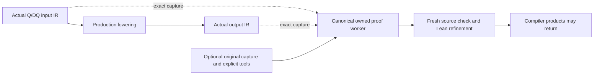

# Check Q/DQ lowering in the compiler

`lower_quant_ext` is an explicitly selected compiler check. It proves refinement
of the actual Q/DQ lowering under Merlin's existing **proposed Q/DQ source
semantics**. It is excluded from `--validate-passes all`, whose five checks are
unchanged. Selecting this check does not approve the source specification.

```sh
merlin-compile ... --validate-passes lower_quant_ext \
  --lean-sdk-bin /path/to/lean-4.35.0/bin
```

In Python, select
`PassValidation(gate, tools, frozenset({"lower_quant_ext"}))` and pass it to
`lower_model`. The existing production lowering still chooses and executes its
ordinary transformation. Verification observes its complete actual endpoints.
An unchanged boundary submits no proof job.

## Three distinct guarantees

| Component | What it checks | What remains separate |
| --- | --- | --- |
| Optional source correspondence | Retained original PT2 graph, complete ordered arguments/returns, producer sources, pinned Torch payload and emitted IR | Source-spec approval, execution attestation and a closed dependency proof |
| Lean lowering proof | Typed whole-module refinement, supported source execution and composed per-entry refinement | Framework/IEEE fidelity and downstream LLVM/native behavior |
| Definedness strengthening | Whether supported typed, nonpoison inputs are proved to avoid modeled UB/poison | Quantizer definedness remains unestablished; refinement can still be verified |

For example, a quantizer's output expansion must preserve the specified
reciprocal, multiply, round-even, zero-point adjustment, clamp and conversion
order. A corrupted multiply must stop compilation. That proof does not establish
that every Python scale can be replaced with an f32 scalar. The source checker
separately refuses lossy materialization, including the retained 50-versus-49
counterexample.

## Where the gate runs



The xDSL route captures `lower_quant_ext`, including existing preparation calls
inside a validation scope. The textual route captures the complete actual
`preprocess_text_textual` invocation, including any enclosing callable's edits.
That route also repairs legacy slices and attaches C-interface annotations;
these edits are included in the whole-module proof and receive no exemption.
The nested xDSL quantizer call is covered by that one boundary. Textual
per-channel dequantization uses its existing dedicated proof label.

The worker reuses `TypedModule.check_sound`, `supportCheck_sound` and the existing
receipt-chain composition. It reports `source_model_status="proposed"`,
`source_spec_approved=false`, `framework_equivalence=false` and
`native_fidelity=false`. With no source selection, source correspondence is
explicitly `not_requested`.

## Bind a fresh original capture

The optional source selection requires a fresh qualification directory produced
by `build_tools/scripts/qualify_qdq_capture.py capture`. It must contain
`original.pt2`, `qdq-source.mlir`, `qdq-frontend.json`, `qdq-producer.json` and
`qdq-source-check.json`. A worker bundle containing only a graph trace does not
supply the original PT2 archive required by this stronger intake.

```sh
export MERLIN_QDQ_CAPTURE_PYTHON=/path/to/pinned-torch-python
export MERLIN_QDQ_PRODUCER=/path/to/pinned-model2mlir
export MERLIN_QDQ_TORCH_WHEEL=/path/to/pinned-torch.whl
export MERLIN_QDQ_CAPTURE_DEPS=/path/to/producer-dependencies
merlin-compile ... --validate-passes lower_quant_ext \
  --qdq-source-capture /path/to/fresh-capture/quantize \
  --lean-sdk-bin /path/to/lean-4.35.0/bin
```

`MERLIN_QDQ_SOURCE_CAPTURE` is the environment equivalent of the capture flag.
Python callers can use
`SourceCapture(directory, python, producer, torch_wheel, dependencies)` as
`PassValidation(..., qdq_source=...)`. The dependency directory is optional when
the selected interpreter already has the producer's ordinary dependencies.
No tool or wheel is downloaded by a check.

Before and after the Lean proof, an owned child reopens the selected identities,
loads the original PT2 graph, compares its ordered nodes and returns, and reruns
the existing capture correspondence checker. By default the complete generic IR
must equal the actual boundary input. Actual endpoint bytes and source/capture hashes are
retained in the verdict. Saved `matched` status is insufficient.

When a proven preparation changes that input, Python callers can explicitly
select `SourceCapture(..., prove_prefix=True)`; the environment equivalent is
`MERLIN_QDQ_PROVE_PREFIX=1`. The worker then freshly proves captured IR → actual
boundary input with the existing typed tensor checker and composes that prefix
with the Q/DQ lowering proof. Both original-source checks still reopen the PT2,
producer and pinned Torch identities. The report distinguishes exact-input
binding, prefix refinement and the captured-IR→output chain. The default remains
exact input binding. A provenance ID or saved prefix receipt cannot authorize
this route, and the prefix proves refinement only under the same proposed model.

The pin lookup belongs to the installed checker; a caller-selected repository
cannot replace it. Changing the capture checker's bound sources requires fresh
capture qualification. An earlier capture is not automatically current after
the compiler integration or pin-lookup hardening.

## Supported domains and limits

The lowering proof and source intake have different domains. Model-relative
lowering may support a broader emitted-IR case than the framework source intake.
The latter currently admits one static root function with Q/DQ, literal splats,
constants and return, with the exact supported `.default` overloads. It preserves
complete tensor identities, qparam order, bounds and result types. It requires
matching signed-i8 full-range storage, exact per-tensor Python-to-f32 scale
materialization and scalar i64 zero points; per-channel dequantization uses f32
scales and i32 zero points. Quantizer scales must also be positive with a finite
f32 reciprocal. Dequantization does not acquire that reciprocal restriction.

If an earlier preparation changes the complete input, select the checked prefix
route above or attach the original capture at its exact input boundary. An
unsupported prefix is refused rather than inferred from provenance IDs.
Source binding does not establish whole-model successful execution, numerical
accuracy, general TorchAO semantics or hardware fidelity.

The source semantics also have a narrower type/granularity domain than the
production lowering: per-tensor full-range signed-i8 quantization with f32 data
and scale; signed-i8→f32 per-tensor/channel dequantization with supported zero
point widths. Per-group dequantization and broader float precisions require
additional semantics and proof coverage. Real native source examples qualify
the selected capture/compiler route; they do not widen these formal domains.

## Native qualification checkpoint, 2026-10-29

The real source route now runs locally with PyTorch **2.10.0+cpu** and producer
commit **905d2c918f839596c9d1198cbdeb42d4c12a325b**. The selected wheel matches the
existing SHA256 pin
`ee40b8a4b4b2cf0670c6fd4f35a7ef23871af956fecb238fbf5da15a72650b1d`;
preflight checked 11,882 installed wheel payload members (excluding `RECORD`)
and all 60 producer source files. CUDA is absent from this Torch build. Provisioning used existing local
producer objects and compatible owned dependencies; no pin was changed.

The dedicated native test module captures and reloads the original programs,
checks retained native references, then exercises all four examples—quantize,
per-tensor dequantize, per-channel dequantize and two-site Q/DQ composition—on
both actual compiler routes. All eight source-qualified compiles matched their
ungated LLVM output. The actual observed pass also accepted a freshly checked
nonidentity prefix and its two-stage composition; swapped original PT2 and
changed source-contract controls refused. These **11 native cases** and **three
earlier source-freshness reruns** passed in the 14-case checkpoint. They retain
proposed status and establish no downstream LLVM/native correctness theorem.

Local records are in
`out/build/pass-verif-integration-20261028/qdq-prefix/`: `verified-tool-identity.json`,
`producer-materialization.json`, `pytest-native-v1.xml` and `pytest-native-v1.log`.
Seven canonical observer-byte mutation controls also passed after the additive
binding hardening. That hardening binds the consumed capture/pin observers and
package initializers; it does not establish foreign dependency closure.

The repository deletes passed pytest temporary trees by default. Use
`-o tmp_path_retention_policy=all` when retaining gate receipts for independent
replay. The checkpoint's XML/log and shared native capture survive; its passed
per-test gate directories were cleaned. An earlier eight-boundary lowering run
predated a checker rebuild, so its replay correctly refused the old provenance;
the fresh `native-v3` qualification cut subsequently passed all eight actual
lowering boundaries and their separate-process replay. Each reports verified
refinement; quantizer definedness remains abstracted.

The final prefix path reconstructs the selected foreign producer and Torch
identity **after** fresh chain composition. This closes a source-freshness
window in the earlier ordering. The retained positive proof is in
`current-native-smoke-v2/prefix/`; independent review rechecked its 67
artifact/endpoint references, 899 project hashes and exact stage join. A real
control freshly captures with a disposable pinned producer clone, completes the
actual Lean composition, changes only that clone, and verifies that final source
reconstruction refuses. Its test passed, with the verified chain and refusal
trace retained in `pytest-postcompose-v1/` and its XML/log. The ordinary selected
producer is untouched. These checks retain proposed-model refinement and do
not establish whole-source definedness or numerical-policy approval.
