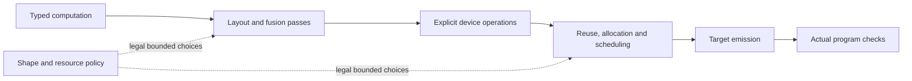

# Generate compilers that consume shared passes

Select the shared library and interface requirements before fresh Phase 1
authoring. The generated backend supplies target operations, physical mapping
and emission. Merlin supplies reusable transformations and checks. In the joint experiment, correctness and performance development proceed together.
Build capabilities in parallel and evaluate immutable snapshots while authoring
continues; applicable shared passes and legal alternatives can be improved from
the first executable compiler. Historical separate workflows remain available.

The opt-in interface contract checks declarations and their stability. It does
not establish that a generated compiler implements its promises. Qualification
still requires changed IR to reach actual emitted and executed code, with
independent complete numerical, state and realized-effect checks.

## Preserve useful compilation boundaries



| Boundary | Information the compiler must preserve | Consumer obligation |
| --- | --- | --- |
| Computation | Scalar arithmetic, complete reductions, layouts, bounds and value ownership | Lower the selected computation rather than reconstructing the original graph. |
| Device | Operand reuse, temporary storage, dependencies, persistent settings and completion | Consume `selected_target_mlir` through the existing `merlin.target_ir_consumer.v1` command. |
| Emission | Actual instructions, accesses, state effects and program limits | Check the emitted program, including changes made after scheduling. |

Fusion belongs before the computation structure disappears. Buffer reuse needs
both planned lifetimes and actual completion. Scheduling must precede final
emission. A final opaque assembly dump cannot supply those earlier semantics.
Unknown operations and effects remain barriers; a legal original route is
retained, or compilation names the missing prerequisite.

RTL facts constrain dimensions, widths, banks, capacities, queues and addresses
where extraction establishes them. Software contracts establish arithmetic,
layout, rounding, persistent state, ownership and completion. Neither a contract
identifier nor an RTL capacity establishes executable correctness or a timing
cost. Target adapters project these independently selected inputs into the
shared interfaces without supplying target-specific algorithms to Merlin.

## Select the requirement for a new authoring run

Add `--require-shared-passes` to the installed Phase 1 invocation described in
[Phase 0 and Phase 1 setup](phase0_phase1_setup.md), together with the explicit
`--compiler-library-root`, `--compiler-library-contract` and
`--compiler-library-contract-sha256` selections. This does not start a run by
itself and does not alter saved compiler submissions.

The v1 authoring integration requires the selected library to expose these
exact reviewed public modules:

- `merlin.transforms.pipeline_state`
- `merlin.sched.ir.kernel`
- `merlin.compile.scheduling.schedule_pipeline`

These are minimum interface APIs, not a claim that every transformation is
included or that a target can execute it. Actual read access must match the
selection. This version uses the existing finite `Kernel` scheduling interface;
arbitrary counted-loop or opaque programs need their own supported integration.
It does not prescribe one representation for every future target.

The original requirement and selected library identity are retained before
authoring and checked on resume. Every staged task, including model tasks,
receives the same requirement. Within this authoring-run scope, ordinary
operator compilation inherits the structural requirement, including explicitly
transported grading children and background work. Adding, removing or changing
that selection on resume refuses.
Historical runs without the selection keep their original behavior and grants.

The separate sealed model/operator-worker protocol does not yet transport this
new selection. Its model-child preparation refuses an active requirement before
compiler callbacks. Runs that require that worker need explicit transport
integration; the outer grading-child support does not qualify that nested path.
Custom treatment task stagers also refuse this opt-in; the supported task bodies
use the ordinary reviewed staging path.

Inspect requirements and a candidate declaration without running its compiler:

```sh
python -B -m merlin.targetgen.oot_starterkit.passes requirement \
  --output "$TMPDIR/shared-pass-requirement.json"
python -B -m merlin.targetgen.oot_starterkit.passes inspect \
  --manifest "$CANDIDATE/manifest.yaml" \
  --requirement "$TMPDIR/shared-pass-requirement.json"
```

Inspection reports declarations only. Its execution, numerical and performance
fields remain unmeasured. It supplies no new authoring import grant.

## Ordinary target consumption with v2

With the v2 requirement active, ordinary operator compilation sends the actual
`lower_interface_to_target` result through `selected.target.mlir` to
`emit_target_bundle`. It does not use an interface-reparsing emitter as a
substitute. Without an original host-selected target rewrite, the selection is
an exact copy of the lowered target bytes. The generated compiler must call
applicable shared passes through its adapters in its normal lowering/emission
pipeline; the copy itself performs no optimization.

`shared_pass_target.json` records the consumed files and their custody. Its
owner hash describes the current implementation; original source ownership is
checked separately. The receipt supplies no numerical or hardware authority.
Commands and pinned inputs/products must remain unchanged during invocation;
existing or aliased host output paths refuse. V1 keeps its original routing.

This connects the device consumer. It does not automatically invoke every
named computation/emission command, qualify a fusion or install the concurrent
copy planner in every backend. Each such integration still needs independent
selected-IR, emitted-effect, numerical and completion tests. Declaring a
supported interface does not establish pass readiness at Phase 1 completion.

## Declare defaults and availability explicitly

`merlin.shared_pass_contract.v1` requires computation, device and emission
boundaries linked to actual manifest command arguments consuming selected IR.
It reuses the existing target consumer rather than aliasing an emitter that
reparses the original interface. Each boundary names its semantics, effects and
capability contracts; these names remain declarations until independently checked.

The nine extension families are producer packing, horizontal matmul fusion,
multi-output fusion, bounded recomputation, joint layout/fusion selection,
padding/gather, destination forwarding, DMA coalescing and dead local writes.
Every family has a reason and one of three statuses:

- `supported`: the compiler promises the required interface; qualification is separate.
- `unsupported`: the selected contract establishes an unavailable capability.
- `unknown`: necessary information or integration is missing.

All supported families must appear exactly once in the declared default policy,
in boundary order. Considering a pass does not imply that every input matches it.
Unavailable families cannot offer enabled choices. Original callers can require
specific supported interfaces; an unknown or unsupported declaration cannot
satisfy that requirement.

Controls retain a baseline alternative and bound code growth and repair.
Existing `PassSpec` and `PipelineSession` remain responsible for actual
prerequisites, source/context freshness, invalidations and repair. Declaring
these obligations does not implement them or replace their verification.

Phase 2 may adjust admitted grouping, layouts, tiling, retention, buffering,
recomputation and ordering choices. It cannot change hardware facts, capability
meanings, numerical thresholds or the verification rules. Freeze learned
policies before evaluating held-out workloads.

## Verify realization before measuring improvement

Acceptance needs both numerical and physical observations. An emitter that
ignores configuration elimination can return identical values while executing
all redundant setters. Conversely, fewer setters do not detect a wrong setting.
Check actual emitted operands and executed effects alongside complete outputs,
carried state, preserved inputs and relevant memory guards.

The neutral consumption tests exercise real translation, object compilation,
linking and recurrent native execution. They include ignored-selected-IR and
wrong-constant mutations. They establish that checking mechanism, not target
support for all nine families or accelerator performance.

The archived V26 compiler lacks the declared selected-target consumer. Its
analysis-bundle output is not a substitute. Keep such snapshots unchanged and
report missing integration; do not infer hardware non-support or qualify a
new compiler from the old snapshot's evidence. Measure functional correctness
and actual cycles on the selected qualified target separately, as described in
[default pass evaluation](default_pass_evaluation.md).


## Require specific supported interfaces in a new generation

Select the prospective v2 contract when requiring buffering/pipelining as a first-class
mechanism. For example, append these original operator options to the normal Phase 1
invocation and retain its existing explicit library selection:

```sh
--require-shared-passes --shared-pass-contract-version 2 \
  --require-supported-shared-pass multi_output_fusion \
  --require-supported-shared-pass buffering_pipelining
```

Repeat `--require-supported-shared-pass` for each interface the new compiler must expose.
V2 retains the nine v1 families and adds `buffering_pipelining`; it also names resource
and completion contracts at each IR boundary. A requested interface reported unknown or
unsupported refuses intake. This does not require unselected hardware to support every
family. V1 records and their nine-family interpretation remain unchanged; do not upgrade
an existing run or replace its library bytes on resume.

Every declared supported family belongs to the compiler's deterministic default policy.
Fusion needs exact scalar/reduction, layout, alias and physical-effect premises.
Buffering/pipelining additionally needs actual private-slot capacity, bounded in-flight
work, dependency and wait/completion semantics. Capacity alone authorizes no concurrency.
Unknown premises preserve the legal original route. Phase 2 tunes alternatives inside
these original bounds; it cannot select legality checkers or enlarge library access.

The generated compiler and its adapters may change during authoring. The original shared
library stays frozen for that run; a library correction needs independent review and a
new versioned selection with identical access for the compared arms.

A supported declaration is a promise of an interface, not numerical or hardware
qualification. Completion requires independent checks on actual selected IR, consumed
emission and linked execution, including complete outputs, state, readonly inputs and
mutation controls. Ignoring selected IR, substituting an operand, omitting a completion
wait, or prematurely reusing a private slot must fail those checks. Structural validation
alone cannot establish that fusion, buffering or pipelining actually executed, nor supply
a latency or resource qualification.

## Connect a generated adapter to the existing schedule compiler

The following sample uses actual public APIs. Each imported module must belong
to the original reviewed library selection; the minimum interface grant does
not implicitly export its companions. Read the selected inputs with
`read_scheduling_contracts(facts_path, software_path, target=target_identity)`
from `merlin.compile.scheduling.selected_contracts`. The target identity is
input data, never a selector for shared target-specific algorithms.

The generated target supplies the `Kernel` and complete ordered buffer
arguments, invocation-private `TemporaryObject` descriptions, physical bank
mapping, and target instruction implementation. `StorageAdapter.project`
projects actual call operands to exact `StorageEffects`, including physical
accesses, arithmetic and completion. `StorageAdapter.rewrite` applies the
allocator's checked address changes. Published outputs, escaping buffers and
carried state cannot be declared invocation-private temporaries.

`ScheduleEncoding.encode` emits actual bytes. Its `decode_calls` callback must
recover every instruction and operand from those bytes, independently of the
optimizer's saved call stream. Its `ProgramDecoder` separately checks encoded
accesses, branches, completion and final program limits. These implementations
need independent original qualification; constructing the dataclasses or
supplying a qualification identifier establishes none.

```python
from merlin.compile.scheduling.schedule_pipeline import (
    ScheduleBudgets,
    ScheduleEncoding,
    compile_schedule,
)
from merlin.compile.scheduling.selected_contracts import SelectedSchedulingContracts
from merlin.compile.scheduling.temporary_storage import StorageAdapter
from merlin.sched.ir import Kernel


def compile_device_schedule(
    kernel: Kernel,
    objects,
    banks,
    adapter: StorageAdapter,
    encoding: ScheduleEncoding,
    limits,
    *,
    selected: SelectedSchedulingContracts,
    budgets: ScheduleBudgets,
    reservations,
    external_windows,
    private_ownership: bool,
    fusion_emitters,
    fusion_qualification_identity,
    prefetch_qualification_identity,
):
    selected.revalidate()
    result = compile_schedule(
        kernel,
        objects,
        banks,
        adapter,
        encoding,
        limits,
        selected_contracts=selected,
        budgets=budgets,
        reservations=reservations,
        external_windows=external_windows,
        private_ownership=private_ownership,
        fusion_emitters=fusion_emitters,
        fusion_qualification_identity=fusion_qualification_identity,
        prefetch_qualification_identity=prefetch_qualification_identity,
    )
    selected.revalidate()
    return result
```

The original caller supplies the selected context, qualifications and finite
ceilings before compiler callbacks. They cannot come from candidate policy or
a successful-looking saved report. The compiler maps its own typed source to
this interface and consumes `result.kernel` and `result.program`, rather than
emitting the original `kernel`. Emit `result.program.segments` through the real
backend while preserving its checked launch/continuation contract; do not
flatten segments into a new unchecked program. Retain the source, selected IR,
report and actual emitted artifact, then join the real object and linked image.

On this selected-contract path, `fusion_emitters` maps original declared readout
selectors to target callbacks accepting the producer and consumer `Call`s.
They return an actual supported fused `Call` or `None`. The selected fusion
binding constructs `FusionCapability` values and checks scalar MLIR, ordered
stages, layouts, effects and fact-derived readout bounds. Do not also pass an
arbitrary `fusion_capabilities` tuple to override the selected declaration.
Missing physical routes or qualification retain the supported original route.
Invariant or conformance failures must not be hidden by catching every error.

The ordinary schedule compiler's qualified prefetch path preserves explicit
completion and uses its selected storage contract. For separately qualified
concurrent copies, select the V8 companion in the same fixed storage stage:

```python
from merlin.compile.scheduling.copy_pipeline import (
    CopyPipelinePolicy,
    copy_pipeline_motion,
)

motion = copy_pipeline_motion(
    original_copy_admission,
    policy=CopyPipelinePolicy(distance=4, max_moves=8, max_pending_copies=2),
    budgets=original_budgets,
)
result = compile_schedule(
    kernel, objects, banks, adapter, encoding, limits,
    selected_contracts=selected,
    budgets=original_budgets,
    external_windows=original_windows,
    private_ownership=True,
    copy_pipeline=motion,
)
```

The numbers illustrate bounded policy choices, not a recommended schedule.
The original admission separately qualifies instruction crossing and concurrent-copy
pairs, queue bounds, descriptor/configuration effects and token completion. RTL
capacity alone does not authorize concurrency. Missing admission selects no motion.
Existing V6/V7 import inventories remain unchanged; this companion needs an
explicit compatible library selection.

Allocation precedes motion. The pass uses actual placed private slots, preserves
all calls and waits, and rechecks their new lifetimes and completion. If compact
allocation merged slots, one bounded repair may preserve the original slots,
provided those slots fit and actually enable checked motion. Otherwise the compact
route remains. This implementation does not synthesize double buffers or combine
copy motion with a selected deletion-only post-storage rewrite.

Final checks reconstruct the instruction stream from actual encoded bytes and
repeat the independent copy, dependency, occupancy and memory checks. A partial
token wait cannot be reported as a global drain while another copy remains pending.
No arbitrary reordering of pass stages is exposed to policy.

## Select target-IR scheduling from the original host

An original host may select `merlin.llvmlower.target_schedule.TargetScheduleSelection`
through `capsule_common.lower_interface(..., target_schedule=selection)`. This
host-only adapter is outside the public SDK. It accepts selected contracts,
private objects, a storage adapter, encoding, program limits and a `parameters`
dictionary containing the existing `compile_schedule` keyword choices. The actual
lowered target module is parsed, scheduled, rewritten and passed to the package's
existing `emit_target_bundle` consumer. `target_schedule.json` retains the source,
selected IR, emitted artifact and original selection identities. The configuration
and schedule selections are mutually exclusive.

`DeviceRouting(target_schedule=selection, ...)` carries the same original selection
through routed model preparation, per-kernel object generation and final linked-image
admission. Missing consumed receipts, changed selections and empty/catalog-only routes
refuse. Combining this selection with source offload economics still requires separate
cost qualification and currently refuses; the unselected route retains its behavior.

The initial target-IR domain is a single finite, flat, unannotated module containing
constant integer operands and declared resultless ISA operations. Unknown or dynamic
operations retain the unchanged fragment with a reason. Segmented launch programs
retain the original route rather than flattening their continuation ABI. Invalid
invariants fail; they do not silently acquire a successful fallback verdict.

Supported declared readout fusion uses the existing scalar, layout and physical
composition checks before allocation. Missing physical routes or observed intermediate
fanout preserve the original computation. The target consumer must actually emit the
selected fused operation; custody receipts alone cannot prove this. Neutral tests
check the LLVM command-image global, its actual use, the loaded shared object's bytes,
complete recurrent outputs and an independent integer reference. They include an
emitter that ignores selection while producing correct outputs, which must still fail.
The companion pipelining tests link a separate delayed-copy token-queue machine:
launches do not publish bytes, and each wait completes only its named transfer.
They check actual selected order, loaded bytes, complete carried state and memory
guards, with missing-wait and broken-visibility controls.

These tests establish the shared integration mechanism, not Gemmini instruction
support or accelerator latency. The archived public V26 compiler still lacks the
selected-target consumer and its software input lacks the required ISA/scheduling
declarations. Those interfaces and independent live execution qualification remain
prerequisites for using this route on that compiler snapshot.

Phase2 policy may vary enabled legal alternatives and finite bounds such as
`ScheduleBudgets.max_fusions`, `prefetch_distance` and `max_prefetch_moves`.
Where the concurrent-copy consumer is independently admitted, its
`CopyPipelinePolicy.distance`, `max_moves` and `max_pending_copies` are also
bounded choices. Every choice stays below the original capacity, overlap and
work ceilings. Phase2 cannot replace the source/facts, qualification owner,
effects, decoder, numerical policy or library, or grant additional overlap.

Qualification must exercise the real default compilation route and independently
verify both selected IR and consumed emission. Use complete numerical/state
references and readonly inputs. Mutations that ignore the selection, alter a
fused operand or width, omit a wait, reuse a pending slot or exceed a queue
bound must refuse or fail independently. Existing neutral checks demonstrate
particular mechanisms; they do not qualify every family or a generated target.
