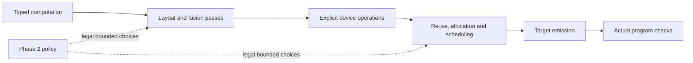

# Generate compilers that consume shared passes

Select the shared library and interface requirements before fresh Phase 1
authoring. The generated backend supplies target operations, physical mapping
and emission. Merlin supplies reusable transformations and checks. Normal
compilation should run applicable passes with conservative defaults during
Phase 1 iteration; Phase 2 tunes the legal alternatives afterward.

The opt-in interface contract checks declarations and their stability. It does
not establish that a generated compiler implements its promises. Qualification
still requires changed IR to reach actual emitted and executed code, with
independent complete numerical, state and realized-effect checks.

## Preserve useful compilation boundaries



| Boundary | Information the compiler must preserve | Consumer obligation |
| --- | --- | --- |
| Computation | Scalar arithmetic, complete reductions, layouts, bounds and value ownership | Lower the selected computation rather than reconstructing the original graph. |
| Device | Operand reuse, temporary storage, dependencies, persistent settings and completion | Consume `selected_target_mlir` through the existing `merlin.target_ir_consumer.v1` command. |
| Emission | Actual instructions, accesses, state effects and program limits | Check the emitted program, including changes made after scheduling. |

Fusion belongs before the computation structure disappears. Buffer reuse needs
both planned lifetimes and actual completion. Scheduling must precede final
emission. A final opaque assembly dump cannot supply those earlier semantics.
Unknown operations and effects remain barriers; a legal original route is
retained, or compilation names the missing prerequisite.

RTL facts constrain dimensions, widths, banks, capacities, queues and addresses
where extraction establishes them. Software contracts establish arithmetic,
layout, rounding, persistent state, ownership and completion. Neither a contract
identifier nor an RTL capacity establishes executable correctness or a timing
cost. Target adapters project these independently selected inputs into the
shared interfaces without supplying target-specific algorithms to Merlin.

## Select the requirement for a new authoring run

Add `--require-shared-passes` to the installed Phase 1 invocation described in
[Phase 0 and Phase 1 setup](phase0_phase1_setup.md), together with the explicit
`--compiler-library-root`, `--compiler-library-contract` and
`--compiler-library-contract-sha256` selections. This does not start a run by
itself and does not alter saved compiler submissions.

The v1 authoring integration requires the selected library to expose these
exact reviewed public modules:

- `merlin.transforms.pipeline_state`
- `merlin.sched.ir.kernel`
- `merlin.compile.scheduling.schedule_pipeline`

These are minimum interface APIs, not a claim that every transformation is
included or that a target can execute it. Actual read access must match the
selection. This version uses the existing finite `Kernel` scheduling interface;
arbitrary counted-loop or opaque programs need their own supported integration.
It does not prescribe one representation for every future target.

The original requirement and selected library identity are retained before
authoring and checked on resume. Every staged task, including model tasks,
receives the same requirement. Within this authoring-run scope, ordinary
operator compilation inherits the structural requirement, including explicitly
transported grading children and background work. Adding, removing or changing
that selection on resume refuses.
Historical runs without the selection keep their original behavior and grants.

The separate sealed model/operator-worker protocol does not yet transport this
new selection. Its model-child preparation refuses an active requirement before
compiler callbacks. Runs that require that worker need explicit transport
integration; the outer grading-child support does not qualify that nested path.
Custom treatment task stagers also refuse this opt-in; the supported task bodies
use the ordinary reviewed staging path.

Inspect requirements and a candidate declaration without running its compiler:

```sh
python -B -m merlin.targetgen.oot_starterkit.passes requirement \
  --output "$TMPDIR/shared-pass-requirement.json"
python -B -m merlin.targetgen.oot_starterkit.passes inspect \
  --manifest "$CANDIDATE/manifest.yaml" \
  --requirement "$TMPDIR/shared-pass-requirement.json"
```

Inspection reports declarations only. Its execution, numerical and performance
fields remain unmeasured. It supplies no new authoring import grant.

## Declare defaults and availability explicitly

`merlin.shared_pass_contract.v1` requires computation, device and emission
boundaries linked to actual manifest command arguments consuming selected IR.
It reuses the existing target consumer rather than aliasing an emitter that
reparses the original interface. Each boundary names its semantics, effects and
capability contracts; these names remain declarations until independently checked.

The nine extension families are producer packing, horizontal matmul fusion,
multi-output fusion, bounded recomputation, joint layout/fusion selection,
padding/gather, destination forwarding, DMA coalescing and dead local writes.
Every family has a reason and one of three statuses:

- `supported`: the compiler promises the required interface; qualification is separate.
- `unsupported`: the selected contract establishes an unavailable capability.
- `unknown`: necessary information or integration is missing.

All supported families must appear exactly once in the declared default policy,
in boundary order. Considering a pass does not imply that every input matches it.
Unavailable families cannot offer enabled choices. Original callers can require
specific supported interfaces; an unknown or unsupported declaration cannot
satisfy that requirement.

Controls retain a baseline alternative and bound code growth and repair.
Existing `PassSpec` and `PipelineSession` remain responsible for actual
prerequisites, source/context freshness, invalidations and repair. Declaring
these obligations does not implement them or replace their verification.

Phase 2 may adjust admitted grouping, layouts, tiling, retention, buffering,
recomputation and ordering choices. It cannot change hardware facts, capability
meanings, numerical thresholds or the verification rules. Freeze learned
policies before evaluating held-out workloads.

## Verify realization before measuring improvement

Acceptance needs both numerical and physical observations. An emitter that
ignores configuration elimination can return identical values while executing
all redundant setters. Conversely, fewer setters do not detect a wrong setting.
Check actual emitted operands and executed effects alongside complete outputs,
carried state, preserved inputs and relevant memory guards.

The neutral consumption tests exercise real translation, object compilation,
linking and recurrent native execution. They include ignored-selected-IR and
wrong-constant mutations. They establish that checking mechanism, not target
support for all nine families or accelerator performance.

The archived V26 compiler lacks the declared selected-target consumer. Its
analysis-bundle output is not a substitute. Keep such snapshots unchanged and
report missing integration; do not infer hardware non-support or qualify a
new compiler from the old snapshot's evidence. Measure functional correctness
and actual cycles on the selected qualified target separately, as described in
[default pass evaluation](default_pass_evaluation.md).
