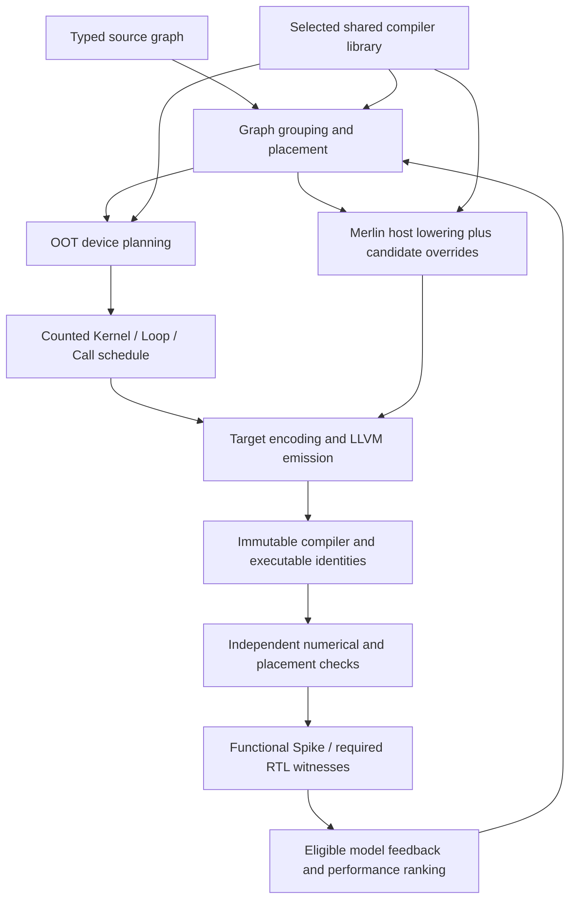

# Compiler optimization surfaces and execution evidence

An available pass, a candidate import, an emitted transformation, a numerically
correct executable and a performance improvement are five different observations.
Keep them separate when evaluating compiler co-evolution. A successful import or
an author-written `applied` record cannot establish the last two.

## How passes are created and exposed

The experiment gives the author a selected immutable compiler library and an
explicit inventory. With the editable-library contract enabled, the candidate
can override selected compiler modules under `compiler_library/merlin/`. Untouched
modules resolve to the original library. Each evaluation captures both the OOT
backend and its overrides. Checker, provenance and runtime authority stay outside
that fork. This is source-level compiler development, not an automatic system that
extracts new verified passes from successful kernels.

There are several distinct pass interfaces:

| Interface | What it provides | What it does not establish |
| --- | --- | --- |
| `xdsl_dialects.lowering.passes.all_catalogs()` | Production whole-model boundary passes, normalizations and separately labelled prototypes | That an OOT compiler calls the research prototype pipeline |
| `merlin-opt --list-merlin-passes` | Dynamically constructed xDSL `ModulePass` wrappers for compatible catalog callables | New optimization algorithms; non-module dispatch transforms remain separately reported |
| `transforms.pipeline.apply_common_pipeline` | Shared normalization, scalar cleanup, ordered tiling/unrolling, storage and dependency transformations | A valid production certificate without the original verification broker |
| `PipelineSession` and `PassSpec` | Analysis stamps, requirements, invalidation, pass-order checks and records | Numerical correctness of arbitrary registered actions |
| `pipeline_policy.execute_policy` | Ordered alternatives based on shapes, semantics, graph properties and resources | A search algorithm or automatic selection by measured performance |
| `compile.scheduling.compile_schedule` | Checked finite schedule construction, selected fusion/configuration/storage/prefetch and final-byte checks | A drop-in optimizer for arbitrary symbolic nested loops |
| OOT manifest commands | Source admission, target lowering and emitted target consumption in subprocesses | Use of every shared pass, or a distinct registered MLIR dialect |

The opt driver *generates wrappers* around existing Python implementations.
The agent creates or changes algorithms by editing source. Adding an algorithm
does not automatically register it in every interface, select it in the backend,
or promote it into Merlin's canonical source tree.

`PipelineSession.host_pass_profile` records each pass invocation's host action
time and framework time separately, including failures. Policy and variant
receipts expose these profiles; common-prefix timing is reported separately so
it is not charged again to every alternative. Profiling adds no verification
pass or extra IR traversal, and timings do not enter semantic identities. These
are compiler development costs, not target cycles or evidence of a faster kernel.

## Three representations that should not be conflated

1. Typed source MLIR carries graph operations, layouts, numerical semantics,
   live values and externally visible outputs.
2. `merlin.sched.ir.Kernel`, `Loop`, `Call`, symbolic expressions and `Stage`
   describe a counted device schedule. Calls can express completion tokens,
   execution units, configuration state and storage staging. These are Python
   scheduling IR objects, separate from xDSL schedule-dialect operations.
3. Emitted target/LLVM MLIR and the executable carry the actual instructions.
   The target owns instruction encoding, physical layouts and completion.

Using the counted scheduling IR is meaningful even without a custom registered
target operation dialect. Conversely, naming a module attribute after a target
does not make that attribute a typed target dialect. Follow the actual parser,
verifier and consumer rather than inferring architecture from filenames.



The diagram describes integration boundaries. The caller still has to choose
which graph transforms and scheduling algorithms run at each boundary.

## Generated instruction values and allocation

The backend starts empty. Reusable generation lives in Merlin and consumes
explicit public ISA declarations as data; an existing target compiler checkout
is not a construction dependency or an author input. Optional generated neutral
operations are a separately declared input treatment, never an optimized seed.

Every package produced by `isa_dialect_gen.generate_package` exposes
`create(name, operands=..., immediates=...)` and `encode_op(op, allocate=...)`.
The builder uses named SSA operands and generates result types from the declared
signature. The encoder calls `allocate(value, argument)` for encoded SSA inputs
and results; the callback supplies physical register/address bindings. It checks
encoding field widths separately from the values' types. A 64-bit value does not
mean a 64-bit register-index field. Immediate attributes remain immediate values.

The author supplies the target lowering and allocation using the same public
declarations. The generator does not infer payload semantics, packing, resource
lifetimes or schedules. Undeclared effects remain unknown. Encoding success is
not functional correctness or evidence of performance.

## Mapping optimization work to existing mechanisms

| Optimization | Shared mechanism to inspect | Required target integration or evidence |
| --- | --- | --- |
| Tiling and compact host loops | `transforms/loops.py`, `unrolling.py`, `dense_planning.py`; counted scheduling IR | Preserve reduction order, tails, index bounds and a compact large-shape representation |
| Resident operands and shape policies | `compile/scheduling/dense_resident_panel.py`; `transforms/pipeline_policy.py` | Actual target allocation and consumption; capacity is not evidence of overlap or latency |
| Configuration reuse | `configuration.py`, `configuration_loops.py` | Decode established/required state and invalidation across commands and loops |
| Command and transfer compaction | `command_compaction.py`, `panel_transfers.py`, `window_transfer.py` | Equivalence of address ranges, boundaries, faults and completion |
| Buffer reuse and spilling | `temporary_storage.py`, `device_spills.py`, `spill_conformance.py` | Real physical effects and lifetime events; distinguish consumption, readiness and completion |
| Prefetch and double buffering | `copy_pipeline.py`, `staged_dense.py`, selected schedule adapters | Independent storage slots, queue/resource bounds, legal dependencies and final-byte checks |
| Adjacent arithmetic/readout fusion | `fusion.py`, `fusion_semantics.py`, `output_fusion.py` | The selected composition preserves exact rounding, activation, saturation and all visible uses |
| Connected/shared-input/multi-output fusion | `compile/fusion_workflow.py`, `shared_input_groups.py`, `multioutput_fusion.py` | Graph discovery is separate from physical realization; whole-region checks remain necessary |
| Packing and host preparation reuse | `llvmlower` host builders and preparation routes | Identify immutable inputs and invocation lifetime; distinguish per-call reuse from persistent preparation |
| Performance feedback | Experiment performance reports, roofline and selected timing observer | Matching source, workload, timing boundary and model epoch; no private reference scores in author feedback |

The complete contracts and restrictions are in
[shared compiler passes](shared_compiler_passes.md). For example, the physical
`plan_fusion` implementation handles adjacent synchronous elementwise operations
with a private unobserved intermediate. It is not arbitrary cross-layer fusion.
The finite schedule pipeline cannot simply be applied to a huge nested-loop
program by expanding every iteration. Use a compatible region adapter or the
counted-loop interfaces, and retain the compact representation.

`fusion_workflow.discover` returns bounded pages with a source/contract-bound
`next_cursor`. Each page grows deterministic producer–consumer frontiers and
shared-input prefixes; it does not enumerate all subsets. Region-size limits
and deferred work are explicit. Resume with unchanged input/contract identities.
Candidate-budget exhaustion no longer fails the compilation.

`realize_candidate` rechecks the selected source opportunity and delegates to
the available native realization. `evaluate_fusions` emits an unfused baseline
and at most fifteen alternatives on independent IR copies. Its emitter receives
the actual `Realization.artifact` and storage objects, not merely a success
receipt. Unsupported routes keep concrete reasons and the original source.
An emitted source or logical schedule is not an executable; the target compiler
must consume it through its normal lowering and independently check its outputs.
The public `examples/compiler/fusion_exploration.py` exercises these same APIs
for small synthetic integer residual, shared-projection and MLP structures.

## Reviewing an authored compiler

Trace the entrypoint through graph selection, schedule construction, emission and
the target consumer. Inspect both direct calls and transitive dependencies. Then
compare sparse overrides against the *selected run library*, not today's main.
An identical copied module is not a compiler improvement.

For each optimization, record:

- The semantic match and negative cases; do not select by capsule or model name.
- Actual source/pass options and IR before/after, bound to the compiler revision.
- Live-ins/outs, numerical policy, aliasing, resource and completion assumptions.
- Whether it produced the consumed executable, rather than a detached example.
- Independent correctness and placement verdicts, distinct from author diagnostics.
- Comparable whole-call cycles or a labelled provisional estimate; leave missing
  host, packing or queue costs unknown.

The read-only audit utility inventories Python imports, changed override files
and retained schedule diagnostics. It credits diagnostic counts only when all
selected Python source files match the per-case retained source copy:

```sh
python build_tools/scripts/audit_compiler_integration.py \
  --submission "$FROZEN_COMPILER" \
  --baseline "$SELECTED_LIBRARY_PYTHON" \
  --results "$PER_CAPSULE_RESULTS" \
  --schedule-attribute "$TARGET_SCHEDULE_ATTRIBUTE" \
  --output "$AUDIT_OUTPUT"
```

This does not execute candidate code or rerun simulators. Its attribute reader
accepts the retained generic-MLIR diagnostic string format; it is not a general
MLIR parser or an execution verifier. Static absence of a direct import is useful
review evidence, not proof that a transitive or dynamically loaded path never ran.

## Making compiler improvements compound

Promote reusable graph algorithms and host code from the candidate fork into
Merlin only after reviewing their contracts and relevant independent cases.
Keep instruction selection and resource realization in the OOT backend.
Register separate graph, schedule and emission policies at their existing IR
boundaries. Record selected alternatives and invalidated analyses so pass-order
exploration can be evaluated without replacing numerical checks.

Preserve a working backend while extracting one transformation at a time. Start
with already exercised resident-panel planning and source grouping. A generic
planner should return a decision with premises; the backend should realize it.
Do not turn target instruction details into shared constants or describe a byte
traffic heuristic as a calibrated whole-system cycle model. Qualification of a
shared pass and demonstrated target performance remain separate release claims.
