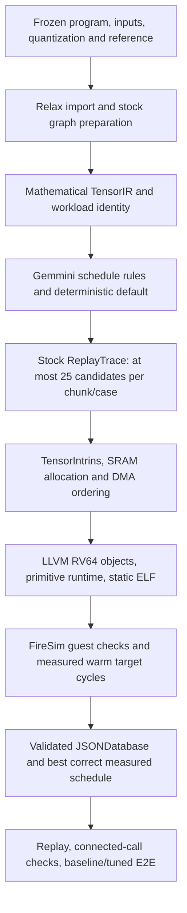

# Minimal TVM–Gemmini architecture and paper scope

Audited implementation: TVM `64bed0cb9c876b89707e69584909abe5e13b0384`,
Merlin runner `9794880b465a8fa456bd0949914187ea192a45e3` and handoff
`9ab339ca2b8f34a2a362350fd8c74bd752e47780`. Later documentation-only changes do
not reattribute earlier measurements. Cleanup successor TVM `2c0857ab8` isolates
legacy graph lowering without changing the 13 existing semantic definitions
(apart from explicit compatibility imports); prior Spike results retain their
`bb4ad9f8d` source binding. The operation authority is the exact
[8ec99308 software specification](https://github.com/ucb-bar/merlin/blob/8ec99308cb1182b9b896a6075300312266fadf6f/examples/gemmini/target/software-spec.yaml).

**Design conclusion:** retain this architecture as the implementation baseline:
mathematical TensorIR, target schedule rules, TensorIntrins, necessary physical
memory lowering, a primitive runtime and an external measurement adapter. It is
a modified TVM backend, not stock TVM with only intrinsic registration. There is
no reason to restore the removed pattern-forcing graph optimizations. Freezing
the design does not complete software-spec or hardware qualification.

## Top-down execution path

The final hardware steps are required campaign work, not completed results.

| Layer | Implementation and ownership | Why it remains |
| --- | --- | --- |
| Program and numerics | Frozen captures/references and explicit quantization outside search; TVM Relax import with inherited frontend correctness fixes | Search changes implementation, not the mathematical experiment. Host work and conversions remain visible. |
| Graph preparation | Stock legalization, pattern annotation, constant folding, binding canonicalization, fusion, reshape rewriting and DCE; optional stock CSE | Ordinary TVM graph optimization. The campaign starts at fusion=2/CSE off. Four fusion levels × CSE on/off give eight nominal plans, often fewer distinct programs. |
| Workload identity and extraction | Custom `AnnotateGemminiWorkloads`, stock `extract_tasks`; common preparation for tuning and compilation | Structural records need the same mathematical IR and capability target. Annotation is metadata, not an arithmetic rewrite or spec proof. |
| Scheduling | Custom `GemminiScheduleRule` invokes ordinary TensorIR split/reorder/cache/reindex/layout/blockize primitives | TVM needs a target search space. Convolution and batched contractions may require explicit packing/gathering; their work must be included. |
| Tensorization | Registered mathematical description/implementation pairs, generally stock `RewriteTensorize`; deterministic schedules tensorize directly, and pool schedules record tensorization eagerly | A legal matching block is replaced by the target implementation. One TensorIntrin may emit multiple primitive commands. |
| Final placement | Custom `ScheduleGemminiTensorIR` after stock `MetaScheduleApplyDatabase` | Preserve selected schedules, supply defaults for misses, lower device memory and report CPU/refusal reasons. This custom pass still exists. |
| Memory and ABI | Custom `lower_memory`, scalar match-buffer offset compatibility fix, static row allocator, host-DMA hazard handling and buffer checks | Scoped accelerator storage is not a CPU pointer. Layout, capacity, ownership and DMA completion need concrete lowering. |
| Host scheduling | `_inline_cpu_producers` uses stock `compute_inline` on eligible internal pointwise producers, avoiding low-precision storage-rounding changes | Removes operator-local temporaries for the bare-metal exporter. This is remaining custom orchestration of a stock optimization; it is fixed, not a tuned graph knob. |
| Code and runtime | LLVM RV64 plus C primitive command runtime; static graph/package/session exporter | Rocket issues accelerator commands. Packaging, graph workspace and session state are supplied integration, not the stock TVM VM/AOT runtime. |
| Measurement | Stock Builder/Runner interfaces with custom ELF/FireSim adapters; Merlin owns fixtures, budgets, watchdog and evidence | TVM does not supply this FPGA transport or experimental contract. |

These use TVM's documented [schedule/tensorize interface](https://github.com/apache/tvm/blob/v0.19.0/python/tvm/tir/schedule/schedule.py)
and [ReplayTrace implementation](https://github.com/apache/tvm/blob/v0.19.0/src/meta_schedule/search_strategy/replay_trace.cc).
The upstream base is TVM v0.19.0 `c4dc0c29`; do not describe the fork as unmodified
upstream or infer compatibility with another TVM release.

## Scheduling, memory choices and defaults

The common contraction default selects the largest exact intrinsic dimensions
up to 16 and ranks bounded M/N reuse groups by estimated logical operand traffic,
then group size and K batching. Actual compacted/aligned memory allocation is the
legality check. It tries at most eight ranked choices plus a one-group fallback;
it can refuse if none fits. OS, ij traversal, no hoist and no pipeline are the
starting structure. This heuristic is not an analytical cycle model or a proven
optimum. Prime dimensions can yield small exact tiles; search also has tail choices.

The traced search space includes intrinsic rectangles, M/N/K reuse groups,
OS/WS, legal traversal/hoisting/pipelining, staging and tails. The active FireSim
profile is `compact=True`: epilogues stay at root and unroll choices are 0/16.
Do not advertise every generic backend option as searched in this campaign.
Physical SRAM addresses and required fences are deterministic lowering, not
independent search dimensions. There is no general cross-function SRAM residency,
no arbitrary DMA-overlap optimizer and no hardware matmul/conv loop-FSM path.
The C runtime retains configuration shadowing and compatible WS tile reuse;
these are fixed runtime optimizations, not learned schedule decisions.

Automatic bias folding, constant-weight prepacking, scale specialization,
readout-normalization passes, DMA command merging and zero-init elimination
remain removed. Explicit bias initialization already present in mathematical
TensorIR may tensorize. A post-reduction bias is not automatically moved there.
Schedule-local packing still exists; removing automatic prepacking does not mean
all packing costs disappear. Required load batching is distinct from the removed
post-lowering command-merging peephole.

## Search and measurement contract

- Stock ReplayTrace randomly selects a legal sketch and resamples its trace
  decisions. Completed costs select the final winner; they do not guide subsequent
  sampling. No XGBoost, feature training or learned ranking is used. The API's
  RandomModel placeholder is unused. Legacy Evolutionary/XGB code remains opt-in.
- Round-robin distributes **up to 25 candidate trials total per case/chunk** across
  extracted tasks. Graph alternatives share that reservation. This is neither
  25 per internal head/operator nor an ML warmup followed by more trials.
  Generation failures, duplicates, builds, successful unique measurements and
  actual executions must be reported separately; 25 is an upper bound, not a
  guarantee of 25 distinct valid measurements or exhaustive search.
- The active FireSim entry point selects **contractions only**, `include_cpu=False`.
  The generic backend has secondary-family and CPU spaces, but that is not evidence
  of tuning them here. Their fixed schedules/host work still affect complete calls.
- Measure three correct baseline jobs per selected task for the wall watchdog.
  Retain the measured baseline as a fallback. Baseline jobs and timing repeats
  are additional executions charged to the same slot budget, not free trials.
- Record the completed second/warm call's target cycles, including its host work,
  DMA and completion. Convert cycles to seconds using the documented target
  counter frequency at the TVM Runner boundary. Legacy local cycle-valued
  databases must not be mixed with this seconds-valued database.
- Use the approved median wall watchdog, not best-so-far cycle cancellation.
  Completed slow results remain eligible. Timed-out runs have no measured cycle
  label. Wall limits still censor sufficiently slow candidates; report this bias.
- ResNet has 4h DSE and 30min per final E2E run. The 16-case TVM kernel study has
  a planning ceiling of 24 aggregate occupied-slot-hours. Time caps win; finish
  already active jobs under their watchdogs and report overrun. Remote aggregate
  occupancy enforcement is required; the local deadline alone does not enforce
  slot-hours across concurrent workers.

The source-backed details are in [TUNING.md](https://github.com/grammy117/tvm/blob/64bed0cb9/apps/gemmini/TUNING.md),
[ADAPTER_CONTRACT.md](ADAPTER_CONTRACT.md) and [FIRESIM_HANDOFF.md](FIRESIM_HANDOFF.md).

## Operation support and admission

[TENSORIR_OP_AUDIT.md](TENSORIR_OP_AUDIT.md) is the canonical operation inventory.
It distinguishes primitive mappings, declared composite candidates, memory/view
handling and unsupported math. The 51 baseline entries are frontend fixtures,
not 51 hardware operations. The spec declares eleven families; nine have candidate
subsets/compositions, while component-linear and component-bilinear lowering are
not implemented. That count is not nine fully qualified hardware families.

Compiler recognition, a passing fixture and spec admission are different facts.
Current checks cover useful domain, shape, memory and rounding restrictions, but
there is no complete per-program gate discharging all spec obligations. Runtime
alias/capacity checks are not a substitute for arithmetic/composition proofs.
Unsupported operations and failed default schedules can remain on the CPU with
placement reasons; experiment admission must reject an unintended fallback for
work that is required to run on Gemmini.

## Constraints on paper claims

| Concern | Required evidence or disclosure |
| --- | --- |
| Exact spec compliance | Bind every evaluated program's PE/accumulator bounds, scales, layouts and permitted compositions. Until then say implemented candidates, not complete spec support. The source-default software-spec.yaml differs from the requested pin; use exact 8ec99308 bytes. |
| Hardware and oracle identity | Match capability/header/runtime facts to deployed hardware. ResNet's selected U250 and reported F2 kernel setup are not interchangeable. Repaired diagnostic Spike is not the missing spec-pinned oracle. |
| Final-source execution | The current 74-case operator suite and 16 complete kernels pass diagnostic Spike with the current reuse default; see SPIKE_HANDOFF_EVIDENCE.md for ResNet checks and source hashes. Older releases retain their own identities. No FireSim speedup follows from Spike correctness. |
| Complete workloads | The tuning runner measures extracted contractions. Complete all-head/all-output kernel builders and ResNet chunk/parent builders now exist. Final FireSim confirmation is still required; never sum isolated minima into complete-call/E2E cycles. |
| Fair comparison | Match shapes, input bytes, dtypes, exits, cache/warm policy, placement and host packing across systems. Include runtime config/WS reuse and any timed preparation; report precomputed preparation separately. |
| Tuning strength | This is a small, seeded random trace search with an engineered default, not an ML-tuned or converged optimum. Publish seeds, unique valid candidates, errors, per-task allocation, timeouts and actual occupancy. A four-hour cap may leave chunks undertuned. |
| Baseline attribution | Report the default heuristic as an optimization itself. Compare default versus selected schedules; an ablation is needed to attribute gains specifically to search, reuse, fusion or a runtime change. |
| Coverage and effort | Full TinyLlama/SmolVLA are deferred as too expensive. Their isolated kernels do not establish model quality, full decode coverage or equal optimization effort. |
| Reproducibility | Publish exact source pins, inputs/references/checksums, traces, compile options, placement, ELFs and measurement receipts. Frozen historical releases cannot acquire new source labels. |
| Repository gates | Nine inherited module-size failures and eight existing no-regex call sites in unchanged files remain repository lint debt. They are not runtime failures; staged no-regex passes. |

A justified description is **a target-specific TensorIR backend using stock TVM
scheduling/tensorization and bounded ReplayTrace search, with custom resource
lowering, a primitive runtime and external FireSim measurement**. Avoid “only
1:1 hardware instructions,” “no custom passes,” “all 51 ops accelerated,” “all
memory handling optimized by MetaSchedule,” or “optimal/ML-guided schedules.”

For an implementation freeze, keep the architecture and current experimental
policy; resolve the remaining admission and remote qualification work
above before calling the artifact a final measured implementation. Additional
compiler changes should address demonstrated correctness/coverage failures and
receive new source/measurement identities, not silently extend the benchmark.
