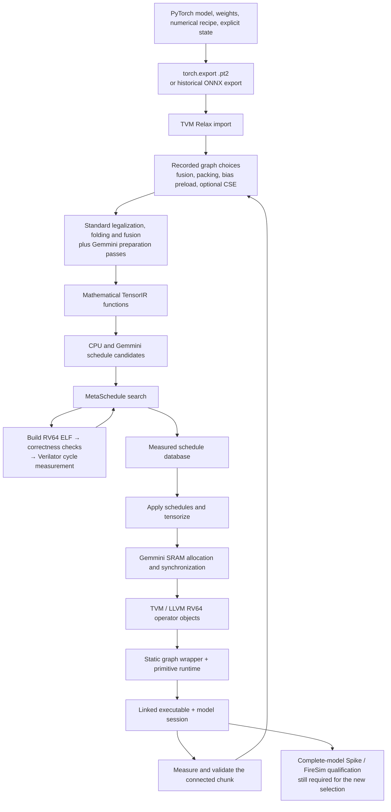

# TVM Gemmini Generation

For additional optimization/DSE proposals use
[OPTIMIZATION_KNOBS.md](OPTIMIZATION_KNOBS.md): it separates existing traced
decisions from proposed integration and requires general IR-derived rules.
The FireSim driver now exposes the existing FuseOps level and saves its Relax
Trace; host-only DSE and bounded im2col packing remain additional work.

New numerical releases follow [CURRENT_RUN_POLICY.md](../../numerics/CURRENT_RUN_POLICY.md).
Calibration scales and rounding/bias semantics are fixed numerical inputs,
not performance knobs. [TUNING_PLAN.md](TUNING_PLAN.md) records the next
profile-directed DSE scope; [ADAPTER_CONTRACT.md](ADAPTER_CONTRACT.md) defines
the required live cutoff. The ownership/implementation inventory below remains
the compiler reference; it does not imply that every listed choice was searched
in the October 26 F2 campaigns.

Updated 2026-10-24 after the bounded FASED-memory tuning study.

The current integration is a **Gemmini backend implemented inside a TVM fork**, with TVM controlling mathematical lowering, scheduling, tensorization, and schedule search. The project supplies the Gemmini-specific hardware descriptions, intrinsic implementations, scheduling rules, memory lowering, runtime, and measurement adapters.

The current implementation exposes generic per-operator schedules through MetaSchedule and 32 graph-preparation alternatives through stock Relax `Knob` / `Choice` / `Trace`. The completed study retains **16 fresh operator records** measured with the FASED latency-pipe Verilator model. The older nine-record `rtl-v1` preset remains historical evidence from a different memory/timing policy.

The 32 configurations need not produce 32 different programs. The follow-up
[tuning plan](TUNING_PLAN.md) records an equality audit, removes duplicate graph
choices from connected measurement, and adds per-operator profiling for actual
stage bottlenecks. It also distinguishes the newer reported F2 results, whose
presets matched no tasks, from the bounded study described below.

The strongest admitted connected result is **25.95% fewer warm cycles for a TinyLlama K/V region**, from 622,531 to 460,958, using optional stock common-subexpression elimination. This is a bounded region result. New complete-model FireSim qualification remains unfinished; the historical ResNet50 FPGA pass does not qualify the new compiled selection.

This account supersedes the earlier “Document TVM-Gemmini integration” chat explanation. It describes the TVM worktree based on `d4480d521` and Merlin worktree based on `36899e8f4`, including the source deltas frozen in the study's `source-final/`. See [FASED_SWEEPS.md](FASED_SWEEPS.md) for exact measurements and source bindings, [PERFORMANCE_AUDIT.md](PERFORMANCE_AUDIT.md) for the memory/mapping audit, and the companion [OWNERSHIP.md](https://github.com/grammy117/tvm/blob/f1e411b1fe57f9fb5983d6cdef45877a6c211485/apps/gemmini/OWNERSHIP.md) for upstream versus extension ownership.

The end-to-end flow is:



The last stage is still a qualification task; the diagram describes both implemented compilation machinery and the intended complete deployment flow.

1. **PyTorch defines the program and numerical contract before TVM chooses its implementation.**

   The starting point includes the checkpoint, input shapes, preprocessing, precision, quantization recipe, and state interfaces. For TinyLlama, this includes explicit KV-cache inputs and outputs; for SmolVLA, it includes the prefix, denoising recurrence, and action decoding.

   The current shared intake accepts a `torch.export` `.pt2` archive and imports it through TVM’s `from_exported_program`. Earlier workflows also use ONNX. Compilation and tuning share the same importer, helping ensure that a measured schedule applies to the program subsequently compiled. See [program_io.py](https://github.com/grammy117/tvm/blob/f1e411b1fe57f9fb5983d6cdef45877a6c211485/apps/gemmini/program_io.py).

   **Quantization is supplied by the model-preparation workflow.** TVM is not automatically deciding that the original floating-point model should become W8A8. The supported Gemmini contraction path primarily operates on signed INT8 inputs and INT32 accumulation; surrounding floating-point arithmetic may remain on the CPU.

   Frontend work therefore has two distinct parts: using TVM’s existing import infrastructure, and extending or fixing it to preserve the exported program’s actual semantics. The fork includes Torch/ONNX fixes for integer arithmetic, quantization patterns, broadcasting, reductions, BF16 handling, and other operators. These are compiler correctness changes, separate from Gemmini instruction selection.

2. **Relax performs graph preparation, using both standard passes and project-specific passes.**

   Relax represents tensor operations and dependencies. After legalization, it also references mathematical TensorIR functions through `call_tir`; it remains responsible for the surrounding graph.

   The optimized preparation path explicitly sequences these **standard TVM passes**:

   | Pass | Role in this integration |
   |---|---|
   | `EliminateCommonSubexpr` | Optional graph choice before legalization; shares repeated pure computations. |
   | `LegalizeOps` | Lowers supported Relax operators to mathematical TE/TIR implementations. |
   | `AnnotateTIROpPattern` | Classifies generated functions for graph-fusion analysis. |
   | `FoldConstant` | Evaluates eligible computations whose inputs are constants. |
   | `CanonicalizeBindings` | Simplifies and normalizes bindings. |
   | `FuseOps` | Forms legal operator-fusion groups. |
   | `FuseTIR` | Combines corresponding TensorIR computations into fused functions. |
   | `RewriteDataflowReshape` | Rewrites eligible reshape computations into higher-level reshape operations. |
   | `DeadCodeElimination` | Removes unused graph content. |

   **These passes were not invented for Gemmini.** The project chooses their ordering and configuration and verifies their interaction with this backend.

   The pipeline then applies **project-supplied preparation inside TVM**:

   | Supplied transformation | Purpose |
   |---|---|
   | `SpecializeGemminiReadoutScales` | Specializes supported constant scale expressions for later readout handling. |
   | `prepack_constants` | Converts eligible constant weights into supported packed layouts and folds the resulting constants. |
   | `CanonicalizeGemminiBias` | Moves eligible integer bias into reduction initialization when equivalence and overflow conditions permit. |
   | `NormalizeGemminiReadout` | Normalizes supported output and scaling chains for recognition. |
   | `AnnotateGemminiWorkloads` | Attaches structural workload identity used during extraction and database application. |

   The source shows this ordering directly in [prepare_gemmini_tensorir_workloads](https://github.com/grammy117/tvm/blob/f1e411b1fe57f9fb5983d6cdef45877a6c211485/python/tvm/relax/backend/contrib/gemmini_tensorir.py).

   Graph search exposes fusion levels 0/1/2/3 × constant packing × bias preload canonicalization × optional CSE: 32 alternatives. All 32 were checked for numerical legality; only a bounded subset was timed. The experiment budget does not limit the compiler to a model-specific plan.

   **A pass implements a legal transformation; a knob lets search decide when it is profitable.** Stock CSE is the concrete example: the TinyLlama K/V fixture goes from six CPU calls to three while its two Gemmini calls and operator/constant bytes remain unchanged. The host wrapper shares the repeated producer. Model names select fixtures and reporting profiles, never compiler behavior. Legality checks, row allocation and required synchronization remain deterministic; adding unsupported memory transitions requires a real implementation and proof before a search knob can select them.

   A useful distinction is that **fusion machinery is standard TVM; proving that a particular fused computation can use a Gemmini primitive is project-specific**. Fusing functions also does not, by itself, establish that an intermediate stays in accelerator SRAM.

3. **TensorIR retains mathematical computation while the schedule determines execution.**

   A contraction initially expresses computation equivalent to:

   ```text
   for i, j:
       C[i, j] = 0
       for k:
           C[i, j] += int32(A[i, k]) * int32(B[k, j])
   ```

   Its blocks describe iteration domains, reduction axes, and buffer reads and writes. Scheduling transforms this representation into an execution structure suitable for Gemmini.

   The project uses ordinary TVM primitives including:

   - `split` and `reorder` for tiling and traversal order.
   - `cache_read` and `cache_write` for explicitly staged operands and outputs.
   - `compute_at` and `reverse_compute_at` for producer/consumer placement.
   - `reindex`, `transform_layout`, and `transform_block_layout` for supported access layouts.
   - `blockize` and `decompose_reduction` for isolating tile computations and initialization.
   - `loop_partition` and `pad_einsum` for supported tails and padding.
   - `tensorize` for replacing matching mathematical regions with registered intrinsic implementations.

   **TVM implements these transformations and their general legality checks. The project specifies how to combine them into legal Gemmini schedules.** The current implementation starts from legalized mathematical functions, unlike the earlier route that generated tiled templates or replaced a whole matmul with an opaque call.

   Convolution can be recognized through its contraction semantics and access maps. The scheduler constructs suitable matrix regions; CPU gathering or staging remains necessary when the original accesses cannot be expressed as rectangular Gemmini transfers.

   The current scheduling choices include:

   | Choice | What it controls | Ownership |
   |---|---|---|
   | M/N/K reuse factors | Number of tiles grouped for reuse and accumulation | Supplied schedule structure; stock `sample_perfect_tile` and mutation |
   | Intrinsic rectangle and tails | Supported tile dimensions within the 16×16 array and treatment of incomplete regions | Supplied intrinsic families and recognition |
   | `ij` versus `ji` traversal | Ordering of output tile groups | Supplied alternatives expressed with stock scheduling |
   | Output-stationary / weight-stationary | Primitive execution/data-reuse strategy | Supplied OS/WS implementations and sketches |
   | Operand hoisting | Retention of an operand across a larger loop region | Supplied capacity policy; stock placement primitives |
   | Software pipelining | Overlap using multiple operand-buffer slots | Supplied annotations; stock pipeline transformation |
   | Producer/epilogue placement | Where staging and surrounding arithmetic execute | Supplied alternatives; stock placement operations |
   | Root versus tile staging | Materialize staging once or within tile processing | Supplied alternatives |
   | Unrolling | Expansion of surrounding loops | Stock scheduling rules and mutation |
   | CPU versus Gemmini | Placement of eligible prepared functions | Supplied union of CPU/device spaces; stock search |

   These are **software scheduling parameters**. Verilator tuning does not change the physical array dimensions, scratchpad capacity, or arithmetic widths. Those are fixed hardware capabilities supplied to the compiler. See [gemmini_sketch.py](https://github.com/grammy117/tvm/blob/f1e411b1fe57f9fb5983d6cdef45877a6c211485/python/tvm/relax/backend/contrib/gemmini_sketch.py).

4. **Memory scopes and intrinsics make Gemmini operations explicit to TVM.**

   The backend defines:

   ```text
   local.gemmini_spad   — operand scratchpad storage
   local.gemmini_acc    — accumulator storage
   ```

   It uses `cache_read` to stage operands into the scratchpad and `cache_write` to place accumulated outputs in accumulator storage. The selected capability profile describes a 16×16 array, 256 KiB scratchpad, 64 KiB accumulator, INT8 inputs, INT32 accumulation, and a 20-bit PE intermediate constraint.

   These facts are explicitly registered; TVM does not discover them from RTL.

   Each registered tensor intrinsic has two parts:

   - A **description** expressing the mathematical effect and buffer constraints.
   - An **implementation** invoking the corresponding Gemmini primitive interface.

   Separate intrinsic families cover operand movement, accumulator initialization, OS/WS computation, output movement, and additional supported operations such as bias, reductions, copy/fill/add/ReLU, and proved scaled readout. The central definitions are in [gemmini_intrin.py](https://github.com/grammy117/tvm/blob/f1e411b1fe57f9fb5983d6cdef45877a6c211485/python/tvm/relax/backend/contrib/gemmini_intrin.py).

   Tensorization substitutes these implementations after TVM has established a matching mathematical region. Thus, TVM still controls the outer loops and data reuse even though the final instruction emission uses C primitive calls.

   **Physical SRAM management requires additional project code.** `gemmini_memory.py` assigns row addresses, checks capacity and alignment, accounts for pipeline buffers, reuses storage across nonoverlapping lifetimes, and inserts required host-DMA waits. This is more than naming a memory scope.

   Several optimizations are currently deterministic lowering choices rather than search knobs: coalescing compatible loads, avoiding redundant configuration commands, using first-K overwrite where initialization permits it, and reusing SRAM across disjoint lifetimes. See [lower_memory](https://github.com/grammy117/tvm/blob/f1e411b1fe57f9fb5983d6cdef45877a6c211485/python/tvm/relax/backend/contrib/gemmini_memory.py).

   The allocator operates within a function. It does not establish persistent intermediates, weights or KV-cache residency across separate functions or model calls.

   The capacity audit found that scratchpad and accumulator sizes are correctly exposed, but the searched contraction ABI supports fewer memory transitions than the pinned RTL. The hardware supports accumulator operand reads and scratchpad output writes; accumulator operands pass through scale/activation to INT8, so they are not arbitrary full-width INT32/FP32 inputs. Current contraction intrinsics take INT8 operands from scratchpad, accumulate INT32 in accumulator, and normally return output to host memory. Additional resident forms need representation, numerical, alias/lifetime and completion proofs.

   Memory use also depends on exact schedule coverage. In the compact ResNet package, the untuned reduction uses 512 B scratchpad / 1,024 B accumulator; the tuned spatial function uses 49,664 B / 8,192 B. Its 8,192-byte intermediate still returns to host memory. SmolVLA's full FP32 concatenation is 288,000 bytes, exceeding either SRAM; retaining that transition would require a legal row/block producer-consumer schedule. These are coverage and representation limits, not evidence of incorrectly declared SRAM capacity.

5. **MetaSchedule tunes operators; an outer graph search measures connected work.**

   The current implementation uses TVM’s standard infrastructure:

   ```text
   extract_tasks
       → schedule-space generation
       → tune_tasks / EvolutionarySearch
       → build and measure candidates
       → XGBModel updates
       → JSONDatabase
       → MetaScheduleApplyDatabase
   ```

   Stock components include task extraction, call-count weights, schedule traces, mutation, evolutionary search, task allocation, XGBoost modeling, and database serialization/application. `ReplayTrace` provides the random-search comparison.

   The integration supplies `GemminiScheduleRule`, legal sketch families, memory verification, compilation and measurement adapters, and a feature adapter. The feature adapter exposes mathematical stores before tensorization postprocessing so the standard feature extractor can distinguish schedules whose final bodies contain external primitive calls. See [gemmini_meta_schedule.py](https://github.com/grammy117/tvm/blob/f1e411b1fe57f9fb5983d6cdef45877a6c211485/python/tvm/relax/backend/contrib/gemmini_meta_schedule.py).

   The measurement loop is concrete:

   1. Generate a candidate schedule and compile a freestanding RV64 executable.
   2. Check it in Spike against an independent mathematical reference, including a deliberately incorrect-reference control.
   3. Execute the positive executable in Verilator with the confirmed latency-pipe model and check every output.
   4. Run one unconditional warmup and one measured invocation on the same buffers. Record target cycles around `model_run`, including CPU epilogue work and completion synchronization; retain first-call timing separately.
   5. Feed successful measurements into MetaSchedule and retain the schedule trace.
   6. Apply a matching record when compiling the corresponding workload.

   **Spike provides functional evidence; Verilator supplies the cycle labels.** Simulator wall-clock time is not the optimization objective.

   The new runner confirms read/write latency **30/30 cycles** and outstanding reads/writes **16/16** in every reported channel. Historical magic-memory costs never enter the fresh measurement database. Matching current traces are replayed and remeasured before comparing candidates. The frozen fallback database uses stock `OrderedUnionDatabase`: a fresh primary match takes precedence, and only a miss consults the historical fallback. The final package reports each function's selected source; historical fallback costs are not fresh labels.

   Connected graph choices are compiled and measured as complete chunks, including CPU glue and host intermediates. Their objective is observed chunk cycles, not the sum of isolated operator minima. Optional CSE plus the fresh operator library reproduces the 460,958-cycle TinyLlama result; library transfer adds no further measured gain.

   | Workload and measurement scope | Admitted warm result | Interpretation |
   |---|---:|---|
   | TinyLlama connected decode K/V, two full M1 K2048 N256 projections | 622,531 → **460,958** | **25.95% lower** through optional CSE; before RoPE/cache updates; architectural surrogate, not a selected EL4 capture. |
   | TinyLlama decode K/V operator | **134,254** | Remeasured current trace wins; new proposals were slower. |
   | TinyLlama prefill K/V operator, M32 K2048 N256 | 602,545 → **601,930** | 0.10% in one sample; near tie. |
   | SmolVLA action-output operator, M50 K720 N32 | 67,811 → **63,322** | **6.62% lower warm cycles**; first-call cycles rise 79,495 → 81,267. |
   | SmolVLA full M50 time concatenation | **68,796** | Complete validation passed on replay with a larger validation allowance; no valid baseline ratio. |
   | ResNet compact-region spatial convolution, full channels | **1,269,090** | Controls capped; no baseline speedup ratio or complete-region result. |

   The ResNet fixture retains full 2048→512→512 channels but crops spatial geometry to a 4×4 halo and 2×2 final output. Its traces cannot be transferred to the full 7×7 layer by name or scaled into a model latency. SmolVLA prefixes retain M50 and all channels; their outputs match independent parent checkpoints. The larger and shorter connected SmolVLA runs and the connected ResNet runs have **no admitted timing**. A printed timing without a completed output check is excluded. TinyLlama's exact MLP up-projection candidates also capped and supplied no winner.

   These remaining boundaries matter when using the results:

   - Matching uses prepared mathematical IR and hardware capabilities, not model names or dimensions alone. ReLU/clip and quantization changes can produce legitimate database misses.
   - The 16-record library has partial coverage. Unsupported CPU-only tasks are excluded from the current inner search; five of seven tasks in the compact SmolVLA transition remain CPU-only. General CPU tuning is still needed.
   - Fusion level is currently a whole-module choice. Per-edge partition choices and cross-function SRAM residency are not implemented.
   - One measured warm invocation and a small proposal budget do not establish convergence or a trained cross-model ranking advantage. Small repeated working sets also differ from full-model cache traffic.
   - Databases retain target cycles in the standard `run_secs` field; these values are not seconds.
   - Exact source, input, reference, schedule trace, memory receipt and ELF bindings are retained. Timeouts, caps and stopped trials remain evidence but supply no valid cost.
   - The final finite-output checker repairs an overflow edge case without changing inference arithmetic or tolerances. Completed evidence retains its original source/ELF attribution.

   All study jobs have stopped. The retained broad regression suite passed **207 tests**; overlapping targeted suites are not added to that count. Documentation checks passed, with nine inherited module-size findings in the structure check. Commands and admission details are in [WORKLOAD_TUNING.md](https://github.com/grammy117/tvm/blob/f1e411b1fe57f9fb5983d6cdef45877a6c211485/apps/gemmini/WORKLOAD_TUNING.md) and [FASED_SWEEPS.md](FASED_SWEEPS.md).

6. **The backend produces ordinary RISC-V code plus Gemmini command calls, followed by custom static packaging.**

   The target remains LLVM/RV64: Rocket executes the generated control code and issues accelerator commands. TVM/LLVM compiles the scheduled functions into operator objects. The project’s primitive adapter implements the Gemmini calls using supported low-level commands.

   Hardware-loop FSM instructions are prohibited by this project’s deployment contract. Software loops, primitive OS/WS commands, and legal buffering remain available.

   The project’s `baremetal.py` exporter walks the static graph, plans host buffers and constants, and emits the `model_run` wrapper and manifests. An external toolchain then links operators, primitive runtime, math support, startup code, and session orchestration.

   **That static graph wrapper is custom integration code**, rather than stock TVM VM or AOT graph code generation. The model-session layer must additionally route state between calls, reset repetitions, check outputs, and account for full-session memory and timing.

TVM and LLVM also perform conventional compiler optimization around this accelerator-specific work:

| Optimization | Where it comes from | Qualification |
|---|---|---|
| Constant folding and dead-code elimination | Standard Relax passes | Explicitly present in the optimized preparation pipeline |
| Arithmetic and index simplification | Standard TIR `Simplify` | Must preserve the selected numerical semantics |
| Common-subexpression elimination | Standard Relax `EliminateCommonSubexpr` and TIR `CommonSubexprElimTIR` | Relax CSE is an outer graph knob; TIR CSE follows build configuration |
| Loop partitioning, condition hoisting, unrolling | Standard TIR passes | Applied according to schedule and pipeline settings |
| Buffer compaction, flattening, storage rewriting | Standard TIR lowering | Distinct from custom Gemmini physical-row allocation |
| No-op elimination | Standard TIR `RemoveNoOp` | General lowering cleanup |
| Instruction selection, register allocation, machine-code optimization | LLVM | Targets the selected RV64 ISA |
| Vectorization and parallelization | Available TVM capabilities | Explicitly disabled in these scheduling rules for the selected single-hart RV64GC target |

The pinned lowering pipeline contains these general passes in [driver_api.cc](https://github.com/grammy117/tvm/blob/f1e411b1fe57f9fb5983d6cdef45877a6c211485/src/driver/driver_api.cc). It would be inaccurate to describe this integration as enabling RVV vectorization.

There is also a third ownership category beyond “stock TVM” and “Gemmini extension”: **general fixes made to the TVM fork**. These include repairs to loop partitioning, block/region metadata, trace replay after illegal mutations, BF16 narrowing, and floating-point division handling. They improve the framework used by the backend, but they are neither new Gemmini scheduling knobs nor unmodified upstream behavior.

The relationship to the papers is explicit:

| Original TVM paper contribution | Corresponding implementation here |
|---|---|
| Graph optimization, §3 | Relax folding, fusion, reshape rewriting, and dead-code elimination |
| Separation of computation and schedule, §4.1 | Mathematical TensorIR remains available before schedule selection |
| Explicit memory scopes, §4.2 | Scratchpad and accumulator scopes plus target lowering |
| Extensible tensorization, §4.3 | Mathematical intrinsic descriptions paired with primitive implementations |
| Memory-latency hiding, §4.4 | Local software-pipeline alternatives and required synchronization |
| Automated schedule optimization, §5 | Supplied search space explored with measured MetaSchedule search |

This is a **modern implementation of the original methodology**. Relax, the current TensorIR abstraction, and MetaSchedule are later infrastructure, so this is not a reproduction of the 2018 software stack. Developer-supplied target knowledge and primitive implementations are consistent with that paper; complete performance claims still require full-workload accounting, including CPU work. [Original TVM paper](https://www.usenix.org/system/files/osdi18-chen.pdf).

The **TensorIR paper** gives the closest architectural explanation. Its block signatures separate tensor computation from surrounding loop structure; transformation primitives alter schedules; intrinsic descriptions connect mathematical regions to hardware implementations; and tensorization-aware search explores sketches. Gemmini’s cache blocks, reduction decomposition, intrinsic pairs, and schedule traces follow that organization. TVM supplies the abstraction and transformations, while the project supplies the hardware-specific semantics and legal alternatives. [TensorIR paper, §§3–4](https://arxiv.org/pdf/2207.04296).

The **RVV paper** follows a similar integration pattern: register instruction-backed intrinsic families, then use MetaSchedule to choose mappings. Its variable-length hardware requires multiple static intrinsic descriptions; it registers progressively smaller VL variants while fixing LMUL to eight. Gemmini instead exposes matrix rectangles, SRAM staging, accumulator behavior, and OS/WS alternatives. The RVV study measures FPGA and commercial hardware; the retained Gemmini operator and connected-chunk evidence uses local Verilator measurements. Consequently, their integration strategy is comparable, but their performance results and deployment evidence are separate. [RVV paper, §§III–IV](https://arxiv.org/pdf/2507.01457).

The current integration status is best stated at these separate levels:

| Area | Supported conclusion |
|---|---|
| Mathematical TensorIR backend | Implemented, with standard schedule transformations and explicit Gemmini intrinsics |
| Scratchpad/accumulator handling | Implemented within functions, including capacity checks and local reuse |
| Operator tuning | Implemented; 16 fresh FASED-memory records, separate from the nine historical `rtl-v1` records |
| Reusable tuned compilation | Implemented through standard database matching and application |
| Workload fixtures | Representative operator and connected chunks with independent references; selected full-model EL4 numerical release remains separate |
| Graph-level search | 32 generic alternatives exposed; measured subset yields a 25.95% connected K/V improvement; no admitted SmolVLA/ResNet connected timing |
| Cross-function/cross-call SRAM residency | Not implemented |
| Complete selected model deployment | Integration and qualification remain unfinished |
| Full-model FireSim performance | Historical ResNet FPGA pass reported; no new qualified full-model result from these sweeps; historical TinyLlama tolerance failure unresolved |

The final FireSim parameter record (`firesim-parameters.json` in the local study product `perf-studies_gemmini-fased-workload-sweeps_v1_20261024T073102Z_36899e8`, not in Git; its validated operator records ship as TVM preset `fased-v1`) contains exact stock traces and sampled decisions, graph choices, primary/fallback selections, cycle scopes, failures, source/ELF identities and the proposed full-session protocol. It explicitly records `ready_to_launch_firesim: false`.

For the complete model path, remaining work is to freeze the shared numerical payloads and independent references, extract and compile every selected stage, audit actual database coverage, verify all outputs and carried state under the original tolerances, and audit the final ELF's memory, instructions and loader compatibility. The selected sessions are one ResNet image, TinyLlama 32-token prefill plus 32 teacher-forced decode calls with cache capacity 64, and SmolVLA prefix plus ten denoise calls plus action decode. One warmup session and three measured sessions with state reset are proposed; the chunk measurements used one warmup and one measured call.

The FireSim image, driver and loader must be bound to the actual deployment. The bitstream archive's `runtime.conf` is not yet byte-verified, and same-ELF FireSim/Verilator timing agreement remains unverified. The newer F2 screenshot is a separate deployment identity. Its approximately 3.23 billion ResNet cycles correspond to about **53.8 seconds at 60 MHz**, not 54 milliseconds. The user's approximate 100× reference is not a controlled baseline, and this study does not claim to close that gap.

The next general compiler extensions are CPU-only task tuning, finer graph partition choices, and a proved row/block residency representation. A useful generic candidate is concat followed by rowwise quantization: traverse the source regions for a shared row maximum/scale and emit INT8 codes without materializing the full FP32 concat, preserving rounding and all live consumers. This is proposed work, not an implemented or credited gain. Recheck those choices with actual exported boundary fixtures and complete stateful sessions before attributing full-model speedups.

The [integration README](README.md) is the deployment entry point; [PERFORMANCE_AUDIT.md](PERFORMANCE_AUDIT.md) contains the full PyTorch-export-to-ELF audit table, and [FASED_SWEEPS.md](FASED_SWEEPS.md) retains the measured results and their limits.
