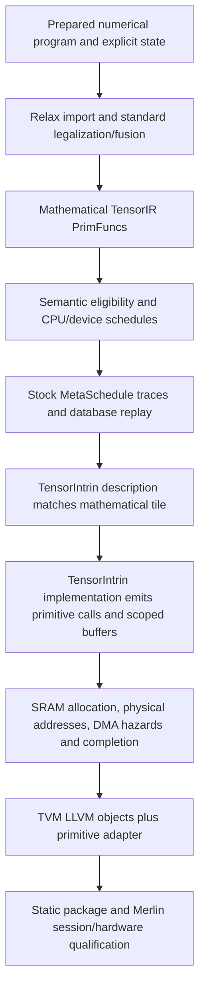

# TVM TensorIR operation and memory audit

**Current preparation release:** [source, checks and restore instructions](../../../../out/artifacts/handoff/gemmini-simplified-tvm/v1/handoff_gemmini-simplified-tvm_v1_20261028T021958Z_dd079d3/README.md).
TVM pin: `619c7c202ff1fe133eceb8fddf3cc9081a6c7e8a`. All 71 unchanged operator
fixtures pass diagnostic Spike with wrong-oracle rejection; fresh extraction
retains 47 contractions/26 owners over 36 chunks. This supersedes local-only
status in historical checkpoints below. Remote/full-model qualification and
spec-pinned oracle provenance remain outstanding.

Audited 2026-10-27. **Keep the compiler interface at mathematical TensorIR plus explicit memory scopes/effects.** The current backend already follows TVM's TensorIntrin design. The latest device extension belongs in that existing path; it does not need per-ATen extern kernels, a separate graph runtime, or a new IR dialect.

## Exact sources and scope

| Source | Audited revision | Meaning |
| --- | --- | --- |
| [Merlin comparisons/tvm-workload-tuning](https://github.com/ucb-bar/merlin/tree/82b321a89a8a646877484f4bd09637040ce0fa26) | `82b321a89a8a646877484f4bd09637040ce0fa26` | Current published integration and shared chunks; E2E protocol is separately pinned to 8ec99308 |
| [TVM firesim-chunks](https://github.com/grammy117/tvm/tree/3423bd6818ab752ddd9cdb5d5773743e48c65f1d) | `3423bd6818ab752ddd9cdb5d5773743e48c65f1d` | Historical compiler pin before the shared-chunk publication |
| [TVM device-ops](https://github.com/grammy117/tvm/tree/42b3c1ef27abe878f930e48b335b24956beb0e56) | `42b3c1ef27abe878f930e48b335b24956beb0e56` | Newly published operation extensions; fetched and inspected directly |
| [Requested software specification](https://github.com/ucb-bar/merlin/blob/8ec99308cb1182b9b896a6075300312266fadf6f/examples/gemmini/target/software-spec.yaml) | `8ec99308cb1182b9b896a6075300312266fadf6f` | Capability/numerical admission comparison, not proof that TVM implements every permitted construction |
| Apache TVM | v0.19.0, `c4dc0c29ff81ddae688da24625a603da3b4a2c0e` | Upstream API/design reference; the integration is a modified TVM fork |

Device-ops is exactly **one commit above the handoff pin**, changing 18 files, +1446/-26 lines. It adds Python/backend/runtime/test code and no TVM C++ changes. This is now verified source, superseding the earlier audit's missing-checkout limitation. The 82b321a89 shared-chunk publication explicitly selects device-ops. Historical ELF, schedule-record and campaign identities remain unchanged; new whole-model qualification is still separate.

Audit work used isolated worktrees. The dirty original Merlin checkout was not switched, merged or reset. The supplied `/home/grammy/...` paths correspond here to restored sources under `/scratch/grammy`; no other user's home directory was accessed.

The audit covers every one of the existing 51 baseline operator fixtures, every current Gemmini semantic family and primitive ABI, the new commit's integration, and the current Torch frontend registration boundary. It does not certify all TVM operators, all argument combinations, arbitrary dynamic programs, or every ONNX schema. The generated frontend inventory lists **149 registered converter keys**; registration alone does not establish successful import, legal TensorIR, device execution, static packaging or model qualification.

## Simplified implementation update

The working compiler at `/scratch/grammy/tvm-gemmini-simple` now removes the
full-domain INT32-add TensorIntrins, including scalar and explicitly wrapping
forms. The original `add.Tensor`, `add.Scalar` and `sub.Scalar` fixtures retain
their mathematical programs, extreme-value inputs and expected outputs; their
new placement is explicitly host arithmetic. The historical counts below are
not relabeled. Current fixture classifications are 5 array, 0 accumulator,
1 narrow ReLU, 21 movement, 4 mixed, 15 host and 5 elided/ABI-copy.

Unbounded standalone INT32 readout has also been removed from byte-affine
admission: its old matcher incorrectly reused a byte-source magnitude bound.
The original extreme-value fixture now executes explicitly on the host.
Producer readout with its contraction/epilogue proof remains available.
Surviving byte affine mappings report accumulator/PE partial-sum bounds.

Contraction and pooling result ranks are restricted to 2–4; standalone
movement/affine/sum ranks stop at five, and per-operand rounded sums require
rank two. Rank-five 3D convolution retains host mathematics. Sum admission
uses `128*K <= INT32_MAX`, including for an INT64 ABI output; the former
`K=2**24` boundary could reach `-2**31` and violate the spec's absolute bound. These are semantic admission checks in the existing matcher,
not graph rewrites. Bounded byte affine/residual command sequences remain.
The 51-original-fixture host/emulator regression passes all 51 subtests, and
the focused elementwise/device suite passes 22 tests plus 92 subtests. Logs are
`out/build/tvm-simplification/spec-baseline51-tests.log` and
`out/build/tvm-simplification/spec-domain-tests.log`.

This closes specific known overbroad cases, not all software-spec obligations.
Selected-scale screens, producer/composition proofs, actual emitted-command
bounds and selected hardware/oracle identities remain separate admission gates.
The current compiler is packaged in the release above; see [the implementation and cost-model
review](OPTIMIZATION_KNOBS.md) for removed custom passes and measurement changes.

A separate diagnostic Spike checkpoint passes 11 cases (six retained device
mappings and five full-i32 host fixtures), with wrong-reference rejection at
exit 22 and 129 checked source/tool/ELF bindings. It precedes the standalone
readout removal and preserves its exact source patch; it is not a claim about
later source identities. The follow-up readout/device regression passes 23 tests
and 30 subtests (`out/build/tvm-simplification/spec-readout-tests.log`). The
checkpoint is local at `out/artifacts/verification/gemmini-tvm-spec-domain/v1/`,
not a published remote delivery or a spec-pinned simulator qualification.

## Strict software-spec admission update (2026-10-27)

**This section supersedes the earlier implementation-based support proposals below.**
Only the exact eleven `operations` declarations in the pinned 8ec99308 YAML are
candidate device contracts. Similar names, a working primitive, or passing a
small fixture cannot add a family or enlarge its domain. The JSON inventory
copies the declarations, obligations, restrictions and transfer contracts from
those exact hashed bytes; it never derives eligibility from an ATen name.

The reviewed declaration is only the first gate. Resolve selected hardware
facts and bind source/provider proofs, every emitted-program obligation,
instruction audits and execution evidence. Missing evidence remains pending.
The current TVM matcher is broader than this strict contract; the audit tool is
not a production admission pass. Do not submit an unproved matched path for
paid runs merely because TVM can compile it. No new custom pattern-forcing pass
has been added.

| Exact YAML declaration (`operations.` prefix) | Current implementation candidate | Strict limit / missing evidence |
| --- | --- | --- |
| `contraction` | i8*i8 -> i32; split/cache/blockize/tensorize; OS/WS primitive compute | Every retained PE partial <=524287 and accumulator partial <=2147483647, including seed; all logical ranks/layout/tails and raw-exit audit required. |
| `elementwise_map` | Producer readout: explicit f32 product, RNE, saturation, optional ReLU | Selected scheme and multiplier bits, scalar command partition, nonnegative scale/order proof, pinned RNE oracle; threshold proof alone does not discharge all emission audits. |
| `elementwise_map_standalone` | Same-shape one/two widened byte terms with signed-byte coefficients and constant i32 bias | Bound all prefixes. Full-domain wrapping i32 add/sub/scalar-add is outside bounded-exact admission; standalone full-i32 readout needs its own bound/identity proof. |
| `elementwise_map_after_operand_sum` | Exact byte sum followed by a single proved narrow readout | Use this exact rounding contract; no bias epilogue; per-scale exhaustive contract and emission evidence remain required. |
| `elementwise_map_after_per_operand_sum` | Two independently rounded/saturated byte operands, exact i32 sum, proved narrow readout | Rank 2 only, no broadcast/bias/pool/raw exit. Screen all 65536 pairs for EVERY scale triple; current two fixtures do not admit arbitrary triples or ranks. |
| `pooling_on_readout` | Existing standalone matcher gathers a window, widens to accumulator, and emits pooled mvout | Declaration is fused readout, not blanket standalone maxpool. Require selected composition/producer proof and complete region audit. Gathered padding is host work, not an implicit padded-pool capability. |
| `reduction_standalone` | Bounded widened-i8 sum; already-present selected reciprocal/readout for window mean | Resolve standalone hardware facts. Mesh-against-ones must separately satisfy contraction rank/bounds; arbitrary f32/i64 reduction is not admitted by similarity. |
| `movement` | Materialized static copies, broadcasts, uniform fills and selectors; legal views can be elided | Resolve actual standalone movement forms/facts and each selector/alias proof. i32/f32 accumulator-carrier copies are not the F1 int8-transfer implementation. |
| `movement_bitwise` | Opaque byte-copy TensorIntrin for bool/i16/f16/bf16/i64/f64; existing i8 DMA | Explicit declared dtype/rank, closed selectors, LE byte storage, disjointness, unit scale, no pooling, nonzero address, bounded rows/bytes. complex<f32> is declared but not implemented. |
| `component_linear` | No general signed-radix-256 component lowering in this TVM branch | Do not relabel byte affine as full integer component support. Requires WS-only component proof and exact host recombination. |
| `component_bilinear` | No general multi-limb bilinear lowering in this TVM branch | Requires WS-only component proof, raw full-i32 exits, bounded partials and exact host recombination; no float/int64 arithmetic inference. |

The historical 51 are **fixtures**, not 51 hardware arithmetic units. Their
old classifications (5 array, 3 accumulator, 1 ReLU, 21 movement, 4 mixed,
12 host, 5 elided/ABI-copy) remain execution history. In particular, the three
full-i32 accumulator fixtures wrap at dtype boundaries: passing them on Spike
does **not** admit them under the bounded-exact affine declaration. No old
fixture was silently rewritten to an i8-source example to inflate support.

In this table, “candidate” always means proof/qualification pending; no row is
unconditionally execution-admitted. Declaration references identify only the
device subregion, not all host arithmetic of the named source operator.

| Historical fixture | Exact declaration candidate | Strict disposition |
| --- | --- | --- |
| `mm` | `contraction` | device_subregion_candidate |
| `bmm` | `contraction` | device_subregion_candidate |
| `addmm` | `contraction` | device_subregion_candidate |
| `convolution` | `contraction` | device_subregion_candidate |
| `convolution_backward` | `movement` | host_arithmetic_with_movement_candidate |
| `add.Tensor` | `elementwise_map_standalone` | outside_declared_exact_domain |
| `sub.Tensor` | None for this typed fixture | host_only_for_baseline |
| `add.Scalar` | `elementwise_map_standalone` | outside_declared_exact_domain |
| `sub.Scalar` | `elementwise_map_standalone` | outside_declared_exact_domain |
| `mul.Scalar` | None for this typed fixture | host_only_for_baseline |
| `div.Scalar` | None for this typed fixture | host_only_for_baseline |
| `neg` | None for this typed fixture | host_only_for_baseline |
| `relu` | `elementwise_map_standalone` | device_subregion_candidate |
| `mean.dim` | None for this typed fixture | host_only_for_baseline |
| `avg_pool1d` | `movement` | host_arithmetic_with_movement_candidate |
| `avg_pool2d` | `movement` | host_arithmetic_with_movement_candidate |
| `avg_pool3d` | `movement` | host_arithmetic_with_movement_candidate |
| `adaptive_avg_pool1d` | None for this typed fixture | host_only_for_baseline |
| `_adaptive_avg_pool2d` | None for this typed fixture | host_only_for_baseline |
| `_adaptive_avg_pool3d` | None for this typed fixture | host_only_for_baseline |
| `avg_pool2d_backward` | None for this typed fixture | host_only_for_baseline |
| `_adaptive_avg_pool2d_backward` | None for this typed fixture | host_only_for_baseline |
| `col2im` | None for this typed fixture | host_only_for_baseline |
| `clone` | `movement` | elided_or_host_abi_copy |
| `repeat` | `movement`, `movement_bitwise` | movement_or_view_candidate |
| `cat` | `movement`, `movement_bitwise` | movement_or_view_candidate |
| `slice_scatter` | `movement` | movement_facts_required |
| `select_scatter` | `movement` | movement_facts_required |
| `fill.Scalar` | `movement` | elided_or_host_abi_copy |
| `full` | `movement` | elided_or_host_abi_copy |
| `full_like` | `movement` | elided_or_host_abi_copy |
| `constant_pad_nd` | `movement`, `movement_bitwise` | movement_or_view_candidate |
| `reflection_pad1d` | `movement`, `movement_bitwise` | movement_or_view_candidate |
| `reflection_pad2d` | `movement`, `movement_bitwise` | movement_or_view_candidate |
| `reflection_pad3d` | `movement`, `movement_bitwise` | movement_or_view_candidate |
| `replication_pad2d` | `movement`, `movement_bitwise` | movement_or_view_candidate |
| `replication_pad3d` | `movement`, `movement_bitwise` | movement_or_view_candidate |
| `_to_copy` | `elementwise_map_standalone` | widening_candidate |
| `as_strided` | `movement` | movement_facts_required |
| `diagonal` | `movement`, `movement_bitwise` | movement_or_view_candidate |
| `permute` | `movement`, `movement_bitwise` | movement_or_view_candidate |
| `scalar_tensor` | `movement` | elided_or_host_abi_copy |
| `select.int` | `movement` | movement_facts_required |
| `slice.Tensor` | `movement`, `movement_bitwise` | movement_or_view_candidate |
| `split_with_sizes` | `movement` | movement_facts_required |
| `squeeze.dim` | `movement` | movement_facts_required |
| `squeeze.dims` | `movement` | movement_facts_required |
| `unsqueeze` | `movement`, `movement_bitwise` | movement_or_view_candidate |
| `view` | `movement`, `movement_bitwise` | movement_or_view_candidate |
| `mean.default` | None for this typed fixture | host_only_for_baseline |
| `sum.dim_IntList` | `reduction_standalone`, `contraction` | device_subregion_candidate |

Reproduce the complete machine-readable derivation with
`audit_software_spec.py --spec PINNED_YAML --tvm TVM_CHECKOUT --output NEW_JSON`.
The script refuses altered specification bytes and any unclassified baseline
operator. See [all exact declarations](../../../../out/artifacts/handoff/gemmini-firesim-elf-plan/v1/handoff_gemmini-firesim-elf-plan_v1_20261027T235144Z_82b321a/audit-evidence/spec-derived-ops.json) and
[all 51 explanations](../../../../out/artifacts/handoff/gemmini-firesim-elf-plan/v1/handoff_gemmini-firesim-elf-plan_v1_20261027T235144Z_82b321a/audit-evidence/baseline51-strict.csv).

**Changes actually made:** a shared `default_device_schedule` now dispatches
the tuning driver's default/fallback baseline through the existing contraction,
reduction, pooling and elementwise schedule functions. It returns ordinary
TensorIR schedules; search, mathematics, memory lowering and TensorIntrin
registration are unchanged. Verification bundles now bind affine, byte, pool,
sketch and device-fixture sources that were previously missing from their
source list. No new mathematical family, host optimization pass, graph search
axis, numerical recipe or physical memory convention was introduced.

**Fresh execution:** all 51 historical fixtures and 20 device-extension fixtures
pass the restored Spike model, with wrong-oracle controls. A targeted spec RNE
counterexample fails that model (exit 22): `664 * float32(1/166)` must narrow to
4. The isolated one-line repaired diagnostic extension passes the counterexample,
all 71 fixtures, and their wrong-oracle controls. Its binary SHA256 is
`9e80eb15d04c4a8135fde037ff80500035344c758761345bd5cd76608dfe285e`.
This is a new local build, not the unavailable spec-pinned oracle binary and not
RTL/FireSim evidence. General scaled-readout admission remains gated.

Six focused contraction/memory-sketch tests also pass, covering capacity, pipeline storage, DMA coalescing/waits and JSON trace replay. Device schedule tests pass: 5 tests and 29 subtests, including seven new
non-contraction baseline/trace/memory-lowering checks. No new FireSim cycles
have been measured. The three-model scope, revised 4h/1h/1h tuning budgets, unresolved recipe
conflicts and actual preparation state are in [FIRESIM_HANDOFF.md](FIRESIM_HANDOFF.md).

## Earlier implementation inventory (not an admission whitelist)

The source inventory below describes what the existing backend can emit. Its
per-overload proposals are historical audit context and must be filtered by
the exact declaration/domain decisions above.

## Earlier findings and proposals

| Finding | Current state | Proposed change |
| --- | --- | --- |
| Shared chunks now select device-ops | Merlin `82b321a89` names TVM `42b3c1ef2` | Rebuild current source-bound packages; preserve previous compiler/ELF identities and distinguish source selection from full-model qualification. |
| Backend methodology matches the requested design | Mathematical TIR -> schedule -> TensorIntrin -> physical memory lowering -> primitive C ABI | Retain it. Add coverage through semantic matchers, descriptions/implementations and normal schedule traces. |
| Non-contraction tuning application has an integration gap | `_supported` admits elementwise/sum/pool, but `tune_models.py` default baselines call contraction-only `default_schedule` | Introduce a shared semantic-family default-schedule dispatcher returning a normal `tir.Schedule`; use it for baselines and fallback records. This is orchestration repair, not a new search algorithm or performance knob. |
| New affine support is deliberately narrower than the spec | <=2 same-shape/index byte-source terms, signed-byte coefficients, constant i32 offset; no general outer broadcast or wide-int arithmetic | Publish those exact typed contracts. Extend broadcast only when an actual workload needs it and TensorIR access/alias proofs exist. Keep unmatched i32/FP32 arithmetic on CPU. |
| Group16 native scale fusion is partial | Frozen scales preserved; nonuniform groups can retain raw-i32 device result + original CPU rescaling | Preserve semantics. A future scale-partitioned readout schedule must use exact group/tail values and prove ordering; never average scales to force fusion. |
| Byte movement is not all-dtype construction/conversion | New bool/i16/f16/bf16/i64/f64 copies/broadcasts; literal matcher remains i8/i32/f32 | Distinguish copied scalar bits from newly constructed literals. Optional extra literal-fill TensorIntrins need exact bit semantics; mixed CPU fill/device copy remains valid. Complex storage and wider arithmetic remain outside this minimal set. |
| Tests establish only their stated boundary | New source includes TE/TIR fixtures, replay/design-space tests and Spike guest tooling; source inspection is not a new run | Add family-dispatch CLI tests, fresh-process database replay and actual frontend-to-device examples before calling every family fully integrated in the tuning application. Requalify source-bound adapter/guest execution before adoption. |

The default-baseline issue is a source-level finding, not an observed new failing run. `apps/gemmini/tune_models.py:333` admits all `_supported` kinds. At lines 563/578/624 it calls `gemmini_sketch.default_schedule`; that function at line 537 requires exactly one supported contraction. Non-contraction default baselines therefore record a failure instead of establishing the intended device baseline. Search can still generate non-contraction sketches, and a matching validated seed/current record may supply an incumbent. Under moving-cutoff policy, missing validated incumbents can defer a task. Do not equate design-space visibility with complete baseline/measurement integration.

## Current interface and expected TVM extension pattern

TVM's [v0.19 TensorIntrin API](https://github.com/apache/tvm/blob/v0.19.0/python/tvm/tir/function.py#L166) explicitly pairs a mathematical `desc` PrimFunc with an execution `impl` PrimFunc. Its [Schedule API](https://github.com/apache/tvm/blob/v0.19.0/python/tvm/tir/schedule/schedule.py) provides scheduling and tensorization. Calling a target C primitive from an intrinsic implementation is an appropriate use of this interface; the hardware primitive remains target-supplied, rather than something TVM discovers automatically.

The semantic boundary should be a normal typed PrimFunc. Examples are `C[i,j] += cast(i32,A[i,k])*cast(i32,B[k,j])`, `Y[i]=a*cast(i32,X[i])+b*cast(i32,Z[i])+c`, `Y[i]=sum(cast(i32,X[selector(i,k)]))`, and `Y[i]=X[static_selector(i)]`. The last pattern is movement, not payload arithmetic. Explicit casts, overflow, init values, selectors, layout and rounding are part of the pattern; source overload names are traceability only.

The current implementation uses:

- `LegalizeOps`, `AnnotateTIROpPattern`, folding, bindings, `FuseOps`/`FuseTIR`, reshape rewriting and DCE, plus explicit target preparation for weight packing, bias and readout.
- `split`, `reorder`, `cache_read`/`cache_write`, `compute_at`/`reverse_compute_at`, reindex/layout transforms, blockization, reduction decomposition and tensorization. Ordinary TVM traces retain these choices.
- `TensorIntrin.register` through `register_intrinsic_once`; descriptions express mathematics and implementations issue scoped primitive commands. New affine and byte-copy families use this same registry.
- `GemminiScheduleRule`, a CPU/device union of stock schedule generators, `RewriteTensorize`, `VerifyGemminiMemory`, stock EvolutionarySearch/XGB/JSONDatabase and `MetaScheduleApplyDatabase`. Secondary elementwise/reduction rules have conservative rectangular/scalar alternatives; they do not introduce a separate optimizer.
- Pooling uses ordinary `Schedule.tensorize` before stock reduction decomposition, because its intrinsic includes initialization. The resulting trace is replayable; not every legal target intrinsic must wait for `RewriteTensorize`.

Keep memory semantics explicit through `local.gemmini_spad`, `local.gemmini_acc`, read/write regions and access pointers. After tensorization, `gemmini_memory.lower_memory` assigns physical SRAM rows and rewrites primitive arguments. This target lowering is necessary and fits the TensorIR boundary. It is not a reason to put physical addresses or command encodings in frontend graphs.

The target is currently LLVM RV64GC with explicit `gemmini`/`cpu` dispatch keys and a capability fingerprint. There is no native Gemmini TargetKind requirement for this design. Deployment uses a project static graph/archive exporter and Merlin's session bridge, rather than stock Relax VM/AOT execution in the guest. These are existing custom integration surfaces and must remain explicit in claims about “TVM support.” Legacy BYOC/template APIs are retained references, not the current path.

Merlin owns preparation, numerical policy, independent references, orchestration/session/hardware binding. TVM contrib and its adapter own the trusted comparison backend's target matching, schedules, intrinsics and SRAM/ISA lowering. Shared Merlin core must not gain Gemmini-specific operation dispatch or ISA constants.

## Complete current device family list

`Prev` means present at `3423bd681`; `New` means verified at `42b3c1ef2`. “Available” means code and described typed path exist, not unconditional frontend overload coverage, measured profitability or fresh hardware qualification.

| Mathematical family | Status | Actual handling and boundary |
| --- | --- | --- |
| i8 x i8 -> i32 contractions: mm/bmm/linear/convolution/attention products | Prev | Contraction normalization, OS/WS sketches, operand cache TensorIntrins and primitive mesh calls. Independent batches and legal access maps; gathering/packing may remain CPU. Softmax/rotary are separate. |
| i32 contraction seed/bias, eligible addmm | Prev | Bias equivalence/bounds normalization then full-width unscaled accumulator seed once. Arbitrary FP32 bias or arbitrary alpha/beta is not automatically admitted. |
| i32 tensor/scalar addition, explicitly wrapped forms | Prev | Accumulator overwrite/add DMA; includes matched broadcast forms. Preserve modulo-32 vs bounded-exact semantics; no generic all-integer claim. |
| i8 -> i32 signed widening | Prev | Unit-scale shrunk accumulator load. It remains in the copy-offload policy rather than being globally enabled. |
| i8 ReLU | Prev | Widen then identity-scale native narrow activation; producer epilogues use the separate readout proof. FP32 ReLU stays CPU. |
| Fused scalar scaled/RNE/saturated i8 readout, optional ReLU | Prev | Monotone output-code threshold equality over the full signed-i32 domain. Positive finite scalar scale; supported divisions are positive powers of two; unacceptable chains retain CPU. |
| Bounded byte-source sums/window sums | Prev | Reindex/flatten axes and mesh reduction against ones. Prefix bound and selected i64 output conversion; this is not native i64 summation. |
| i8/i32/f32 copies, scalar broadcast and uniform literal fills | Prev | Copy/fill TensorIntrins and rectangular static region machinery. FP32 copy is bit-preserving. Compile-time constants/views can eliminate the work. |
| Static pad/concat/repeat/permute/slice/select/scatter/diagonal | Prev machinery, New dtype reach | Legal views elide; materialized disjoint outputs use proved regions. Static selector/alias proof required; no generic runtime scatter or implicit hardware transpose. Some producer/fill work can remain CPU. |
| bool/i16/f16/bf16/i64/f64 opaque movement | New | Byte-copy intrinsic using existing scratchpad DMA. Byte-addressed offsets/extents and strides; <=16 physical rows and <=16 bytes/row. No numeric cast, complex type, or floating arithmetic. |
| Bounded byte-source affine: a*x+b*y+c, subtraction, negation, scalar coefficients | New | 1–2 widened i8 terms; coefficients in [-128,127], nonzero; constant i32 offset; conservative accumulator-prefix bound. Same shape and identical pointwise indices, no arbitrary outer broadcasting. Unit terms use loads; other coefficients use WS K=1 mesh. Conservative one-column tiles. |
| Single-rounding residual | New | Exact two-byte i32 sum then one proved i8 readout, optionally ReLU. Distinct from per-operand rounding. |
| Per-operand-rounding residual | New | Each byte has a proved positive scale <=1 and i8 RNE/saturation before i32 sum; two unit-coefficient terms, zero offset, narrow output. No raw-i32 exit/bias for this scaled family. |
| Standalone i32 -> scaled/RNE/saturated/ReLU i8 | New integration | Raw i32 load and existing narrow store recognized as `affine_i8`; common default placement/search can select it. Not a generic FP32 round/clamp primitive. |
| Quantized mean/window-average epilogue | New | Existing bounded sum plus already-present proved scalar readout, including eligible FP32 reciprocal factors. Output layout reconstruction remains explicit. FP32 average ops are not silently quantized. |
| Values-only signed-i8 max over 4 or 9 terms (2x2/3x3 physical window) | New | Gather complete window in host TIR, widen to accumulator, device pooled readout. One output window per command group. Explicit source padding is gathered too, so negative padding values need not be replaced by implicit hardware zero. No indices or general floating maximum. |
| View/alias/reshape/squeeze/unsqueeze/split | Prev | Metadata where legal; otherwise materialized copy under normal policy. Metadata-only work is not counted as accelerator arithmetic. |

The existing 51-fixture categories are **5 array, 3 accumulator, 1 narrow ReLU, 21 movement, 4 movement+CPU, 12 CPU, 5 elided/ABI-copy**. They are exact historical fixture contracts retained in current source. They do not change merely because a new different typed pattern is admitted. In particular, the old INT32 sub/mul/neg and FP32 mean/pool fixtures are not made device operations by the new byte-source/quantized matchers.

Copy offload is still `offload_copies=False` by default. A measured database schedule is applied before the deterministic copy gate and can choose device movement. Arithmetic kinds `add_i32*`, `relu_i8` and `affine_i8` are exempt from that copy gate; reduction/pool families have their own routes. Always report actual selected placement and surviving CPU payload work.

## Every baseline operation

The companion CSV retains separate handoff-path and device-ops-path columns and converter keys. This table explains the latest typed path and any proposed change. The fixture column is the unchanged explicit small fixture classification, not a universal overload label.

| Operator | Existing fixture | Current device-ops handling | Proposed change / boundary |
| --- | --- | --- | --- |
| mm | array | C += cast(i32,A_i8)*cast(i32,B_i8); optional i32 bias init. Convolution/batches normalize to matrix regions; packing may be CPU. | Retain current TensorIR/TensorIntrin path and typed refusal checks. |
| bmm | array | C += cast(i32,A_i8)*cast(i32,B_i8); optional i32 bias init. Convolution/batches normalize to matrix regions; packing may be CPU. | Retain current TensorIR/TensorIntrin path and typed refusal checks. |
| addmm | array | C += cast(i32,A_i8)*cast(i32,B_i8); optional i32 bias init. Convolution/batches normalize to matrix regions; packing may be CPU. | Retain current TensorIR/TensorIntrin path and typed refusal checks. |
| convolution | array | C += cast(i32,A_i8)*cast(i32,B_i8); optional i32 bias init. Convolution/batches normalize to matrix regions; packing may be CPU. | Retain current TensorIR/TensorIntrin path and typed refusal checks. |
| convolution_backward | movement + CPU | Baseline FP32 arithmetic remains CPU; legal gather/copy stages can independently use DMA. Overlap sum is not a copy. | Retain current TensorIR/TensorIntrin path and typed refusal checks. |
| add.Tensor | accumulator | NEW: one/two same-shape i8 loads widened to i32, signed-byte coefficients, constant i32 offset; optional proved i8 narrow. Existing i32 add remains; general i32 sub/mul/neg remains CPU. | No replacement kernel needed. Keep full-range i32 arithmetic on CPU; outer broadcast/general coefficients need new semantic proof and matching, not an unconditional overload label. |
| sub.Tensor | CPU | NEW: one/two same-shape i8 loads widened to i32, signed-byte coefficients, constant i32 offset; optional proved i8 narrow. Existing i32 add remains; general i32 sub/mul/neg remains CPU. | No replacement kernel needed. Keep full-range i32 arithmetic on CPU; outer broadcast/general coefficients need new semantic proof and matching, not an unconditional overload label. |
| add.Scalar | accumulator | NEW: one/two same-shape i8 loads widened to i32, signed-byte coefficients, constant i32 offset; optional proved i8 narrow. Existing i32 add remains; general i32 sub/mul/neg remains CPU. | No replacement kernel needed. Keep full-range i32 arithmetic on CPU; outer broadcast/general coefficients need new semantic proof and matching, not an unconditional overload label. |
| sub.Scalar | accumulator | NEW: one/two same-shape i8 loads widened to i32, signed-byte coefficients, constant i32 offset; optional proved i8 narrow. Existing i32 add remains; general i32 sub/mul/neg remains CPU. | No replacement kernel needed. Keep full-range i32 arithmetic on CPU; outer broadcast/general coefficients need new semantic proof and matching, not an unconditional overload label. |
| mul.Scalar | CPU | NEW: one/two same-shape i8 loads widened to i32, signed-byte coefficients, constant i32 offset; optional proved i8 narrow. Existing i32 add remains; general i32 sub/mul/neg remains CPU. | No replacement kernel needed. Keep full-range i32 arithmetic on CPU; outer broadcast/general coefficients need new semantic proof and matching, not an unconditional overload label. |
| div.Scalar | CPU | NEW: standalone i32->i8 proved scalar readout integrates via affine_i8. Generic division and baseline i32 division remain CPU. | Retain current TensorIR/TensorIntrin path and typed refusal checks. |
| neg | CPU | NEW: one/two same-shape i8 loads widened to i32, signed-byte coefficients, constant i32 offset; optional proved i8 narrow. Existing i32 add remains; general i32 sub/mul/neg remains CPU. | No replacement kernel needed. Keep full-range i32 arithmetic on CPU; outer broadcast/general coefficients need new semantic proof and matching, not an unconditional overload label. |
| relu | readout ReLU | max(i8 load,0) -> widening + narrow ReLU intrinsic. Contraction epilogue uses separately proved readout. Generic f32 ReLU -> CPU. | Retain current TensorIR/TensorIntrin path and typed refusal checks. |
| mean.dim | CPU | NEW: bounded byte-source sum can fuse an already-present proved scaled i8 readout. Generic baseline FP32 mean/pool remains CPU. | Do not auto-quantize FP32 pools. Normalize only prepared quantized sum/divisor semantics; unmatched rounding/layout keeps CPU tail. |
| avg_pool1d | movement + CPU | NEW: bounded byte-source sum can fuse an already-present proved scaled i8 readout. Generic baseline FP32 mean/pool remains CPU. | Do not auto-quantize FP32 pools. Normalize only prepared quantized sum/divisor semantics; unmatched rounding/layout keeps CPU tail. |
| avg_pool2d | movement + CPU | NEW: bounded byte-source sum can fuse an already-present proved scaled i8 readout. Generic baseline FP32 mean/pool remains CPU. | Do not auto-quantize FP32 pools. Normalize only prepared quantized sum/divisor semantics; unmatched rounding/layout keeps CPU tail. |
| avg_pool3d | movement + CPU | NEW: bounded byte-source sum can fuse an already-present proved scaled i8 readout. Generic baseline FP32 mean/pool remains CPU. | Do not auto-quantize FP32 pools. Normalize only prepared quantized sum/divisor semantics; unmatched rounding/layout keeps CPU tail. |
| adaptive_avg_pool1d | CPU | NEW: bounded byte-source sum can fuse an already-present proved scaled i8 readout. Generic baseline FP32 mean/pool remains CPU. | Do not auto-quantize FP32 pools. Normalize only prepared quantized sum/divisor semantics; unmatched rounding/layout keeps CPU tail. |
| _adaptive_avg_pool2d | CPU | NEW: bounded byte-source sum can fuse an already-present proved scaled i8 readout. Generic baseline FP32 mean/pool remains CPU. | Do not auto-quantize FP32 pools. Normalize only prepared quantized sum/divisor semantics; unmatched rounding/layout keeps CPU tail. |
| _adaptive_avg_pool3d | CPU | NEW: bounded byte-source sum can fuse an already-present proved scaled i8 readout. Generic baseline FP32 mean/pool remains CPU. | Do not auto-quantize FP32 pools. Normalize only prepared quantized sum/divisor semantics; unmatched rounding/layout keeps CPU tail. |
| avg_pool2d_backward | CPU | Baseline FP32 arithmetic remains CPU; legal gather/copy stages can independently use DMA. Overlap sum is not a copy. | Retain current TensorIR/TensorIntrin path and typed refusal checks. |
| _adaptive_avg_pool2d_backward | CPU | Baseline FP32 arithmetic remains CPU; legal gather/copy stages can independently use DMA. Overlap sum is not a copy. | Retain current TensorIR/TensorIntrin path and typed refusal checks. |
| col2im | CPU | Baseline FP32 arithmetic remains CPU; legal gather/copy stages can independently use DMA. Overlap sum is not a copy. | Retain current TensorIR/TensorIntrin path and typed refusal checks. |
| clone | elided / ABI copy | Legal view elides; materialized static selection/copy/fill regions use existing i8/i32/f32 movement TensorIntrins. In-place aliasing and unproved selectors refuse. NEW: region machinery can select opaque bool/i16/f16/bf16/i64/f64 copies; per-region tensorization still must succeed. | Keep views elided and copy offload opt-in/measured. Audit literal fill regions separately for new dtype padding; unsupported residual host work stays visible. |
| repeat | movement | Legal view elides; materialized static selection/copy/fill regions use existing i8/i32/f32 movement TensorIntrins. In-place aliasing and unproved selectors refuse. NEW: region machinery can select opaque bool/i16/f16/bf16/i64/f64 copies; per-region tensorization still must succeed. | Keep views elided and copy offload opt-in/measured. Audit literal fill regions separately for new dtype padding; unsupported residual host work stays visible. |
| cat | movement | Legal view elides; materialized static selection/copy/fill regions use existing i8/i32/f32 movement TensorIntrins. In-place aliasing and unproved selectors refuse. NEW: region machinery can select opaque bool/i16/f16/bf16/i64/f64 copies; per-region tensorization still must succeed. | Keep views elided and copy offload opt-in/measured. Audit literal fill regions separately for new dtype padding; unsupported residual host work stays visible. |
| slice_scatter | movement | Legal view elides; materialized static selection/copy/fill regions use existing i8/i32/f32 movement TensorIntrins. In-place aliasing and unproved selectors refuse. NEW: region machinery can select opaque bool/i16/f16/bf16/i64/f64 copies; per-region tensorization still must succeed. | Keep views elided and copy offload opt-in/measured. Audit literal fill regions separately for new dtype padding; unsupported residual host work stays visible. |
| select_scatter | movement | Legal view elides; materialized static selection/copy/fill regions use existing i8/i32/f32 movement TensorIntrins. In-place aliasing and unproved selectors refuse. NEW: region machinery can select opaque bool/i16/f16/bf16/i64/f64 copies; per-region tensorization still must succeed. | Keep views elided and copy offload opt-in/measured. Audit literal fill regions separately for new dtype padding; unsupported residual host work stays visible. |
| fill.Scalar | elided / ABI copy | Uniform i8/i32/f32 literal or scalar-source fills; constant folding often removes them. Scalar DMA uses constrained one-column forms. Six extra byte types support scalar-source copies; literal-fill matcher remains restricted to i8/i32/f32. | Optional: add bit-exact literal-fill descriptions for extra storage types, with padding-completeness checks; do not claim these are already generic. |
| full | elided / ABI copy | Uniform i8/i32/f32 literal or scalar-source fills; constant folding often removes them. Scalar DMA uses constrained one-column forms. Six extra byte types support scalar-source copies; literal-fill matcher remains restricted to i8/i32/f32. | Optional: add bit-exact literal-fill descriptions for extra storage types, with padding-completeness checks; do not claim these are already generic. |
| full_like | elided / ABI copy | Uniform i8/i32/f32 literal or scalar-source fills; constant folding often removes them. Scalar DMA uses constrained one-column forms. Six extra byte types support scalar-source copies; literal-fill matcher remains restricted to i8/i32/f32. | Optional: add bit-exact literal-fill descriptions for extra storage types, with padding-completeness checks; do not claim these are already generic. |
| constant_pad_nd | movement | Legal view elides; materialized static selection/copy/fill regions use existing i8/i32/f32 movement TensorIntrins. In-place aliasing and unproved selectors refuse. NEW: region machinery can select opaque bool/i16/f16/bf16/i64/f64 copies; per-region tensorization still must succeed. | Keep views elided and copy offload opt-in/measured. Audit literal fill regions separately for new dtype padding; unsupported residual host work stays visible. |
| reflection_pad1d | movement | Legal view elides; materialized static selection/copy/fill regions use existing i8/i32/f32 movement TensorIntrins. In-place aliasing and unproved selectors refuse. NEW: region machinery can select opaque bool/i16/f16/bf16/i64/f64 copies; per-region tensorization still must succeed. | Keep views elided and copy offload opt-in/measured. Audit literal fill regions separately for new dtype padding; unsupported residual host work stays visible. |
| reflection_pad2d | movement | Legal view elides; materialized static selection/copy/fill regions use existing i8/i32/f32 movement TensorIntrins. In-place aliasing and unproved selectors refuse. NEW: region machinery can select opaque bool/i16/f16/bf16/i64/f64 copies; per-region tensorization still must succeed. | Keep views elided and copy offload opt-in/measured. Audit literal fill regions separately for new dtype padding; unsupported residual host work stays visible. |
| reflection_pad3d | movement | Legal view elides; materialized static selection/copy/fill regions use existing i8/i32/f32 movement TensorIntrins. In-place aliasing and unproved selectors refuse. NEW: region machinery can select opaque bool/i16/f16/bf16/i64/f64 copies; per-region tensorization still must succeed. | Keep views elided and copy offload opt-in/measured. Audit literal fill regions separately for new dtype padding; unsupported residual host work stays visible. |
| replication_pad2d | movement | Legal view elides; materialized static selection/copy/fill regions use existing i8/i32/f32 movement TensorIntrins. In-place aliasing and unproved selectors refuse. NEW: region machinery can select opaque bool/i16/f16/bf16/i64/f64 copies; per-region tensorization still must succeed. | Keep views elided and copy offload opt-in/measured. Audit literal fill regions separately for new dtype padding; unsupported residual host work stays visible. |
| replication_pad3d | movement | Legal view elides; materialized static selection/copy/fill regions use existing i8/i32/f32 movement TensorIntrins. In-place aliasing and unproved selectors refuse. NEW: region machinery can select opaque bool/i16/f16/bf16/i64/f64 copies; per-region tensorization still must succeed. | Keep views elided and copy offload opt-in/measured. Audit literal fill regions separately for new dtype padding; unsupported residual host work stays visible. |
| _to_copy | movement | NEW: same-dtype opaque bool/i16/f16/bf16/i64/f64 movement joins existing i8/i32/f32 paths. Numeric casts are separate; widening/copy policy unchanged. | Retain byte-pointer extents/strides and matching ABI; no complex or general numeric cast claim. |
| as_strided | movement | Legal view elides; materialized static selection/copy/fill regions use existing i8/i32/f32 movement TensorIntrins. In-place aliasing and unproved selectors refuse. NEW: region machinery can select opaque bool/i16/f16/bf16/i64/f64 copies; per-region tensorization still must succeed. | Keep views elided and copy offload opt-in/measured. Audit literal fill regions separately for new dtype padding; unsupported residual host work stays visible. |
| diagonal | movement | Legal view elides; materialized static selection/copy/fill regions use existing i8/i32/f32 movement TensorIntrins. In-place aliasing and unproved selectors refuse. NEW: region machinery can select opaque bool/i16/f16/bf16/i64/f64 copies; per-region tensorization still must succeed. | Keep views elided and copy offload opt-in/measured. Audit literal fill regions separately for new dtype padding; unsupported residual host work stays visible. |
| permute | movement | Legal view elides; materialized static selection/copy/fill regions use existing i8/i32/f32 movement TensorIntrins. In-place aliasing and unproved selectors refuse. NEW: region machinery can select opaque bool/i16/f16/bf16/i64/f64 copies; per-region tensorization still must succeed. | Keep views elided and copy offload opt-in/measured. Audit literal fill regions separately for new dtype padding; unsupported residual host work stays visible. |
| scalar_tensor | elided / ABI copy | Uniform i8/i32/f32 literal or scalar-source fills; constant folding often removes them. Scalar DMA uses constrained one-column forms. Six extra byte types support scalar-source copies; literal-fill matcher remains restricted to i8/i32/f32. | Optional: add bit-exact literal-fill descriptions for extra storage types, with padding-completeness checks; do not claim these are already generic. |
| select.int | movement | Legal view elides; materialized static selection/copy/fill regions use existing i8/i32/f32 movement TensorIntrins. In-place aliasing and unproved selectors refuse. NEW: region machinery can select opaque bool/i16/f16/bf16/i64/f64 copies; per-region tensorization still must succeed. | Keep views elided and copy offload opt-in/measured. Audit literal fill regions separately for new dtype padding; unsupported residual host work stays visible. |
| slice.Tensor | movement | Legal view elides; materialized static selection/copy/fill regions use existing i8/i32/f32 movement TensorIntrins. In-place aliasing and unproved selectors refuse. NEW: region machinery can select opaque bool/i16/f16/bf16/i64/f64 copies; per-region tensorization still must succeed. | Keep views elided and copy offload opt-in/measured. Audit literal fill regions separately for new dtype padding; unsupported residual host work stays visible. |
| split_with_sizes | movement | Legal view elides; materialized static selection/copy/fill regions use existing i8/i32/f32 movement TensorIntrins. In-place aliasing and unproved selectors refuse. NEW: region machinery can select opaque bool/i16/f16/bf16/i64/f64 copies; per-region tensorization still must succeed. | Keep views elided and copy offload opt-in/measured. Audit literal fill regions separately for new dtype padding; unsupported residual host work stays visible. |
| squeeze.dim | movement | Legal view elides; materialized static selection/copy/fill regions use existing i8/i32/f32 movement TensorIntrins. In-place aliasing and unproved selectors refuse. NEW: region machinery can select opaque bool/i16/f16/bf16/i64/f64 copies; per-region tensorization still must succeed. | Keep views elided and copy offload opt-in/measured. Audit literal fill regions separately for new dtype padding; unsupported residual host work stays visible. |
| squeeze.dims | movement | Legal view elides; materialized static selection/copy/fill regions use existing i8/i32/f32 movement TensorIntrins. In-place aliasing and unproved selectors refuse. NEW: region machinery can select opaque bool/i16/f16/bf16/i64/f64 copies; per-region tensorization still must succeed. | Keep views elided and copy offload opt-in/measured. Audit literal fill regions separately for new dtype padding; unsupported residual host work stays visible. |
| unsqueeze | movement | Legal view elides; materialized static selection/copy/fill regions use existing i8/i32/f32 movement TensorIntrins. In-place aliasing and unproved selectors refuse. NEW: region machinery can select opaque bool/i16/f16/bf16/i64/f64 copies; per-region tensorization still must succeed. | Keep views elided and copy offload opt-in/measured. Audit literal fill regions separately for new dtype padding; unsupported residual host work stays visible. |
| view | movement | Legal view elides; materialized static selection/copy/fill regions use existing i8/i32/f32 movement TensorIntrins. In-place aliasing and unproved selectors refuse. NEW: region machinery can select opaque bool/i16/f16/bf16/i64/f64 copies; per-region tensorization still must succeed. | Keep views elided and copy offload opt-in/measured. Audit literal fill regions separately for new dtype padding; unsupported residual host work stays visible. |
| mean.default | CPU | NEW: bounded byte-source sum can fuse an already-present proved scaled i8 readout. Generic baseline FP32 mean/pool remains CPU. | Do not auto-quantize FP32 pools. Normalize only prepared quantized sum/divisor semantics; unmatched rounding/layout keeps CPU tail. |
| sum.dim_IntList | array | Bounded widened-i8 sum -> mesh against ones, i32 accumulation; optional CPU i64 writeback. Generic f32/i64 sum stays CPU. NEW: proved scalar scaled narrow readout can fuse onto this sum; output-view reconstruction remains visible. | Retain current TensorIR/TensorIntrin path and typed refusal checks. |

## Additional frontend and prior-chat operations

Frontend names explain intake; device support still follows the resulting TensorIR. All 149 current exported-program converter keys/handlers are in the generated registration CSV. No frontend converter changed in the new device-ops commit. Therefore the extension expands TIR matching, not the exported ATen registration list.

| Operation group | Current framework treatment / support decision |
| --- | --- |
| `matmul`, `_int_mm`, `linear`, `baddbmm`, eligible `einsum`, conv1d/2d/3d and transpose forms | Registered intake exists; only resulting supported bounded i8 contraction/access patterns can select device. No blanket dimensional/transpose/dtype guarantee. |
| `scaled_dot_product_attention` | Composite import; eligible prepared quantized QK/PV contractions can use the mesh. Host softmax, masks, cache/indexing and recipe-dependent planes are separately accounted. Generic floating attention is not automatically W8A8. |
| `max_pool2d` | Registered intake plus new values-only i8 pool matcher. Kernel/dilation/ceil/layout options must lower to admitted complete-window pattern and pass scheduling. |
| `max_pool2d_with_indices` | Importer explicitly handles unused indices; live indices are not supported by the new values-only device primitive. |
| `amax` | Registered; only a resulting 4/9-term i8 max pattern meeting pool matcher/schedule can use the new family. Arbitrary-axis/global max is not generally provided. |
| `max.other`, `clamp`, `hardtanh`, `round` | Registered mathematical operations; device only if the whole expression is an already-proved byte-readout/ReLU pattern. General pointwise max or arbitrary clamp/FP round stays CPU. |
| `mean`, avg/adaptive pools/backwards, `col2im`, convolution gradients | Registered frontend formulas exist. Existing FP32 contracts remain CPU; prepared integer contractions/sums/readout may use device. Overlap additions are arithmetic, not mere DMA. |
| `argmax`, `argmin`, `cumsum` | Registered CPU computations; no current index-returning reduction or scan intrinsic. Wider-integer scan/component constructions are possible proposals, not implemented support. |
| `embedding` | Registered runtime-index lookup; host path. Closed static copying is a separate case and must not be claimed as arbitrary embedding offload. |
| `where` variants, `tril`, `triu` | Registered; general predicates/selection stay CPU. A closed static selector/padding decomposition may expose legal DMA regions. |
| `eq.Scalar`, `eq.Tensor`, `lt.Scalar`, `lt.Tensor`, `le.Tensor` | Registered host comparison paths; no general accelerator comparator. Saturation-based comparators are explicitly excluded by the requested spec. |
| Norms, softmax/log_softmax, exp/logistic/trig, sqrt/rsqrt, GELU/SiLU/ELU-like work | Keep floating non-contraction math on CPU under selected policy. Registration varies by exact spelling; see inventory rather than assuming every synonym is accepted. |
| `mul.Tensor`, `pow.Tensor_Scalar`, `pow.Tensor_Tensor` | Registered mathematical intake; runtime pointwise products/powers do not become generic mesh instructions. Literal-coefficient affine cases must match typed semantics; generic product-reduction constructions are excluded. |
| `floor_divide`, generic tensor/scalar division | Registered where listed; host unless an exact identity or the proved narrow-readout chain applies. No general floor/trunc quotient intrinsic. |
| `alias`, `flatten`, `reshape`, `transpose`, `expand`, `tile`, `stack`, `concat`, `chunk`, `unbind`, `split` | Registered view/transform intake; eliminate metadata or express static materialization via existing region/DMA family. Bounds/alias/packing costs remain visible. |
| `upsample_nearest2d.vec` | Registered; static selector may admit copying/duplication. Do not promise every rounding/coordinate mode or layout is device. |
| `upsample_bilinear2d.vec` | Registered floating interpolation generally remains CPU; not a pure copy. |
| `arange.start`, `arange.start_step`, `new_ones`, `empty.memory_format`, uniform constructors | Registered construction/metadata. Fold literal constructions where legal; arbitrary nonuniform result generation is not “DMA arithmetic.” |
| Q/DQ and `_to_copy`/`to.dtype*` | Registered handlers preserve explicit numerical conversion. Opaque same-dtype transport is independent; arbitrary conversion, FP32 quantization or centering is not performed by byte-copy DMA. |
| `dropout.default` | Current converter returns input; this cannot be advertised as training RNG/mask support. The exact exported evaluation contract must justify the identity. |
| `native_dropout`, `sort`, `prod`, `prod.dim_int`, `min.dim`, `max.dim`, `amin`, `flip`, `any*`, `ne.Scalar`, `le.Scalar`, `gt.Scalar`, `ge.Scalar`, scalar bitwise ops, `isinf`, `isnan`, `floor`, `ceil`, `trunc`, `fmod.Scalar`, `remainder.Scalar`, `div.Scalar_mode`, `elu`, `sign` from the pasted list | These exact spellings are not present in this exported-program converter map. Do not label them complete CPU fallback support without import/decomposition work. Some can decompose/fold before this importer, or be represented directly in TIR/another frontend; that is a separate verified path. None gains general device arithmetic in this commit. |

The intended supported device set is the semantic family table above. Registered host paths can coexist, and unregistered source spellings should explicitly refuse or use a separately verified frontend decomposition. “CPU allowed” is a placement policy, not proof that the static exporter can compile arbitrary host/library code.

## Memory/DMA contract: current state and required interface

The necessary extension beyond pure arithmetic TensorIR is a target memory/effect contract, already implemented through scoped buffers, primitive calls and target lowering. Retain these responsibilities:

| Concern | Current implementation | Constraint / proposed boundary |
| --- | --- | --- |
| External ABI | Positive static compact buffer parameters, byte-span/stride checks and pointer/alias admission | Dynamic scalars/shapes, arbitrary strided external buffers and empty tensors are not generally admitted by the device finalizer. Views must normalize/materialize as needed. |
| Scratchpad/accumulator | `local.gemmini_spad` and `local.gemmini_acc`; lifetime-based physical-row allocation | Bound both capacities including pipeline slots; no CPU dereference of device-local storage after tensorization. |
| Layout and pointer meaning | Mathematical indexed accesses, then matched intrinsic buffers/access pointers; byte family uses explicit byte offsets/extents | Preserve BF16/FP16 as opaque storage in DMA. Numeric dtype legalization must not rescale byte-pointer offsets. |
| Transfers | Source/destination direction, dimensions, row stride, accumulator overwrite/add, full vs narrow exit | Keep units explicit: element strides before ABI adaptation vs byte strides where runtime expects bytes. No assumed arbitrary transpose/negative stride. |
| Command effects | `_DMA_READS`/`_DMA_WRITES` identify host-pointer argument positions | The extension adds scaled-in/pool-out to both effect tables and argument rewrites. Every future primitive must do likewise or supply equivalent declared effects. |
| Host/DMA hazards | Wait flags for in-statement/loop-carried conflicts; fences between top-level statements; final completion | Constant/coefficient/temporary reuse must wait before CPU overwrite. Include CPU reads after DMA stores and store-group ordering. |
| Configuration state | Primitive adapter caches loads/stores/execute configuration | New cache key includes load-scale bits. Pooled store invalidates ordinary-store cache; subsequent store must clear pooling. Cross-family sequence tests matter. |
| CPU packing/gather | Explicit global TIR producers remain visible | New max pool gathers on host; sum may gather/reconstruct layout. Include this work in correctness, transfer and connected cost. |
| Whole graph/session | Static wrapper/workspace and Merlin state routing | No general cross-function SRAM residency. Fusion alone does not retain an intermediate in device SRAM. |
| Alignment/aliasing | Runtime output alignment and disjoint-span checks; static region bounds | Keep conservative existing admission; do not infer arbitrary alias/unaligned support from newly permitted storage dtypes. |

The pinned capability profile is 16x16, i8 operands, i32 accumulator storage, 20-bit PE intermediates, 16384 scratchpad rows and 1024 accumulator rows. It is a supplied checked profile, not automatic RTL derivation by TVM. Contraction scheduling bounds K chunks; its primitive OS adapter explicitly restarts the PE reduction per command and accumulates chunks in i32 SRAM. Do not infer whole-operation exactness from chunk size alone for a different emission sequence. The requested spec requires every retained partial sum, including total OS K where retained, to fit its declared bound.

New affine weighted commands have K=1; the matcher uses `abs(offset)+sum(128*abs(coefficient)) <= INT32_MAX`. This is conservative across term order and may refuse some mathematically safe asymmetric extrema. Existing exact-byte sums restrict total depth to <=2^24 and use i32 internal accumulation even for selected i64 outputs. Generic wide-integer storage does not widen arithmetic.

### Every primitive adapter entrypoint

| ABI symbol(s) | Status | Role |
| --- | --- | --- |
| `tvm_gemmini_begin`, `tvm_gemmini_end` | Prev | Exclusive per-function command session, config state and completion/coherence fences |
| `tvm_gemmini_load_a`, `tvm_gemmini_load_b` | Prev | Raw scratchpad loads using selected configuration |
| `tvm_gemmini_dma_a`, `tvm_gemmini_dma_b` | Prev | Configured operand/opaque-byte scratchpad loads |
| `tvm_gemmini_dma_a_blocks`, `tvm_gemmini_dma_b_blocks` | Prev | Legally coalesced multiblock loads |
| `tvm_gemmini_zero_acc` | Prev | Hardware zero initialization |
| `tvm_gemmini_compute`, `tvm_gemmini_compute_ws` | Prev | Primitive OS/WS mesh work; new weighted affine reuses WS compute |
| `tvm_gemmini_store`, `tvm_gemmini_dma_out` | Prev | Raw full-i32 readout |
| `tvm_gemmini_dma_acc_write`, `tvm_gemmini_dma_acc_add` | Prev | Unscaled full-width overwrite/add |
| `tvm_gemmini_dma_widen` | Prev | Unit-scaled signed-byte accumulator load |
| `tvm_gemmini_dma_spad_out` | Prev | Opaque scratchpad-byte output |
| `tvm_gemmini_dma_relu_out`, `tvm_gemmini_dma_scaled_out` | Prev | Proved narrow activation/scale/RNE/saturation |
| `tvm_gemmini_dma_scaled_in` | New | Per-operand byte load-scale/RNE/saturation and accumulator overwrite/add |
| `tvm_gemmini_dma_pool_out` | New | One complete 2x2/3x3 values-only signed-byte max window |
| `tvm_gemmini_matmul_i8_i32` | Prev, legacy | Retained whole-operation API; not current primitive TensorIR scheduling boundary |
| `tvm_gemmini_validate_matmul_i8_i32`, `tvm_gemmini_validate_tensor_buffers`, `tvm_gemmini_validate_tensor_output` | Prev, host checks | Pointer, size, range, alias and ABI admission; not accelerator computation |

The two new C primitives issue hardware configuration/transfer commands rather than computing payload outputs on CPU. No new graph runtime, C matmul replacement or hardware-loop FSM is needed. Final ELF instruction audits still forbid loop-engine commands.

## Software-spec comparison and numerical policy

The spec is a capability/admission envelope. The compiler implements a conservative subset; it is correct to refuse a permitted case until its lowering is proved. This distinction resolves several apparent “missing ops.”

| Spec declaration | Latest TVM state | Decision |
| --- | --- | --- |
| `contraction` | Existing bounded i8 mesh path with seed and readout support | Retain; qualify the actual emission/dataflow and partial-sum bounds |
| `elementwise_map` / standalone affine | Fused readout plus new bounded byte-source affine | Support implemented subset; no arbitrary broadcast/coefficient/wide-type promise |
| After operand sum / per-operand sum | New distinct expression recognizers and load/readout paths | Preserve exact order. Per-input full-i32-domain threshold proofs are used; exhaustive fixture pairs cover two chosen operand-scale pairs with output scale 1. They are not recorded screens of every future scale triple or RTL qualification. |
| `reduction_standalone`, `window_mean` | Byte-source sum and newly fused readout | Support prepared quantized sum/mean form, not arbitrary FP32 pooling |
| `pooling_on_readout` | Complete gathered byte windows; device max only | Physical hardware padding is not used. Source padding is explicit TIR, so all-negative padded max can be handled without assuming zero is neutral. General conv+pool resident fusion remains absent. |
| `movement`, `movement_bitwise` | 9 storage types total across old and new paths | Implemented i8/i32/f32 plus bool/i16/f16/bf16/i64/f64; spec's complex<f32> is not implemented. New byte-copy rectangles are stricter than spec maxima. |
| `component_linear`, `component_bilinear` | No general exact wide-integer limb implementation in this commit | Keep outside the minimal current set; do not present plain i64 byte movement as i64 mesh arithmetic |
| Host selection | CPU math permitted/selected separately | Preserve floating islands and explicit fallback; frontend registration and host lowering still need their own checks |

[The selected 8ec protocol](https://github.com/ucb-bar/merlin/tree/8ec99308cb1182b9b896a6075300312266fadf6f/examples/gemmini/protocol) fixes this campaign's selected W8A8 program: signed symmetric weights [-127,127], activations [-128,127], static activation scale per tensor, frozen weight scales in groups of 16 output channels, i32 bias/accumulation, RNE and saturation. Both i8 and raw-i32 layer exits are allowed. Extra attention/operand planes and host reconstruction must be recorded and costed. These numerical choices are not MetaSchedule performance knobs.

The earlier software-spec-only audit correctly observed that generic column-block width resolves from facts, but this selected Merlin policy **does require group16**. Keep both truths: do not derive an arbitrary software-policy width from a transfer limit, and do not ignore the explicitly frozen policy. Current `group16_preserved` fixture keeps a 33-channel, three-group scale vector and CPU rescale after raw-i32 device output. That proves a tested expression is preserved when run; it does not demonstrate general grouped-vector fusion.

Spec scheme `q_pow2_tensor` retains exact-rational host readout unless its device equality gate is satisfied; `q_f32_*` uses specified f32 conversion/product RNE. A permissive FP32 scalar readout matcher does not by itself choose/validate the scheme. Retain source/provider admission and scale identity at the preparation boundary. Never replace single-rounding residual with per-operand rounding or vice versa.

The spec's strict per-operand composition row restricts rank/broadcast and requires a full byte-pair screen for each selected concrete scale combination. TVM's general TIR matcher can normalize more ranks into physical tiles. If applying that exact row, bind/prove the normalization and record the required selected-scale screen or a reviewed stronger admission proof; source fixtures alone do not discharge every future admission obligation. This is a selection/evidence obligation, not an assertion of a measured numeric bug.

## Proposed work, ordered by necessity

1. **Use the current selected integration.** Merlin `82b321a89` selects TVM `42b3c1ef2`; bind the rebuilt adapter and source-bound tests. Existing deployed baselines remain historical. Do not silently relabel the current campaign or widen its contraction-only paid task scope.
2. **Repair generic default-baseline dispatch.** Use one semantic-family dispatcher for contraction, sum, pool and pointwise schedules in `tune_models.py` baseline/fallback paths. Reuse existing schedule functions and save/replay the exact same schedule trace. Keep CPU candidates and stock search unchanged. This should be covered by no-hardware/mock-runner tests for every family, including moving-cutoff bootstrap.
3. **Make support accounting reflect typed TIR.** For each mathematical function report: family/formula, input/result/accumulator dtype, static shape/layout, bounds and alias evidence, selected device and CPU blocks, readout/scale proof, memory/DMA bytes, fallback reason, selected trace/source/ABI identity. A single “Gemmini function” label can conceal a CPU gather or rescale. Reuse existing placement/resource/package reports; no new op-name dispatch list is needed.
4. **Close replay and admission evidence.** Fresh-process JSONDatabase load/ApplyDatabase for affine, byte copy, sum-readout and pool; frontend-to-TIR examples for actual exported workloads; selected residual-scale screens; config transition/hazard tests for new primitives. Bind source and adapter hashes in addition to unchanged capability-profile identity. Existing native library compatibility must be verified rather than inferred from Python import success.
5. **Only then consider optional coverage extensions.** Exact nonuniform group16 readout partitioning, outer-broadcast affine and additional bit-exact literal fill are plausible small semantic/schedule extensions. General wide-integer limbs, complex storage, scans/min/arg reductions or resident conv+pool are separate larger work. No new host/packing/fusion search knobs are proposed for the current campaign.

The earlier implementation-based proposal, superseded by the strict admission table above, was: contractions/bias; existing i32 additions and widening/ReLU; bounded byte-source affine and both residual roundings; admitted readout; byte-source sums/quantized averages; complete-window values-only i8 max; and static legal movement across the implemented storage types. Floating islands, general predicates/index reductions, arbitrary runtime products, unregistered frontend spellings and unproved semantics stay CPU or refuse explicitly.

## Earlier static inventory evidence

The initial inventory was a source audit and documentation change (before the strict-spec follow-up and fresh tests above). It fetched/verified exact Git refs, read the new commit and its integration points, parsed every baseline fixture and converter registration, enumerated intrinsic/tensorization sites and existing test functions, and recorded source hashes. It did not modify compiler behavior, repin handoff artifacts, rebuild TVM, run a new simulator, start a campaign or publish changes.

The source includes **295** Gemmini backend/application-related test functions in the scanned `tests/python/relax/test*gemmini*.py` files. This count is an inventory, not passed tests. The new four test methods cover real primitive execution, trace replay, stock design-space visibility and numeric refusal cases. `verify_device_ops.py` defines 20 guest fixture cases: five affine, two exhaustive byte-pair residual grids, six scalar-DMA dtype permutations, one rectangular i64 copy, two pools, two averages, standalone readout and group16 preservation. Its positive/wrong-oracle tooling exists. Prior-chat reports of Spike success are historical claims; no unavailable receipt was treated as a fresh audit result.

The device-op tests largely construct TE/TIR directly, which is appropriate for this interface. That does not establish every ATen importer path, complete-model placement, all selected residual scale triples, fresh-process database replay, tuning CLI baselines, throughput, FireSim timing or model-quality gates. Source declaration, compiler correctness, simulator semantics, RTL/FireSim execution and model quality remain separate evidence.

Generated audit files (relative to the Merlin checkout):

- [summary.json](../../../../out/artifacts/handoff/gemmini-firesim-elf-plan/v1/handoff_gemmini-firesim-elf-plan_v1_20261027T235144Z_82b321a/audit-evidence/summary.json)
- [baseline-51-comparison.csv](../../../../out/artifacts/handoff/gemmini-firesim-elf-plan/v1/handoff_gemmini-firesim-elf-plan_v1_20261027T235144Z_82b321a/audit-evidence/baseline-51-comparison.csv)
- [frontend-registration.csv](../../../../out/artifacts/handoff/gemmini-firesim-elf-plan/v1/handoff_gemmini-firesim-elf-plan_v1_20261027T235144Z_82b321a/audit-evidence/frontend-registration.csv)
- [intrinsic-call-sites.csv](../../../../out/artifacts/handoff/gemmini-firesim-elf-plan/v1/handoff_gemmini-firesim-elf-plan_v1_20261027T235144Z_82b321a/audit-evidence/intrinsic-call-sites.csv)
- [existing-test-inventory.csv](../../../../out/artifacts/handoff/gemmini-firesim-elf-plan/v1/handoff_gemmini-firesim-elf-plan_v1_20261027T235144Z_82b321a/audit-evidence/existing-test-inventory.csv)

Audit consistency and `git diff --check` pass. The required `check_structure.py` reports nine module-size findings; every named file was byte-compared to `HEAD` and is unchanged by this audit. Other structure categories, including documentation and paths, pass. See the generated `structure-check.log` and `summary.json`. That initial static inventory claimed no compiler/runtime test pass; the fresh follow-up results are recorded above.
