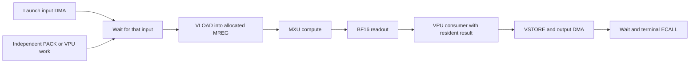

# Atlas target: initial implementation, investigation and remaining plan

**Implementation checkpoint (2026-11-09):** a small shared dense path now works
on `feat/atlas-target`. It reads explicit FP8/BF16 Linalg, reuses Merlin's checked
dense loop planner, expands the actual checked calls in the Atlas OOT adapter,
and executes the emitted words on a pinned compatible `npu_model`. See
[the implementation and reproduction notes](#initial-implementation-checkpoint).
No OOT compiler generation or optimization agent loop was run.

Merlin can support Atlas by extending its shared computation, storage, scheduling,
and realization contracts. The reusable algorithms already cover much of the
required work. The principal missing pieces are operation-specific floating
numerics, a checked model of timed instruction interleaving, composition of
resident instruction sequences, and transport of those decisions through the
generated OOT backend to its final device bytes.

The follow-up [feasibility audit and worked example](#atlas-feasibility-audit-and-worked-example)
supports that architectural direction but found concrete integration and source
compatibility gaps. A compiled MXU0/ReLU example executes correctly on the
originally inspected model; a longer PACK chain failed on that pairing. The plan below includes
the missing expansion/CFG interfaces, numerical-domain discharge, and explicit
compiler/model agreement gates. It is not a claim that the extensions already
exist. The implementation checkpoint selects a compatible model revision and
rechecks that longer chain successfully in both scheduling modes.

The follow-up investigation adds Berkeley MX Gemmini and its Radiance integration
as a second consumer of the same shared numerical interfaces. FP4 E2M1 and FP6
E3M2 are supported by the inspected plain MX compiler profile; its FP6 operands
use four-bit LUT indices. Additional profiles expose FP6 E2M3, FP8 E5M2 and
asymmetric operand pairs. These are capabilities of selected configurations,
not a promise that every Radiance configuration implements all of them. The
[MX extension plan below](#mx-gemmini-and-radiance-precision-extension) separates
format semantics, storage, arithmetic and configuration qualification.

Use the hand-written Atlas compiler as a reference and migration baseline. Extract
general algorithms into Merlin and retain instruction encodings, layout mappings,
hardware timing rules, and launch details in the target adapter. A generated
backend that delegates all compilation to `atlas-opt` is a useful integration
milestone, but does not demonstrate that Merlin generated the compiler or that
its shared passes made and realized the decisions.

The original scope was investigation and an implementation-ready plan. The user
subsequently authorized an initial implementation while excluding OOT generation.
The reuse objective is interpreted as minimizing duplicated code and maximizing
shared algorithms. The original audit and staged plan remain below; the following
checkpoint distinguishes implemented pieces from remaining work.

## Initial implementation checkpoint

### Worktrees and compatible baseline

| Component | Worktree / revision |
| --- | --- |
| Merlin changes | `/home/jeremy/Projects/merlin-atlas-target`, `feat/atlas-target`, based on `04ed0ae2533f484c2bcca8ecb50e8d5746012099` |
| Atlas OOT changes | `/home/jeremy/Projects/atlas-mlir-atlas-target`, `feat/atlas-target`, based on `c9f50c3310a68d9eb8fa318e68492896a5a45737` |
| Execution model | Separate clean detached `/home/jeremy/Projects/npu-model-atlas-target`, `47b8599d8ffbe5ddd96059ffe2b5be2427a410f5` |
| Selected RTL identity | `0079c0541111197741a231c002e3843fa6f545b2`; no RTL build or execution in this change |
| Tool binaries reused | `/home/jeremy/Projects/atlas-mlir/build/bin/{atlas-opt,atlas-emit}`; no C++ compiler changes |

The original source worktrees were left untouched. No `merlin` branch was found
in the inspected Atlas repositories; following the user's clarification, work
continued on these explicit compatible revisions.

The model choice resolves the concrete walkthrough failures below: `c119e54`
changes PACK to row-major output while this compiler still performs the older
half-row repair. The older `origin/rtl-match` at `649cbca` uses incompatible DMA
encoding. Revision `47b8599` has the current encoding and the older PACK layout.
Every executed instruction is independently decoded and re-encoded; a mismatch
fails before execution. The selected RTL revision is an identity, not new RTL
qualification or evidence that every compiler/model behavior matches silicon.

### Changes that work now

| Change | Implementation and checked scope |
| --- | --- |
| Explicit ordered floating source | [ordered_float_dense.py](../../../../src/merlin/transforms/ordered_float_dense.py) recognizes the complete positive-zero fill and `extf/extf/fma/yield` recurrence. It binds exact source bytes, element formats, input domain, K order and either RHS orientation. It rejects changed operands, unused operations, reassociation and implicit numerical conversion. |
| Existing dense scheduling for floating storage | [dense_tile_ir.py](../../../../src/merlin/compile/scheduling/dense_tile_ir.py) projects actual logical calls into the existing compact dense checker. Kernel storage widths now include BF16 and both FP8 formats. The original symbolic coverage, residency, reset/continuation and K-order checks are reused. Logical synchronous tiles are separately expanded into physical Atlas instructions. |
| Atlas OOT adapter | [shared_dense.py](../../../../../atlas-mlir-atlas-target/python/atlas_mlir_native/shared_dense.py) reads that source and consumes the actual checked schedule. It uses existing Atlas virtual operations and compiler passes, including the combined matmul operation when K is one tile. Full 32-wide tiles and at most 64 tile products are admitted; unsupported tails and larger expansions refuse. The accumulator view describes one logical tile, not a physically row-addressable Atlas accumulator. |
| Scheduling dialect | [schedule.py](../../../../src/merlin/xdsl_dialects/schedule.py) adds typed `schedule.time_annotation` and `schedule.overlap`. [timed_schedule.py](../../../../src/merlin/compile/scheduling/timed_schedule.py) consumes those decisions against the current kernel and selected timing identity. It checks actual issue/completion intervals, RAW/WAR/WAW, physical resource capacity, and required/forbidden overlap. Missing effects, stale decisions, duplicate decisions and unknown clocks/resources refuse. |
| Numerical codecs | [fp8_formats.py](../../../../src/merlin/runtime/fp8_formats.py) adds FP6 E2M3 alongside existing E3M2/FP4 E2M1. Exact power-of-two decoding fixes a BF16 one-FP32-ULP error from approximate `exp2`. Tests enumerate all finite BF16 codes and all E2M3 codes, signed zero, rounding ties and saturation. Sub-byte storage remains a separate packing/LUT contract. |
| xDSL compatibility | The FP8 dialect uses upstream FP8 classes where present, so xDSL 0.73 cast constraints and parsed types agree. Older fallback definitions remain. |

The Atlas policy is specifically `mxu0-e4m3-ordered-bf16-finite-v1`, with runtime
input codes restricted to finite normal E4M3 or positive zero. The source reader
also has neutral E5M2/F32 and F16/F32 tests; that establishes source recognition,
not hardware support for those tuples. `pack_inputs` validates the actual byte
domain and maps either logical RHS orientation to the target's tile layout.

The dense proof is conditional on the target's numerical and completion facts.
The new timing checker is currently a bounded straight-line decision consumer,
not a replacement physical scheduler. It is **not yet wired to Atlas's physical
footprint provider**. Atlas's existing scheduling, DMA waits and final stream
verifiers remain responsible for the physical programs executed here.

### Execution and comparison

The reusable [regression driver](../../../../../atlas-mlir-atlas-target/tools/check_shared_dense.py)
compiles each program once and reuses it with different runtime bytes. It checks
every output byte, preserves inputs and guards, and requires clean model halt.
Witnesses cover nonuniform signed permutations, dense products, rounding ties,
normal FP8 values across the finite range, and ordered accumulation across a K
tile boundary. The finite-range oracle performs exact integer arithmetic with
an independent rounding step after every FMA; it does not call compiler/model
numeric helpers or preload expected output values.

| Case (M × K × N) | Source-order words / model cycles | Optimized words / model cycles |
| --- | --- | --- |
| Shared 32 × 32 × 32 | 37 / 3,271 | 42 / 3,183 |
| Shared 32 × 64 × 32 | 53 / 4,921 | 66 / 4,712 |
| Shared 64 × 32 × 64 | 125 / 11,362 | 146 / 10,122 |
| Shared 64 × 64 × 32 | 90 / 8,163 | 108 / 7,344 |
| Direct Atlas 32 × 32 × 32 reference | 37 / 3,271 | 42 / 3,183 |
| Direct Atlas matmul → ReLU reference | 39 / 3,337 | 44 / 3,249 |
| Direct Atlas matmul → ReLU → PACK → matmul, retain both outputs | 110 / 6,757 | 120 / 5,090 |

The 32×32 shared program is byte-identical to the direct Atlas reference in each
mode. These are whole-program model cycles, including transfers, for delegated
Atlas lowering. They are **not performance results for a generated OOT compiler**.
The ReLU/PACK chains establish a working reference baseline; shared source fusion
for these chains has not been implemented.

Validation at this checkpoint:

- **78 distinct model cases pass:** 56 shared matmul cases, 14 direct matmul
  cases, four ReLU cases, and four two-stage PACK cases. Results are in local
  `out/build/atlas-initial/dense-model-final/results.json` and
  `out/build/atlas-initial/reference-final/results.json` (the reference rerun
  also repeats previously passing reference cases).
- **511 selected Merlin checks pass**, one skips. This includes new source,
  tile and timing tests, existing compact dense/bias/integer schedules, async
  scheduling, fusion contracts, serialization, source layout and access checks.
  One additional native serialization test cannot finish because Clang is
  absent; eight portable printer tests pass with the local model2MLIR Python.
- **13 Atlas adapter checks pass**, including source/schedule mismatch, tails,
  expansion bounds, input-domain guards and RHS layout correspondence. The new
  single-source CLI compiles successfully.
- Package docs were regenerated; `git diff --check` passes. The structure gate
  still reports **16 existing violations in unchanged files**: two optional
  experiments imports and 14 module-size ceilings. Its output is in
  `out/build/atlas-initial/structure-final.log`.

### Reproduce and continue

See the companion [Atlas README](../../../../../atlas-mlir-atlas-target/README.md#initial-merlin-shared-dense-path)
for exact environment paths, single-source compilation and the complete test
driver command. Use a fresh output directory. The driver enforces the model
revision. Compilation records source/schedule identities, tool hashes and final
binary hash; tests independently decode the emitted binary before executing it.

Remaining work before a Merlin-generated Atlas backend is ready:

1. Bind Atlas's existing physical footprints and completion/resource rules to
   the shared timing consumer, then transport and independently check selected
   decisions through physical expansion, including bounded helper CFGs and DMA.
2. Extend the existing OOT-declared fusion contracts with exact floating scalar
   correspondence and bounded resident instruction sequences. Start with
   matmul→ReLU, preserve observable intermediates, then admit PACK using the
   now-passing reference chain. Avoid a second target-name-based fusion system.
3. Publish a reviewed SDK version with these APIs and a closed dependency set.
   They currently work from the local shared source tree and are not granted
   into a frozen compiler-candidate SDK. The existing V24 dependency on
   `configuration_c_consumer` must be resolved at the ownership boundary before
   extending that release; do not broaden candidate access to proof/support code.
4. Add independently qualified tails, numerical recipes and source-to-final-byte
   correspondence, then expand runtime/host-launch coverage. The retired native
   binding still depends on older Merlin APIs and is not repaired by this path.
5. Follow the MX plan below for physical FP4/FP6 payloads, scales, LUTs and selected
   hardware profiles. Codec support alone grants no Atlas or Radiance capability.

OOT generation, agent optimization loops and generated-backend benchmarking
remain intentionally unstarted, as requested.

## Source baseline

Investigation date: 2026-11-09. Worktree:
`/home/jeremy/Projects/merlin-atlas-target`, branch
`feat/atlas-target`, based on the current Merlin HEAD.

| Input | Revision inspected | Relevant scope |
| --- | --- | --- |
| Merlin | `04ed0ae25` | Shared passes, scheduling dialect, semantic compiler, Atlas example, OOT authoring and consumption |
| `../atlas-mlir` | `c9f50c3310a68d9eb8fa318e68492896a5a45737` | Virtual and machine IR, scheduling, allocation, waits, verification, native binding, host runtime |
| `../npu_model` | `c119e544342c953977e121b4460746d4ca3cf207` | Executable configuration, ISA export, numerical and timing behavior, DMA and bank conflicts |
| Atlas RTL named by Atlas MLIR | `0079c0541111197741a231c002e3843fa6f545b2` | Selected hardware identity; RTL was not independently elaborated in this investigation |

Merlin and `npu_model` were clean initially. Atlas MLIR had an untracked
`docs/combined-attention-mlp-plan.md`; it is excluded from the findings. External
source trees were inspected without editing them. Relative external links below
assume `atlas-mlir` and `npu_model` are siblings of this worktree.

The MX follow-up used public Berkeley sources retrieved on the same date. The
following are distinct source baselines; they must not be combined implicitly:

| Input | Revision inspected | Role |
| --- | --- | --- |
| [MX Gemmini MLIR](https://github.com/ucb-bar/mx-gemmini-mlir/tree/7c3ab1d1988151d2e8ce585c0885d6f7b21dd0ee) | `7c3ab1d1988151d2e8ce585c0885d6f7b21dd0ee`, `handwritten-implementation` | Profile declarations, packing, numerical references, resident chains and qualification documentation |
| [Compiler profile source bundle](https://github.com/ucb-bar/mx-gemmini-mlir/blob/7c3ab1d1988151d2e8ce585c0885d6f7b21dd0ee/profiles/gemmini-mx-cleanup-266c593/MxGemminiRocketConfig.json) | Gemmini `266c593f2cb51d7e3fe83fc0317072b585ac3c52`; MxGen `dba3e7e706efa156d96efe595cd9935c825ea14d` | Hardware sources named by the inspected compiler profiles; structural declarations, with separate execution evidence |
| [Radiance compatibility record](https://github.com/ucb-bar/radiance/blob/a8d77814eaeb7ee7d48c216894f9d15251b48b1a/COMPATIBILITY.md) | Radiance `a8d77814eaeb7ee7d48c216894f9d15251b48b1a` | Named SoC configurations and compatible Gemmini/kernel revisions; not the compiler profile bundle above |
| [Current MxGen source](https://github.com/ucb-bar/MxGen/blob/3bc981fe901c1df05b2585269a434e4077710496/src/main/scala/mxgen/MxParameters.scala) | `3bc981fe901c1df05b2585269a434e4077710496` | Generator evolution cross-check; current mode inventory extends beyond the pinned compiler profile source |

These sources were read, not built or executed in this investigation. Published
Spike, RTL and Radiance results remain attributed to their original source and
configuration. They do not qualify a new Merlin-generated backend.

## What exists today

### Shared Merlin infrastructure

These are implemented mechanisms with narrower admission than general Atlas
support. Extending their explicit contracts should preserve those boundaries.

| Area | Existing implementation | Reuse and Atlas gap |
| --- | --- | --- |
| Pass ordering and freshness | [pipeline state](../../../../src/merlin/transforms/pipeline_state.py), [pipeline](../../../../src/merlin/transforms/pipeline.py) | Reuse prerequisites, invalidations, source/context identities and bounded repair. Add timing, numerical recipe and chosen composition to the bound context. |
| Dense shape and capacity planning | [dense planning](../../../../src/merlin/transforms/dense_planning.py), [block schedule](../../../../src/merlin/compile/scheduling/block_schedule.py), [compact dense](../../../../src/merlin/compile/scheduling/compact_dense.py) | Reuse blocking, counted loops, tails and operand retention. The selected contract and ordinary source reader admit integer reductions; the compact adapter requires synchronous completion and exact continuation. |
| Staged dense effects | [staged dense](../../../../src/merlin/compile/scheduling/staged_dense.py), [verification](../../../../src/merlin/compile/scheduling/staged_dense_verification.py) | Already separates descriptor issue from consume. Its signed panel-width inequalities and descriptor/fence semantics are also specific; it cannot directly describe Atlas FP8/BF16 streaming engines. |
| Temporary storage and spills | [temporary storage](../../../../src/merlin/compile/scheduling/temporary_storage.py), [device spills](../../../../src/merlin/compile/scheduling/device_spills.py), [allocation types](../../../../src/merlin/semantic_compiler/allocation_types.py) | Reuse backing identities, alignment, reservations, liveness and exact-copy checks. Add paired registers, physical port aliases, MXU ownership and lifetimes ending at actual completion. |
| Async copies and completion | [copy pipeline](../../../../src/merlin/compile/scheduling/copy_pipeline.py), [completion streams](../../../../src/merlin/compile/scheduling/completion_streams.py), [event loops](../../../../src/merlin/sched/primitives/event_loops.py) | Reuse finite queue bounds, launch/wait tokens and commutation checks. Add row/port timing and checked DMA overlap across supported loops. These existing interfaces do not grant arbitrary asynchronous arithmetic. |
| Configuration state | [configuration](../../../../src/merlin/compile/scheduling/configuration.py), [configuration loops](../../../../src/merlin/compile/scheduling/configuration_loops.py) | Reuse persistent state cleanup for scale and DMA configuration once the target declares capture and clobber rules. |
| Physical fusion | [fusion](../../../../src/merlin/compile/scheduling/fusion.py), [fusion contracts](../../../../src/merlin/compile/scheduling/fusion_contracts.py), [scalar semantics](../../../../src/merlin/compile/scheduling/fusion_semantics.py) | Existing v1 is adjacent synchronous integer elementwise composition with a private intermediate and one returned `Call`. Atlas needs floating correspondence, broadcasts and bounded resident instruction sequences. |
| Source composition | [pointwise source](../../../../src/merlin/compile/scheduling/pointwise_source.py), [multi-output fusion](../../../../src/merlin/compile/scheduling/multioutput_fusion.py), [compact dense groups](../../../../src/merlin/compile/scheduling/compact_dense_group.py) | Reuse ownership, observers, complete-source binding and ordered outputs. Broaden numerical and physical recipe support rather than introduce a second graph-fusion framework. |
| Row algorithms | [row softmax](../../../../src/merlin/compile/scheduling/row_softmax.py), [row contracts](../../../../src/merlin/compile/scheduling/row_contracts.py) | Already represents a chosen lane/tree algorithm, masks and normalization. Its f32/f64 and exponential assumptions cannot simply be renamed BF16. Atlas needs a prescribed max/sub/exp/sum/recip/mul graph. |
| Final program checks | [program limits](../../../../src/merlin/compile/scheduling/program_limits.py), [program contracts](../../../../src/merlin/compile/scheduling/program_contracts.py), [ELF admission](../../../../src/merlin/targetgen/contract/elf_admission.py) | Reuse decoding of actual bytes, windows, branch bounds and final image checks. Extend the execution model for word PCs, branch delay slots and reset-entry device programs. |
| Ordinary selected-target consumption | [target schedule](../../../../src/merlin/llvmlower/target_schedule.py), [shared pass contract](../../../../src/merlin/targetgen/shared_pass_contract.py) | The selected IR already travels to `emit_target_bundle`. Current finite schedule compilation is straight-line and maps one decoded instruction to one call; Atlas CFG and helper expansions need an explicit additional path. |

There are already floating formats and semantic rules elsewhere in Merlin.
[Quant formats](../../../../src/merlin/common/quant_formats.py),
[FP8 types](../../../../src/merlin/xdsl_dialects/fp8.py),
[float serialization](../../../../src/merlin/common/dense_float_ir.py),
[semantic value types](../../../../src/merlin/semantic_compiler/model.py), and
[precision policy](../../../../src/merlin/targetgen/precision_policy.py) should
remain the starting points. The kernel IR's `DTYPE_BYTES` currently contains
only `i8`, `i16`, `i32`, `f32`, and `f64`. Supporting a format at the parser or
runtime level does not make it available to the shared counted-kernel compiler.

The [native allocator](../../../../src/merlin/semantic_compiler/allocate.py)
already carries input-read and completion offsets, storage constraints and issue
times. Its `instruction_schedule` deliberately issues serially through completion.
Extend that model where useful; do not add an unrelated allocation engine.
The [activity timeline](../../../../src/merlin/perf/activity_schedule.py) is useful
for analytical cost reporting, but is not an instruction hazard verifier.

### Existing Atlas support has three distinct roles

1. Merlin's [authored Atlas target](../../../../examples/atlas/target/README.md)
   supplies reference metadata, selected-source policy and numerical probes.
   Its [software spec](../../../../examples/atlas/target/software-spec.yaml)
   leaves elementwise placement and model-operand scale/block choices unresolved.
   The example-contract regression explicitly expects prototype status and an
   `unknown` admission result even for a matching contraction signature.
2. The vendored [support provider](../../../../examples/atlas/support/provider.yaml)
   owns experiment-side runtime/oracle integration. Some older declarations still
   mention `block_e8m0` and `must_supply_e8m0_block_scales`. They are not sufficient
   evidence of model-operand block scaling; the authored target README calls out
   this mismatch. Preserve its provenance and reconcile selected executable
   semantics rather than treating those labels as facts.
3. [Atlas MLIR](../../../../../atlas-mlir/README.md) is a hand-written backend
   with virtual SSA and machine operations covering the selected 99 decoder
   modes. Its [native Merlin binding](../../../../../atlas-mlir/python/atlas_mlir_native/binding.py)
   contains integration with the semantic search path, numerical policies and
   device emission. The follow-up audit found that its Python imports no longer
   match this Merlin checkout; it is implementation evidence and a migration
   reference, not a presently working integration with these revisions. It is
   also separate from agent-authored OOT shared-pass consumption.

The target is therefore not missing from every registry. The missing outcome is
a generated compiler that consumes the extended shared interfaces and emits a
checked Atlas program on the ordinary compilation route.

## Atlas requirements that affect the shared interfaces

### Numerical behavior must be selected per operation and unit

The [binding contract](../../../../../atlas-mlir/docs/native-merlin-binding.md),
[hardware status](../../../../../atlas-mlir/docs/hardware-status.md), and
[model timing and numerics](../../../../../npu_model/docs/rtl-timing.md) describe
the following distinctions. Their supported domains differ; the initial backend
should select the narrower, explicitly established domain for each recipe.

| Operation | Behavior to preserve | Consequence for planning |
| --- | --- | --- |
| MXU0 contraction | FP8 operands, ordered custom multiply/add, BF16 rounding after each K step | Keep the original K order, initialization, every rounding boundary and BF16 accumulator continuation. A BF16-to-f32 CPU contraction has different semantics. |
| MXU1 contraction | Anchor-aligned integer accumulation of a 32-product group followed by BF16 rounding | A distinct numerical policy and eligibility decision; choosing the faster unit may change results. MXU1 K continuation is outside the initial native binding's supported chain. |
| VADD and VSUB | FP32 arithmetic then BF16 truncation/chop | Plain BF16 RNE add/sub is not equivalent. |
| VMUL | BF16 nearest-even product | Retain its separate conversion boundary; do not contract add/mul into an FMA. |
| Row sum | Balanced FP32 reduction tree with final BF16 rounding | Record the complete tree and internal precision, not just a BF16 result type. |
| Min/max | RTL ordered-bit comparisons | IEEE min/max needs a domain or equivalence check; signed zero and NaNs distinguish the operations. |
| Exp and reciprocal | RTL lookup/approximation behavior | Carry the algorithm/table identity and admitted domain; an operation name does not authorize replacing mathematical exp/division. |
| VPU PACK | BF16-to-FP8 with E8M0 scaling; the Atlas compiler emits a physical layout repair, but the current model already produces row-major output | Resolve this source disagreement before selecting a layout recipe. Scale direction, code, exceptional values, rounding and layout all participate in equivalence. |
| MXU FP8 pop | Different converter; scale multiplies rather than divides | Cannot substitute for VPU PACK without a separate composition law. |

Reuse typed MLIR scalar regions and existing semantic descriptors. Extend their
admitted operations with explicit format, rounding/conversion nodes, reduction
order/tree/cadence, overflow/subnormal/signed-zero behavior and input domains.
Keep numerical interpretation separate from byte storage width. For nonstandard
hardware primitives, a versioned recipe must name the target rule and separately
selected correspondence evidence. A string policy identity only binds evidence;
it does not establish equivalence.

Separate two checks: exact realization of the selected reduced-precision program,
and the model-quality effect of converting an original f32 graph to that program.
The compiler must never infer permission for the latter from the availability of
the former. Reuse the source-bound precision plan and boundary obligations already
present in the Atlas native binding.

Discharge boundary and intermediate domain obligations before ordinary admission.
The existing native binding records some of them as `caller_premise_unchecked`;
that is diagnostic bookkeeping, not a proof. Use checked constants, explicit
caller contracts with enforcement, or sound propagation through the selected
numerical graph. An unresolved producer-to-consumer domain requires a guard with
fallback, a differently qualified recipe, or refusal. Availability of a PACK or
ReLU opcode cannot establish its input assumptions.

### Storage and layout are part of instruction semantics

The selected Atlas MLIR [target constants](../../../../../atlas-mlir/include/Atlas/AtlasTarget.h)
and [spilling implementation contract](../../../../../atlas-mlir/docs/register-spilling.md)
describe 64 tensor registers, each 1 KiB. A 32x32 FP8 tile occupies one register;
a BF16 tile occupies an even-based pair. Its DRAM layout contains two 32x16
column halves. Weight rows denote output columns, so logical `A @ B` needs an
explicit `B`-to-`W[N,K]` mapping or transpose.

Each MXU has two weight slots and two accumulator slots, with versioned ownership
in virtual IR. These are separate resources per unit, not one combined memory.
Physical MREG port aliases include `mN` and `m(N+32)` even when logical registers
are distinct. Allocation legality and port scheduling legality must be checked
separately against the same selected mapping.

VMEM must account for boundary buffers, DMA staging, PACK raw/relayout scratch,
spills and edge-copy temporaries together. The existing Atlas policy reserves
eight 2 KiB DMA staging windows and a 240 KiB temporary region after them.
Those are current compiler placement choices, not additional architectural
capacities. A load issued early may hold a VMEM staging window without holding
its destination MREG until the first VLOAD/use.

Model full live intervals: issue, source read/release, partial writes, result
readiness, DMA completion, and last consumer. Reloading an accumulator is legal
only after completed raw BF16 preservation; an FP8 round-trip is lossy.

### Timed interleaving needs more than one latency per instruction

Atlas has one scalar issue stream and engines that continue independently. Its
[timing footprints](../../../../../atlas-mlir/include/Atlas/AtlasTiming.h) already
model row accesses, unit/port reservation windows, RAW/WAR/WAW distances and DMA
completion effects. The [timing provider](../../../../../atlas-mlir/include/Atlas/AtlasTimingProvider.h)
separates those rules from validation, and is a useful boundary to generalize.

Instruction scheduling needs all of the following:

- Issue spacing and engine capacity, separately from result readiness.
- Row-specific source reads and destination writes, including physical port aliases.
- The VPU's two single-input slots and operations that occupy both.
- Persistent MXU weight/accumulator state and safe overwrite times.
- Explicit finite DMA channels/queue entries, staging ownership and completion.
- Branch targets, exactly one branch/jump delay slot, and terminal drains.
- Loop access summaries when a transfer remains pending across control flow.

DMA operands and base configuration are captured at launch; source bytes are
sampled as beats are read. Moving scalar setup after launch may be safe while
overwriting an in-flight store's VMEM source is not. A fixed delay cannot prove
DMA completion under a variable-latency memory system. Keep explicit waits.

Reuse [copy pipelining](../../../../src/merlin/compile/scheduling/copy_pipeline.py)
and [completion-stream commutation](../../../../src/merlin/compile/scheduling/completion_streams.py)
for their established cases, then add the timed resource model. The successful
[Atlas DMA/PACK overlap](../../../../../atlas-mlir/docs/pack-dma-overlap.md)
depends on proved memory disjointness across the entire relayout loop. Use the
current [generic scalar-loop analysis](../../../../../atlas-mlir/include/Atlas/AtlasLoop.h)
as the reference; do not make a compiler-generated helper name the proof.

### Reconcile source revisions before exporting facts

The model's older [system-parameter table](../../../../../npu_model/npu_spec/02_system_parameters/README.md)
lists 1 MiB VMEM and 16 GiB DRAM. Its current executable
[default configuration](../../../../../npu_model/npu_model/configs/hardware/default.py)
uses 1536 KiB VMEM and 64 GiB DRAM; Atlas MLIR also uses 1536 KiB VMEM. Scalar
latency fields in a default config are not a substitute for engine row timing.

The model describes 128 KiB physical IMEM, while Atlas MLIR's
`kAtlasGeneratedWordLimit` is a stricter 2048-word generated-program policy.
Keep architecture limits and software ceilings distinct, and apply the latter
after waits, delays, spill code and helper expansion have been inserted.

Merlin's descriptor names bringup-chipyard `426a862f...`; the Atlas host-launch
reference names `245f2a9d...`. Both name the same Atlas RTL gitlink, but this does
not establish that their complete host systems are interchangeable. Select one
full source/map/tool bundle and regenerate its facts before execution qualification.
Keep below-4-GiB compiler/host ABI limits explicit even when the model supports
larger physical DRAM addresses.

## Proposed shared scheduling extension

The following interfaces are proposals, not current syntax or supported schema
versions. Keep `schedule` as chosen compiler decisions; runtime launches, waits
and instruction words stay in payload/target IR. Merely accepting the new syntax
will not make the OOT consumer honor it.

### Decisions and capability inputs

Add `schedule.overlap` and `schedule.time_annotation` to
[the dialect](../../../../src/merlin/xdsl_dialects/schedule.py). Use the existing
handles and plan container, with typed attributes for units and enum values.

| Proposed decision | Minimum information | Required behavior |
| --- | --- | --- |
| `schedule.overlap` | At least two payload handles; scoped plan/epoch; requested resources; mode `permit` or `forbid`; selected capability reference | `permit` requests a candidate search within independently established overlap rules. `forbid` constrains that scope. It cannot manufacture independence or erase waits. Empty, duplicate, unresolved, stale or cross-scope handles refuse. |
| `schedule.time_annotation` | Payload handle; role `estimate`, `constraint` or `realized`; explicit cycle units and epoch; typed temporal fields; provider/source identity | Estimates guide costs only. Constraints are checked scheduling requirements. Realized values are recomputed after lowering. Negative times, inconsistent windows, missing providers and conflicts with actual effects refuse. |

Useful temporal fields are earliest/latest issue, issue interval, result-ready
offset, source-read windows and resource reservation windows. A predecessor
handle plus minimum issue distance represents relative constraints. Encode
windows and read/write phases as typed records rather than loosely interpreted
strings. Preserve a stable source-to-payload mapping when one source operation
expands into several target instructions.

Absolute issue cycles only make sense inside a fixed-latency epoch. A blocking
DMA wait can shift every later instruction; final schedules need local epochs
and relative gaps, not a claim that external memory always completes at cycle N.
Successful `permit` consumption means that the compiler considered and checked
that scheduling scope. Report the realized overlap separately; independent work
or resources may be insufficient to achieve any overlap.

Extend selected target contracts with an explicit timing/resource model. Require
complete coverage for admitted instructions: operand-dependent footprints,
RAW/WAR/WAW distances, pipeline initiation intervals, reservation capacities,
physical port mappings, captured versus live state, DMA completion conflicts,
control-flow boundaries and terminal completion. Unknown coverage is a barrier
or an unsupported diagnostic; it must not become zero latency or infinite
capacity. Keep calibration estimates separate from legality rules.

### Common scheduler and independent checker

Generalize the existing Atlas approach behind a target-neutral interface, using
its [virtual scheduler](../../../../../atlas-mlir/lib/AtlasVirtualScheduling.cpp)
and [machine scheduler](../../../../../atlas-mlir/lib/AtlasScheduling.cpp) as
reference algorithms. The initial shared implementation can support one basic
block and explicit barriers before admitting loop summaries.

1. Read computation/effect dependencies and selected numerical boundaries.
2. Form candidate virtual orders, charging transfer and spill costs; retain a
   legal baseline when a proposal does not improve the selected objective.
3. Allocate registers, MXU state, temporaries, channels and staging windows;
   insert exact spills and recompute affected dependencies and lifetimes.
4. Expand target instruction recipes. Build machine RAW/WAR/WAW edges and
   resource reservations from actual physical operands.
5. Schedule ready instructions with a deterministic bounded heuristic; place
   waits at required completion uses and delays only for fixed-latency hazards.
6. Recompute word PCs, branches and delay slots, then independently check the
   chosen schedule, complete source correspondence and final encoded program.

Apply one-to-many expansion to **all** selected tile operations, including
unfused loads, computes and stores. `DenseSchedulingContract.bind()` currently
wraps one `adapter.encode(operation)` result and assumes row-major logical
pointers; Atlas needs checked target layout maps and expansions such as DMA
setup/launch/wait/VLOAD and weight-push/compute/readout. Each expansion must expose
its input/result values, temporary storage, state effects, read/completion events,
clobbers, source mapping and actual-byte projection. Generalizing fusion alone
would leave the first serial tile blocked.

Bounded helper CFGs are required before full PACK chains, even when the source
graph has no loops. Treat a selected helper as a checked region with entry/exit,
trip count, clobbers and complete memory effects. Initially serialize around it;
admit transfers across it only after the loop access and timing summaries are
proved. The current flat `instruction_kernel()`/`instruction_module()` transport
cannot carry that region. Add a versioned region/CFG consumer path without
weakening the existing finite-fragment restrictions.

Reuse `PipelineSession` invalidation instead of retaining a pre-spill timing
analysis. Bounded repair may choose another order, insert a spill, narrow an
overlap scope, or use the serial baseline. It may not change numerical policy
or silently discard a hard constraint. The legality checker must validate a
witness directly, rather than certify an output by rerunning the same heuristic.

Retain a clear distinction between computation readiness and physical issue
legality. An SSA-topological order can violate MREG ports; an instruction that
has read its scalar operands can still own VMEM bytes or an MXU accumulator.

An illustrative schedule is:



The PACK/VPU work may execute between launch and wait only when the complete
memory/state/port contracts allow it. A further independent tile's DMA can
overlap MXU/VPU work under the same rules and finite staging bounds.

## Determining fusion from OOT per target

The OOT target should declare realizable compositions; Merlin should discover
source candidates, establish legality and choose among them. Do not build an
Atlas-name switch or infer a fusion rule from an operation list. Extend the
existing `SelectedFusionContract` and source-composition entries.

### Separate the three physical outcomes

| Outcome | Atlas example | Information needed from OOT |
| --- | --- | --- |
| Shared dispatch | Several operations in one reset-entry device program | Group boundary, launch/completion ABI, complete ordered outputs and side effects |
| Resident sequence | MXU0 readout, VADD bias, ReLU, PACK feeding the next contraction | Bounded instruction recipe, temporary/register views, exact conversion sequence, state/resource effects and output layout |
| Single hardware instruction | Only a composition actually supported by a selected instruction mode | Specific encoding and numerical correspondence; never inferred from the resident sequence |

The first two are enough for useful Atlas MLP and attention regions. Existing
`schedule.group_dispatch` can continue to express dispatch grouping; add a
versioned composition decision/record for the chosen sequence and bindings.
There is no need to introduce a second set of source graph operations.

### Proposed composition contract

A versioned extension to `merlin.physical_fusion_contract.v1` should retain the
current one-call fast path and permit a finite sequence with explicit inputs,
outputs and temporaries. Each declared recipe needs:

- A typed source pattern/region, shape constraints, broadcasts and complete
  ordered numerical graph, including every conversion and reduction boundary.
- Input/result domains, format/layout mappings, signed-zero and special-value
  rules, constant scale bindings and the selected MXU numerical policy.
- Actual instruction recipe and operand mapping, resident storage classes,
  alignment, resource bounds, in-place permissions and alias restrictions.
- Persistent state and completion effects, extra observable outputs, and whether
  the recipe may be interleaved with independent work.
- A versioned independent correspondence checker/qualification binding and
  actual-byte projection; the emitter's retained request is not the decoder.
- An explicit applicability result and reason, plus a cost estimate that includes
  conversion, layout repair, spills, transfers and launch overhead.

The resulting flow is:

```text
current typed source + selected numerical policy
    -> shared pattern/candidate discovery
    -> OOT recipe applicability and explicit refusal reasons
    -> shared numerical, ownership, layout and completion checks
    -> bounded cost selection against an unfused legal baseline
    -> resident sequence allocation and timed scheduling
    -> decode final bytes and verify the complete chosen realization
```

Start with MXU0 readout -> BF16 ReLU, then add column-broadcast bias and PACK,
then chained MLPs. Bias after the dot product is not interchangeable with a
preloaded accumulator seed: per-step BF16 rounding can change the result. Also
preserve any raw producer result that is an externally visible output before
an in-place ReLU or PACK overwrites its storage.

Softmax is a complete row computation, not an elementwise-fusion special case.
Extend the existing row contract to the explicit Atlas graph. Cross-tile rows
need a separate numerical algorithm and reduction proof; a collection of
independently normalized 32-column tiles does not implement one longer softmax.
Masked lanes also require supported sentinel/exp behavior and a nonempty-row
policy. Keep them outside initial admission until those facts are established.

## Ownership and generated backend boundaries

| Owner | Required responsibility |
| --- | --- |
| Merlin shared library | Candidate discovery, blocking/tails, numerical boundary checks, fusion legality, dependency construction, bounded scheduling/search, storage/spill algorithms, independent witness and final-program checks |
| Atlas target adapter | Declarative instruction/semantic recipes; FP8/BF16 layout maps; MXU unit rules; operand-dependent timing/port footprints; encoder/actual-byte decoder; selected ABI and launch/runtime hooks |
| Selected source and execution tooling | Hardware geometry/encoding facts, numerical characterization, model/RTL differential execution and timing calibration; kept separate from candidate compilation |
| OOT generator and package | Emit a target compiler using the selected shared release and target declarations, expose every compilation boundary, consume chosen IR and package exact device/host artifacts |

Avoid importing target-specific `atlas_mlir_native` implementation into the
shared library. Extract neutral mechanisms and describe Atlas rules through
the target contract. Keep expected outputs, held-out workloads and oracle
implementations outside the candidate compiler's source release.

### Three reusable compilation boundaries

The existing [shared-pass v2 declaration](../../../../src/merlin/targetgen/shared_pass_contract.py)
already separates computation, device and emission. Give each boundary a usable
Atlas representation:

1. **Computation:** typed source with its explicit precision plan, then selected
   logical tiles/regions and numerical recipes. Do not erase graph boundaries
   into opaque words here.
2. **Device:** selected virtual instructions with resource/state identities,
   then physical instruction IR with allocated operands, waits and the realized
   schedule. `emit_target_bundle` must consume this selected IR.
3. **Emission:** checked encoded Atlas words plus device binary/program metadata,
   a separate host command buffer/launch artifact, and source/selection hashes.

Atlas device words do not run on a generic RISC-V host. Reuse the existing
[host runtime](../../../../../atlas-mlir/docs/host-launch.md) through an explicit
ABI: IMEM load, input/constant staging, MMIO start, ECALL completion, output
visibility, cache maintenance and timeouts. Device LLVM/ELF serialization is
separate from the host executable and its C-callable wrappers.

The initial adapter may call hand-written Atlas tools to establish the ABI and
obtain differential artifacts. Make that dependency explicit, and remove it
from a final demonstration of independent generated lowering. Keep the Atlas
compiler available to the experimenter as the comparison implementation.

### Version and source-release changes are necessary

[Selected scheduling contracts](../../../../src/merlin/compile/scheduling/selected_contracts.py)
currently allow a closed set of optional families, and
[the reviewed export](../../../../src/merlin/compile/scheduling/export.py) and
[tool profile](../../../../src/merlin/targetgen/tool_profile_shared.py) pin exact
public/implementation modules. New source files are not automatically available
to an OOT author or ordinary consumer.

Introduce explicit new versions for the changed dense numerical, sequence-fusion
and timing contracts. Preserve existing integer/synchronous schemas. Extend the
outer scheduling parser and shared-pass requirement vocabulary if timing or
sequence consumption becomes a required family. Publish a new library inventory
after the currently selected inventories, with only the necessary public leaves,
implementation closure, dependency versions and source identities. Update
authoring prompts, manifest validation, guarded workers and package-consumption
tests together. Old frozen releases should retain their existing behavior.

The current `merlin.target_ir_consumer.v1` transport can remain if it carries the
new selected IR intact. A new capability declaration must say which temporal and
composition versions it consumes, and the protected runner must check the actual
emitted result. Broader declarations alone do not satisfy consumption.

## Atlas feasibility audit and worked example

### Conclusion of the walkthrough

**The extended architecture can represent a useful Atlas backend. The original
plan needed more explicit interfaces and stronger source-compatibility gates
before it was sufficient to implement one.** Every step of the example below
has an identified shared owner, a target-owned realization and a checkable
result. No Atlas-name branch in Merlin is needed. Correctness nevertheless
depends on implementing those checks and selecting mutually compatible
numerical, layout, timing and tool contracts.

This audit re-read the shared dense/fusion/target-IR interfaces, Atlas's native
integration and virtual/machine lowering, and current model PACK/port behavior.
It also compiled and executed concrete reference programs. No shared compiler
implementation was changed, and no generated OOT backend was produced.

### 1. A concrete source graph and exact expected values

Use three 32x32 FP8 tensors and two ordered BF16 outputs:

```text
R = mxu0_ordered_dot(A, W0)     # W0 is [N,K], equivalent to A @ W0.T
H = bf16_relu(R)
P = pack_fp8(H, scale=E8M0(127))
Y = mxu0_ordered_dot(P, W1)     # W1 is also [N,K]
return H, Y
```

This is the graph in the existing
[typed Linalg example](../../../../../atlas-mlir/test/examples/native_mxu0_relu_pack_mxu0_linalg.mlir),
with ordered MXU0 reduction and explicit ReLU/PACK semantics. It is a selected
reduced-precision program, not a claim of equivalence to an arbitrary f32 MLP.
Both contractions use MXU0; the second must not silently select MXU1.

For a nonuniform, exactly checkable witness, define
`v = [0, 0.5, 1, 2, -0.5, -1, -2]`, and for `phase` equal to 0 or 1:

```text
A[i,k]  = v[(3*i + 5*k + phase) mod 7]
W0[n,k] = 1 if k == (n+3) mod 32 else +0
W1[n,k] = 1 if k == (n+5) mod 32 else +0

R[i,n] = A[i,(n+3) mod 32]
H[i,n] = max(R[i,n], +0)
P[i,n] = the exact FP8 code for H[i,n]
Y[i,n] = H[i,(n+5) mod 32]
```

Each dot has exactly one nonzero product, and all surviving values are exact
powers of two. H contains only +0, 0.5, 1 and 2, satisfying the narrow unit-PACK
recipe; P contains normal E4M3 or +0 for the next MXU0. The expected output is
therefore a literal permutation and sign clamp, independent of a floating
matmul library or the compiler's oracle. These data validate this witness only.
A production compiler must derive or enforce corresponding domain facts for
its admitted inputs; this fixture must never select its optimization strategy.

With unit scales, sample encodings are `0.5 -> FP8 0x30 / BF16 0x3f00`,
`1 -> 0x38 / 0x3f80`, and `2 -> 0x40 / 0x4000`. BF16 outputs use the selected
two-half physical layout, so a comparison must independently check both values
and placement. Returning H keeps it externally observable after the PACK edge.

### 2. Carry the graph through the proposed Merlin interfaces

| Boundary | Concrete object/decision for this example | Required extension and check |
| --- | --- | --- |
| Source and precision | Typed graph above, exact K order, unit scale, ordered outputs `(H,Y)` and domain obligations | Reuse semantic types, source identities and explicit precision policy. Discharge intermediate domains; an annotation is not evidence. |
| Shared dense planning | Two 32x32x32 contractions, each one output tile and one K segment | Extend the integer-only dense contract with the selected floating recurrence and operand layouts. This first case needs no tails or reassociation. |
| Instruction selection | MXU0 weight push, reset-compute and BF16 pop for each contraction; VPU ReLU; selected PACK recipe | OOT supplies numerical and instruction recipes. Shared code checks applicability and complete source coverage. A one-operation-to-one-`Call` interface is insufficient. |
| Fusion selection | A resident sequence with a live exported H, a packed P, and ordered final Y | Extend sequence fusion and multi-output ownership. Preserve H until both its export and PACK reads are safe; do not erase it as a private intermediate. |
| Virtual allocation | FP8 tile values, BF16 pair values, versioned MXU weight/accumulator slots, DMA events and VMEM windows | Reuse allocation/liveness mechanisms with target storage views and completion events. A live DMA staging allocation does not imply its destination MREG is already occupied. |
| Physical expansion | Loads become launch/wait/VLOAD sequences; PACK may include a bounded scalar loop if the selected layout requires it | Add sequence expansion and helper-CFG transport, with clobbers and memory summaries. Compose source-to-sequence mappings through expansion. |
| Scheduling | Permit independent W1 DMA beside earlier work; forbid simultaneous physical-port use and unsafe state overwrite | Use the shared dependency/resource scheduler and target footprints. `schedule.overlap` expresses permission; it cannot waive the port check. |
| Final realization | Checked word stream, branch targets/delay slots, program size, output mapping and host launch metadata | Decode actual bytes, recheck effects/numerics/timing, then package. Confirm the ordinary `emit_target_bundle` route consumed these decisions. |

The floating recurrence is an explicit target recipe for the ordered accumulator
steps. It is not permission to use an f32 reduction and convert only once at the
end. Extending to K=64 adds another weight/input segment and a continuation of
the **same** accumulator before the first readout; the native ordered-K examples
provide a migration reference. Ordinary capacity/tiling heuristics can be reused
once that continuation contract is admitted.

### 3. A feasible resource assignment and device sequence

The reference allocator found the following placement for the full example:

| Value/resource | Placement in the inspected allocation | Lifetime obligation |
| --- | --- | --- |
| A / later W1 | `m0`, reused at separate times | W1's VLOAD must follow the final physical read of A, even if W1 DMA launched earlier. |
| W0 / later P | `m1`, reused at separate times | W0 weight-push reads must finish before PACK or the canonical reload overwrites this register. |
| R / later Y | BF16 pair `m32:m33` | Preserve R through ReLU's reads; then reuse only when the first MXU pop and VPU reads are complete. |
| H | BF16 pair `m34:m35` | Preserve for PACK and output. Two readers can still conflict on a physical read port. |
| MXU0 internal state | One weight slot and one accumulator slot, versioned between matmuls | The second reset cannot overwrite live state from the first contraction. |
| PACK scratch in this compiler | 1 KiB at VMEM `0x20000`, 1 KiB at `0x20400` | Required only by the selected physical layout recipe; account for accesses over every loop iteration. |
| Explicit DMA staging | Three used 2 KiB windows beginning at `0x80000`, `0x80800`, `0x81000` | Reserve from launch until the last consumer/completion; wait before reuse. |

The report showed two used FP8 registers, two used BF16 pairs, a peak of three
in-flight DMA transfers, and no spills. These are feasible placement counts from
the reference policy, not a proof that its timed schedule is correct. Physical
aliases such as `m0`/`m32` still constrain issue times.

The intended sequence is concrete:

1. Launch input transfers into separate staging windows. Wait for A/W0, VLOAD
   their registers, and preserve W1's pending transfer independently.
2. Push W0 to MXU0, reset-compute with A, then pop BF16 R after its accumulator
   readiness event. Apply ReLU after the pair becomes readable.
3. Preserve/export H and perform PACK in an order that respects both source
   reads and physical read-port occupancy. PACK's scale register is configured
   before its capture point. If a layout repair is required, execute its checked
   copy loop and reload the canonical FP8 tile as P.
4. Wait for W1's DMA before its VLOAD, push its weight slot, and use P for the
   second MXU0 reset-compute and BF16 readout.
5. Store both ordered BF16 outputs, complete all output DMA, set the completion
   state, and terminate with ECALL. The host must then observe output visibility.

This is resident fusion despite any necessary **on-chip** PACK scratch traffic.
The only necessary external store of H is its requested output; the next
contraction consumes P without an external intermediate round trip. If H were
private, shared liveness could remove its output transfer, but could not remove
PACK's numerically or physically required steps.

For a first implementation, serialize the helper region and all conflicting
readers. Later, permit W1 DMA across the helper only with disjoint full-loop
accesses and live channel/window ownership. A branch-free source graph does not
make the emitted program branch-free, and a serial source order does not by
itself drain asynchronous engines.

### 4. What the concrete probes verified, and what failed

The probes used unchanged Atlas MLIR `c9f50c3310a68d9eb8fa318e68492896a5a45737`,
`npu_model` `c119e544342c953977e121b4460746d4ca3cf207` with `numerics="rtl"`, and
the existing Atlas binaries. The compiler's inventory names Atlas RTL
`0079c0541111197741a231c002e3843fa6f545b2`. No RTL/SoC was rebuilt or executed,
and the existing binaries were not newly attested to their source revision.

The full virtual program was derived from the existing
[two-layer virtual example](../../../../../atlas-mlir/test/examples/virtual_fp8_two_layer_mlp.mlir)
by selecting MXU0 for both contractions and returning H and Y. A smaller control
program returns R and H and omits PACK/second matmul. The test harness decoded
actual emitted words using the selected inventory, reconstructed current model
instruction objects, and required every model encoding to equal the original
word before execution. It used the model's default memory geometry and checked
all output bytes plus input/guard preservation against literal expectations.

| Probe | Observed result | Interpretation |
| --- | --- | --- |
| Smaller MXU0 -> ReLU, returning `(R,H)` | 60 words; both compiler verifiers and independent encoding audit pass. Two changed, nonuniform input panels each match all 2,048 BF16 outputs / 4,096 output bytes; guards and inputs preserved; no runtime conflicts. | Positive reference realization of the basic compute, resident VPU consumer, two-output layout, DMA and terminal path on this model. |
| Full chain, mandatory/unscheduled lowering | 110 words; compiler verifiers and encoding audit pass. H matches; Y differs in 609 of 1,024 elements on phase 0. | Not a successful end-to-end chain on this source pair. The raw PACK scratch already equals canonical FP8 H; the emitted relayout introduces 609 differing bytes, carried into Y. |
| Full chain, optimized lowering | 120 words; compiler verifiers and encoding audit pass. Model stops at overlapping PACK/VSTORE reads with `MRF bank conflict` on physical bank 2. | The current compiler timing check and model disagree. A successful scheduling check is not sufficient qualification for interleaving. |
| Import current Python native binding | `ImportError: cannot import name 'StagedCompileInputs' from 'merlin.frontends.compile_inputs'` | The native route needs API compatibility repair or a coherent package pin before it can serve as a live migration baseline. |

The baseline's two runs each took 4,601 model cycles; this is reproduction
metadata, not a hardware performance claim or a new compiler speedup. The full
chain failures are enough to block qualification; later stages/inputs are not
claimed to pass. No errors were suppressed and no reference compiler/model code
was patched to make these cases pass.

The PACK disagreement is directly visible in the current model's
[instruction semantics](../../../../../npu_model/npu_model/configs/isa_definition.py)
(`VPACK_BF16_FP8` writes row-major FP8) and
[VPU row writes](../../../../../npu_model/npu_model/hardware/vpu.py), versus the
compiler's documented [halves-to-rows repair](../../../../../atlas-mlir/docs/pack-dma-overlap.md).
This establishes a source mismatch; it does not decide which behavior matches
the selected RTL. Resolve that question with source-derived layout facts and an
independent nonuniform lane test before admitting the PACK recipe.

In the optimized stream, word 46 PACK reads `m34:m35` and word 48 VSTORE also
reads `m34`; the model reports their overlapping read-port use. The compiler's
[timing interface](../../../../../atlas-mlir/include/Atlas/AtlasTiming.h) already
labels the built-in provider unqualified, and emitted metadata says
`explicit_delay_only; other availability unqualified`. Preserve this distinction
when extracting shared timing machinery; never upgrade that label merely by
wrapping the provider in a new contract.

Program SHA-256 identities for reproducibility:

| Program | SHA-256 |
| --- | --- |
| Smaller control | `b90075f1370834521105ce3929f41ef9411682af55ea0d19157a1c1788b7d33a` |
| Full mandatory | `5c4a0cc55079a0c0d936f5b483ff53dea17848ff0324203a7c0ac5e8f74848dd` |
| Full optimized | `354bc585141e145ddbe5231c2ad2c7f5fb0bf92be37379da79adb53ee5f85ffd` |

Local reproduction scripts, staged MLIR, allocation reports, decoded programs,
model traces and binary/tool hashes are retained under
`out/build/atlas-walkthrough-20261109/` and remain ignored generated artifacts.
`execute_reference.py` accepts `WALKTHROUGH_PIPELINE=baseline`, `mandatory`, or
`optimized`; the latter two are expected failures with these sources. This
README preserves the findings independently of those disposable files.

### 5. Required changes to the implementation order

1. **Source compatibility is executable, not just matching commit strings.**
   Reconcile the Python API, PACK result layout, and physical-port timing before
   declaring a coherent baseline. Add these exact disagreements as regression
   cases. Select compatible sources or correct the offending implementation;
   do not relax the check or silently insert/remove conversion work.
2. **Add a general tile-operation expansion contract before the serial target
   milestone.** Extend the existing
   [dense binding](../../../../src/merlin/compile/scheduling/dense_contracts.py)
   beyond its one-call encoder/projector and fixed logical pointer mapping.
   The contract must admit target-owned instruction sequences for unfused
   loads/computes/stores, as well as fused regions, with independently projected
   value/state/memory effects.
3. **Add helper-region/CFG transport before PACK composition.** The current
   [target schedule reader/writer](../../../../src/merlin/llvmlower/target_schedule.py)
   accepts closed finite instruction fragments, not these helper loops. Keep a
   conservative bounded-region route first; general cross-loop overlap can wait.
4. **Make domain obligations an admission gate.** The
   [existing native chain test](../../../../../atlas-mlir/test/test_native_binding.py)
   explicitly expects three `caller_premise_unchecked` producer obligations.
   Preserve that diagnostic status, and add proof/guard/contract discharge for
   ordinary generated-backend use. Testing this exact-value witness does not
   establish the same domains for arbitrary activations.
5. **Check numerical layout and resource timing on the final emitted artifact.**
   The failing 110/120-word examples passed the reference compiler's current
   checks. A generated backend needs independent execution/correspondence gates
   for changed source mapping, port overlap and PACK lanes, with selected RTL
   comparison before making hardware claims.

With those additions, the smaller passing path provides the first implementation
checkpoint. The full graph is the next integration test after source/layout and
timing reconciliation. Attention then adds prescribed row algorithms; larger
matrices add ordered continuation, tails and pressure. These expand the same
contracts and do not require a separate Atlas-only shared compiler.

## MX Gemmini and Radiance precision extension

### Verified format scope and configuration boundaries

The pinned [plain MX profile](https://github.com/ucb-bar/mx-gemmini-mlir/blob/7c3ab1d1988151d2e8ce585c0885d6f7b21dd0ee/profiles/gemmini-mx-cleanup-266c593/MxGemminiRocketConfig.json)
declares these three same-format compute tuples, 32-element scale blocks, a LUT
and a requantizer. It declares neither a VPU nor `SPAD_REQUANT`.

| Logical element format | Selected operand representation | Plain-profile PE mode | Initial Merlin scope |
| --- | --- | --- | --- |
| FP4 E2M1 | Direct four-bit values, two per byte | 0 | MXFP4 operands with explicit E8M0 scale planes; BF16 readout first |
| FP6 E3M2 | Four-bit indices into sixteen-entry, six-bit codebooks | 4 | MXFP6 with explicit activation/weight codebooks and scale planes; BF16 readout first |
| FP8 E4M3 | Direct eight-bit values | 8 | Retain MXFP8 as a regression and shared-interface comparison |

FP6 thus denotes the decoded arithmetic format; it does not imply six payload
bits per matrix element on this path. An arbitrary set of 64 FP6 codes cannot
fit losslessly into a sixteen-entry codebook for a given spatial group. The
compiler's [exact FP6 indexing helper](https://github.com/ucb-bar/mx-gemmini-mlir/blob/7c3ab1d1988151d2e8ce585c0885d6f7b21dd0ee/mx_gemmini_support/fp6.py)
refuses missing codes, uses the lowest index for duplicate entries, and packs
activation nibbles along M and weight nibbles along N. Its selected DIM16 layout
has explicit shape and LUT-window bounds. Preserve those bounds until a more
general layout is established; do not infer arbitrary tails from the dtype.

The [all-asymmetric profile](https://github.com/ucb-bar/mx-gemmini-mlir/blob/7c3ab1d1988151d2e8ce585c0885d6f7b21dd0ee/profiles/gemmini-mx-cleanup-266c593/MxAllAsymGemminiRocketConfig.json)
adds FP6 E2M3 and FP8 E5M2: five element formats, 25 operand-format pairs and
36 format/projection/mode tuples. Its E2M3 and E5M2 operands use LUT projection;
E4M3 has direct and LUT variants. Represent activation and weight formats
independently, including projection, instead of extending one global `fp_bits`
field. PE mode alone is not a unique format identity. The
[pinned MxGen declarations](https://github.com/ucb-bar/MxGen/blob/dba3e7e706efa156d96efe595cd9935c825ea14d/src/main/scala/mxgen/MxParameters.scala)
define these formats and configurable operand sets; availability still depends
on the selected elaboration.

For vector fusion, the separate
[FP4 plus VPU profile](https://github.com/ucb-bar/mx-gemmini-mlir/blob/7c3ab1d1988151d2e8ce585c0885d6f7b21dd0ee/profiles/gemmini-mx-cleanup-266c593/MxE4M3Fp4VpuGemminiRocketConfig.json)
declares direct E2M1/E2M1 and E4M3/E4M3 compute, two VPUs and `SPAD_REQUANT`.
It does not declare E3M2 compute. The compiler's
[profile documentation](https://github.com/ucb-bar/mx-gemmini-mlir/blob/7c3ab1d1988151d2e8ce585c0885d6f7b21dd0ee/docs/current_mx_profiles.md)
also distinguishes structural profiles, source-bound Spike checks, and general
scheduling that remains unfinished. A successful FP6 matrix test does not
authorize FP6-plus-VPU fusion on a different profile.

Radiance is a separate integration and qualification target. Its
[compatibility record](https://github.com/ucb-bar/radiance/blob/a8d77814eaeb7ee7d48c216894f9d15251b48b1a/COMPATIBILITY.md)
states that `RadianceHBMConfig` selects E4M3 MX Gemmini, while
`RadianceFP4HBMConfig` selects an MXFP4-only implementation. It explicitly says
FP4 kernels no longer run on the former configuration. The record does not
establish an FP6 HBM configuration. Keep FP6 support in the numerical/compiler
plan, and require a named FP6-capable Radiance build before claiming FP6 on that
SoC. Rocket RoCC execution and Radiance Muon/MMIO execution need separate
transport, memory-visibility, completion and hardware receipts.

### Existing Merlin support and the actual missing pieces

The [format registry](../../../../merlin/schemas/quant_formats.registry.yaml)
already contains `fp4_e2m1`, `fp6_e3m2`, `fp6_e2m3`, `mxfp4`, `mxfp6`, `mxfp8`
and `e8m0`. The `mxfp6` entry describes six-bit E3M2 elements with block32 scales;
it must retain that meaning. Add a separate LUT-index storage representation
rather than changing the existing entry to four bits. The existing
[scalar codec](../../../../src/merlin/runtime/fp8_formats.py) handles FP4 E2M1 and
FP6 E3M2 but lacks an E2M3 table entry. Its MX aliases select scalar element
decoding only; they do not apply block scales or decode LUT indices. The
[FP8 dialect](../../../../src/merlin/xdsl_dialects/fp8.py) and counted-kernel dtype
consumers are narrower still. Registry presence is only the start.

Merlin's retained [MX software spec](../../../../examples/mx_gemmini/target/software-spec.yaml)
is historical/unreviewed and pins a different hardware revision. The active
[phase-0 recipe](../../../../examples/mx_gemmini/phase0/recipe.yaml) explicitly
selects the OOT `software-spec-2029218-candidate.yaml`. Neither is automatically
the newer `266c593` profile family or the Radiance compatibility bundle. Select
and review the intended bundle before promoting capabilities; preserve archived
contracts and evidence.

Extend the Atlas numerical work in these concrete ways:

| Shared interface | Addition needed for MX | Target-owned facts |
| --- | --- | --- |
| Scalar element semantics | Complete raw-bit encode/decode for E2M1, E3M2, E2M3, E4M3, E5M2, BF16 and E8M0; explicit finite/NaN/Inf, subnormal, overflow and signed-zero policies | Admitted modes and operation-specific conversions |
| Tensor representation | Separate element format, physical encoding (`direct_bits` or `lut_index`), packing map, block-scale operands and LUT operands | Physical axes, row pitches, bank mapping, codebook capacity, DMA alignment |
| Quantization recipe | Scale selection, scale axis/group origin, normalization, rounding, saturation, optional codebook projection, and all intermediate conversions | Exact hardware converter algorithm and supported input/output combinations |
| Contraction recipe | Independent operand tuples, scale application points, product precision, ordered per-stage accumulation, continuation and output conversion | Mesh-specific precision schedule, supported modes and accumulator rules |
| Resource/effect model | Value and lifetime identities for payloads, scales, LUTs, configuration, accumulator contents and completion tokens | State capture points, clobbers, resource aliases, queue and window limits |
| Cost model | Physical payload plus side-data traffic, padding, transfers, conversion cost and legal mode throughput | Measured/derived resource and timing facts for the selected configuration |

Do not extend `DTYPE_BYTES` with floating values such as `0.5` or `0.75` as the
allocation solution. Compute integer physical extents from a packed layout,
including row rounding, side buffers, padding and alignment. For one aligned
32-element block, direct FP4 uses 16 payload bytes plus one scale byte; direct
six-bit FP6 would use 24 plus one. This selected FP6 LUT path instead uses 16
payload bytes plus one scale byte, **and** its separately accounted codebooks.
A sixteen-entry six-bit LUT line occupies 12 bytes before transfer padding.
These are representation calculations, not a claim that a target accepts any
of those buffers without its layout and geometry checks.

Treat block scales as dataflow operands, with one scale per logical K block
for each activation row and weight column. Carry their logical indexing through
tiling/transposition and let the adapter map physical storage. K partitions must
preserve the original scale groups and accumulator order; splitting a group must
not silently recompute scales. Initially require supported complete groups and
retain explicit refusal/fallback for partial groups. Quantization, padding and
tail masking need a numerical equivalence argument before admitting tails.

Codebook selection and index encoding are different operations. Encoding into
an already selected codebook can be exact; selecting a smaller set of values
is generally lossy and belongs in the explicit source precision plan. Initially
accept supplied codebooks and frozen calibration data. Any later dynamic
codebook optimizer must record its algorithm, domain and model-quality checks.
Do not hide that optimization inside a packing pass.

### Arithmetic and conversion cannot be reduced to bit width

Use the same versioned operation/reduction recipe mechanism proposed for Atlas,
with different target data. An MX BF16 output does not imply BF16 multiplication
and accumulation at every internal step. The compiler's
[mesh reference](https://github.com/ucb-bar/mx-gemmini-mlir/blob/7c3ab1d1988151d2e8ce585c0885d6f7b21dd0ee/mx_gemmini_support/mesh_reference.py)
changes accumulator precision schedules for DIM8/DIM16/DIM32 and separately
identifies a product-floor policy. Bind those choices to source evidence;
tiling or choosing a different mesh can change bits even with identical scalar
input/output types. Keep Atlas MXU0, Atlas MXU1 and MX Gemmini recipes distinct.

The compiler's [output references](https://github.com/ucb-bar/mx-gemmini-mlir/blob/7c3ab1d1988151d2e8ce585c0885d6f7b21dd0ee/mx_gemmini_support/quant_reference.py)
demonstrate why conversion also needs a graph: its selected FP4 readout passes
through an E3M1 intermediate before E2M1 projection. Its FP6 readout normalizes,
rounds through BF16 and E3M2, then finds a LUT index in the selected fixed-point
distance representation, with lowest-index tie breaking. Separate legacy
Radiance-header and current output reference functions have different scale
conventions. A generic nearest-FP4/FP6 conversion is insufficient. Derive the
selected recipe from its exact source bundle and compare every packed code and
scale byte independently.

Atlas's E8M0-scaled PACK/pop boundaries and MX Gemmini's per-operand block32
scales may share scale codecs and graph machinery. They have different placement,
direction, grouping and conversion rules; the presence of `e8m0` alone must not
make them interchangeable. Likewise, format-family labels or a TorchAO scheme
do not establish the selected hardware arithmetic.

This extension does not add native FP4/FP6 execution to the inspected Atlas
hardware. A lower-precision source tensor could reach Atlas through an explicitly
admitted conversion into its supported operand representation, with scale/LUT
decoding, conversion semantics and staging costs accounted for. That is a
separate lowering recipe; shared format support alone does not authorize it.

Promote reusable bit packing, scale indexing, exact-codebook mapping and
requantization graph machinery into Merlin once. The MX OOT adapter should
delegate to those algorithms with its checked facts, just as Atlas should.
Keep instruction selection, physical bank layouts, command ordering constraints
and transport in OOT. Keep independent oracle implementations outside generated
candidate grants; do not promote golden-reference code as compiler answers.

### Scheduling and target-declared fusion extensions

The proposed `schedule.overlap` and `schedule.time_annotation` should carry MX
work without a second dialect. Model code/scale/LUT transfers, compute, readout,
requantization and supported vector operations as separate effects. A region may
overlap only when the selected provider exposes enough completion/resource facts.
Begin with conservative ordering; do not substitute fixed Atlas cycle gaps for
MX commands that have queue/backpressure or event-based completion semantics.

Reuse configuration-state elimination and lifetime analysis for scale and LUT
banks. In particular, a loaded table cannot be overwritten until all operations
that read it have completed or captured it according to the selected contract.
Account for scale-window refill, accumulator continuation, multiple load streams,
scratchpad banks and completion before resident reuse. Costs must include LUT
and scale reloads so a narrower format is not always presumed faster.

Express the following as target-declared sequence recipes under the same fusion
contract extension as Atlas:

- **Contraction -> quantized readout -> resident contraction.** The live edge
  carries payload, scales, layout and optional codebook identity. The published
  [FP4 chain](https://github.com/ucb-bar/mx-gemmini-mlir/blob/7c3ab1d1988151d2e8ce585c0885d6f7b21dd0ee/docs/nicolas-fp4-resident-chain.md)
  provides a reference for keeping packed values and scales on chip. The
  [FP6 chain](https://github.com/ucb-bar/mx-gemmini-mlir/blob/7c3ab1d1988151d2e8ce585c0885d6f7b21dd0ee/docs/nicolas-fp6-resident-chain.md)
  also requires MM1's output LUT to be MM2's activation LUT. A matching dtype
  without that codebook identity is insufficient for resident reuse.
- **Contraction -> BF16 vector epilogue -> requantization -> resident
  contraction.** Require every operation on the same selected VPU/requantizer
  profile. Preserve intermediate BF16 rounding, scale computation and fan-out.
  Admit FP4/FP8 first where supported; refuse FP6 vector composition when the
  selected profile lacks it.
- **Asymmetric contractions and projection variants.** Admit only an explicit
  legal activation/weight/projection tuple with qualified arithmetic. Changing
  projection or mode is a numerical and layout decision, not a free schedule
  optimization.

Published source-bound chains demonstrate useful operations and comparisons;
general Merlin fusion must derive legality from SSA, numerics, shapes, layouts,
resources and observers. Neither fixture names nor captured graph IDs may select
the optimization. Recheck actual commands and every intermediate required by
the selected precision plan after fusion and scheduling.

### Additional review units and acceptance criteria

The following extend the main sequence rather than fork a second shared compiler:

| Step | Work and ownership | Dependencies and acceptance |
| --- | --- | --- |
| MX1. Select configurations | MX OOT: pin compiler/profile, Gemmini/MxGen, simulator and transport; choose plain DIM16 for FP4/FP6 arithmetic and separate Radiance FP4/E4M3 integration targets. Reconcile historical provider contracts without rewriting evidence. | Before MX admission. Full source identities and declared legal tuples; a structural-only profile stays distinguishable from an executed configuration. |
| MX2. Complete shared numeric representations | Merlin: extend `common/quant_formats.py`, the registry, scalar codecs, typed IR/serialization and counted-kernel dtype consumers. Separate scalar types from scaled/LUT tensor encodings. Add E2M3 codec coverage; keep existing aliases stable and add explicit block-format variants if needed. | Main step 2 and MX1. Exhaustive scalar-code decode/re-encode with documented canonicalization, boundary/tie tests, exact packed extents and scale/LUT round trips. No target-name routing in core. |
| MX3. Generalize quantization and layout algorithms | Merlin: generic bit packing, block-scale indexing and codebook mapping; OOT: physical layout/config facts. Extend existing precision policy and source boundary obligations for ordered conversion graphs. | MX2. Check all nibble values, nonuniform rows/columns, LUT line selection, missing/duplicate codes, zero blocks, scale extremes and transfer padding. Payload bytes alone cannot pass while scales/LUTs are wrong. |
| MX4. Generate serial FP4 and FP6 contractions | Extend the shared dense contract with operand tuples, scale/LUT bindings and mesh arithmetic recipes; generated OOT performs instruction selection and final emission. BF16 output first, then admitted quantized readout. | MX1–3 and main steps 3/9. Independent raw-bit comparison of unseen inputs, M/N tiles and multiple K groups; retain explicit tail limits; existing integer, FP8 and Atlas tests pass. |
| MX5. Add resident fusion and overlap | Shared sequence fusion, storage/configuration and completion mechanisms from main steps 5–7; OOT supplies MX state, command and transport rules. Start FP4/FP6 plain resident pairs; add vector chains only on supporting profiles. | MX4. Output-code, scale and LUT identity checks at both stages; wrong table, early overwrite, missing completion, unsupported VPU or changed rounding must fail. Check final emitted commands, not just a sidecar. |
| MX6. Expand precision combinations | Add E2M3, E5M2, asymmetric pairs and additional mesh sizes using the same interfaces and explicit profile tuples. Validate direct/LUT variants separately. | MX4; MX5 for compositions. Independent evidence per admitted tuple/mesh; a matching PE mode or passing neighboring tuple does not establish support. |
| MX7. Qualify Radiance execution | OOT integration: Muon/MMIO launch, memory map, cache/visibility, DMA and completion for an exact compatible Radiance/Gemmini/kernel build. Reuse generic host orchestration only where the host contract agrees. | Selected configuration plus generated lowering. Repeated launches with changed inputs and exact final outputs on the named SoC model/RTL; FPGA and cycle claims require separate evidence. FP6 Radiance acceptance additionally requires a named FP6-capable build. |

For numerical acceptance, distinguish four checks: raw format/packing identity;
exact realization of the selected hardware algorithm; source-model quality after
lossy quantization/codebook selection; and timing on the selected hardware.
Include absent LUT codes, stale tables, swapped scale planes, K-group origin
changes, accumulator reordering, signed zero, supported exceptional values and
one-step differences in conversion as negative tests. Compare all meaningful
output codes and scale bytes, with guards around packed and side-data buffers.

Reuse existing tests around
[quant formats](../../../../merlin/tests/infra/test_quant_formats.py),
[MX scale operands](../../../../merlin/tests/targetgen/test_mx_scale_operands.py),
[partial-block refusal](../../../../merlin/tests/targetgen/test_mx_partial_block_refused.py)
and [spelling-independent routing](../../../../merlin/tests/targetgen/test_mx_route_is_spelling_independent.py).
Extend them at their owning layer instead of encoding MX behavior in the shared
scheduler. Add final-artifact differential cases at the target boundary and
independent-shape cases before promoting source-bound compiler prototypes.

## Implementation sequence and review units

Each row is a concrete reviewable change. Proposed new module names below are
placement suggestions; extend existing owners when that avoids duplication.

| Step | Implementation and principal files | Dependencies | Completion evidence |
| --- | --- | --- | --- |
| 1. Select a coherent Atlas baseline | Resolve the selected source/map/tool/model bundle; reconcile authored target, support-provider intent and numerical policy. Repair/pin the native Python API and resolve the PACK layout and physical-port disagreements found by the walkthrough. Use `examples/atlas/target/*`, selected-source tools and ISA declarations. Adapt `npu_model/isa_metadata.py:export_isa` as an encoding cross-check; it deliberately supplies no timing contract. | None | Fresh source/facts/audit identities; selected integration imports; nonuniform PACK lane tests and read-port conflict cases agree across independent checks; no guessed memory or block-scale facts. |
| 2. Extend format and numerical contracts | Reuse `common/quant_formats.py`, semantic types and raw-bit serialization. Extend `sched/ir/kernel.py`, parser/codegen dtype consumers, `dense_ir.py`, `dense_source.py` and versioned `dense_contracts.py`; add explicit operation/reduction recipes, separate packed storage, per-operand formats and scale/LUT operands for MX2–3. | 1 for Atlas; MX1 for MX admission | FP8/BF16 round-trip and byte counts; FP4/FP6 packed extents and side-data identity; ordered MXU0 reduction and continuation accepted only under its policy; unsupported floating sources refuse; existing integer tests pass. |
| 2b. Generalize tile realization and helper regions | Extend the dense encoder/projector and selected IR transport for one-to-many load/compute/store expansions, target layout maps, typed intermediate values and bounded helper CFGs. Share the sequence/effect machinery with later fusion; initially serialize helper entry/exit. | 1, 2 | A single abstract load/compute/store expands and independently projects back to its declared effects; a bounded helper retains branches, delay slots, clobbers and scratch accesses; wrong layout, omitted instruction or erased region refuses. |
| 3. Establish one generated serial tile | Add Atlas instruction/layout/ABI adapters and generated OOT commands. Use shared dense blocking and source checks; retain conservative completion. A synchronous wrapper may complete actual asynchronous device work before returning, but must implement and check those waits. | 1, 2, 2b | A generated compiler lowers unseen tile inputs through selected IR to final bytes; decode and model/RTL output agree; source/domain premises are discharged; hand-written compiler invocation is reported if still used. |
| 4. Add scheduling decisions and coverage | Implement `OverlapOp`, `TimeAnnotationOp`, typed attributes, verifiers, parsing/printing and bound-handle resolution in `xdsl_dialects/schedule.py` and lowering. Extend selected contracts with timing coverage. | 1 | Round-trip plus rejection tests, including stale handles/unsupported overlap; a consumer that ignores a hard temporal constraint fails. |
| 5. Add generic timed scheduling and checking | Extend native timing offsets/allocation and add shared `timed_schedule.py` plus an independent `timing_verification.py` if existing owners are insufficient. Atlas supplies footprints; reuse dependency and pass-state machinery. Start with basic blocks. | 3, 4 | Legal MXU/VPU/LSU interleaving; RAW/WAR/WAW and bank-conflict controls fail; one-cycle-short delays fail; serial fallback remains legal. |
| 6. Integrate storage, spills and asynchronous DMA | Extend storage/spill contracts for paired MREG views, per-unit slots and pending lifetimes. Connect copy pipelines and completion streams; share boundary/staging/PACK/spill reservations. Add proved scalar-loop summaries after basic blocks work. | 5 | Pressure case spills exactly; no channel/window reuse before completion; independent DMA crosses PACK; aliasing/unknown loops retain waits; final timing is recomputed after spilling. |
| 7. Generalize target-declared fusion | Extend `fusion_semantics.py`, `fusion_contracts.py`, `fusion.py`, source composition and readout verification with floating correspondence and bounded instruction sequences. Reuse 2b's expansion/region interface; discharge each producer-consumer domain. Add Atlas recipes in its adapter; use the same contract for MX5 resident payload/scale/LUT edges. | 2, 2b, 3; 5, 6 for interleaved versions; MX4 for MX recipes | MXU0 -> ReLU and bias/PACK/MLP chains avoid unnecessary DRAM; the worked chain passes nonuniform lane and final-port checks; MX resident chains retain codes, scales and codebook identity; raw outputs/fan-out remain correct; changed conversion, scale, unit, operand or observer fails. |
| 8. Add prescribed row algorithms and larger tiling | Extend `row_softmax.py`/`row_contracts.py` for the selected Atlas graph. Reuse ordered dense M/N/K tiling, tails and batching; add host/device region partitioning and program-size handling. | 6, 7 | Single-tile attention and MLP, then multiple output tiles and K chains; long rows/masks require their own admitted algorithms; no illegal zero padding or reassociation. |
| 9. Publish the shared release and consume it in generation | Update `library_sources.py`, `export.py`, `tool_profile_shared.py`, `shared_pass_contract.py`, prompts, package runtime/worker declarations and `llvmlower/target_schedule.py`. Publish incrementally as the preceding APIs settle. | 2 onward, finalized after 8 | Clean-room OOT authoring can import the selected APIs; ordinary compilation honors changed selected IR; no reference implementation/oracle source enters the candidate. |
| 10. Qualify final artifacts and host execution | Extend program/ELF checks and Atlas runtime packaging; run independent final-byte execution, repeated host launches and held-out model evaluation. | 3 for serial; 5–9 for full scope | Final optimized bytes match the selected algorithm and guard/state checks; host launch completes correctly; actual offload coverage and model-quality effects are recorded. |

Steps 2 and 4 can be developed independently after source selection. Step 3 is
the first end-to-end checkpoint. Steps 5–7 establish the scheduling/fusion
mechanisms requested here. Step 8 expands model coverage; it should not block
demonstrating a correct generated serial or interleaved tile backend.

Use MXU0 as the initial contraction lane because its ordered continuation is
already represented by the binding. Add MXU1 as a separate numerical capability
once its selected source policy and compositions are established. A resource
optimizer must not exchange the units merely because both accept FP8 tiles.

## Acceptance gates for a successful generated OOT backend

### Functional baseline

Require all of the following before claiming generated Atlas lowering:

- A new OOT package is produced from the selected shared release and Atlas
  declarations, rather than relabeling the hand-written Atlas package.
- Actual source -> selected tile/region -> selected device IR -> final bytes
  are inspectable and hash-bound. Changed source geometry and operands change
  the realized program or its checked dynamic bindings as appropriate.
- The device program performs nonempty admitted work, all outputs are checked,
  and the host command buffer launches that program. A pass-through graph,
  empty buffer or all-host fallback is not an Atlas backend demonstration.
- The actual emitted program executes against independent raw-bit expectations
  under the selected numerical contract, with guard bytes and carried state.
- Boundary and intermediate numerical-domain obligations are discharged or
  enforced by checked guards/fallback. `caller_premise_unchecked` does not
  qualify ordinary compilation; diagnostic artifacts retain that limitation.
- No hand-written compiler delegation remains in a claim of independent
  generated instruction selection/lowering. An earlier delegated milestone
  states that dependency explicitly.

Start with exact movement and one 32x32 MXU0 contraction; then K=64 continuation,
M/N tails and K tails under the proven leading-zero policy. Include asymmetric
and nonuniform matrices so transposed weights, swapped columns and two-half
BF16 packing cannot pass accidentally. Include rounding-tie cases that
distinguish MXU0/MXU1 and truncating add from RNE.

### Scheduling and fusion

Use concrete positive cases and corresponding mutations:

| Positive case | Required failing or conservative case |
| --- | --- |
| Independent DMA plus PACK or VPU/MXU work | Missing/mismatched wait, channel exhaustion, staging-window reuse, overlapping store or unknown loop access |
| Correct row/port interleaving | One-cycle-short issue gap, logical registers on the same physical port, VPU binary op incorrectly occupying one slot |
| Completed raw BF16 accumulator spill | Spill before completion, lossy FP8 save, stale MXU handle or wrong unit/slot |
| Resident matmul -> bias -> ReLU -> PACK | Bias moved into the accumulator seed, deleted chop/round node, changed scale, wrong PACK layout or ignored selected fusion |
| Multi-output/fan-out region | Intermediate overwritten while still externally observed, swapped output order, dropped output |
| Bounded final program | Count taken before inserted delays, stale branch target/delay slot, omitted drain or instruction image differing from checked bytes |

Check the **final optimized program**, not only a semantically replayed baseline.
The current native binding's optimized path checks the mandatory realization,
then reruns the optimized pipeline and applies compiler/encoding checks. Its
[documentation](../../../../../atlas-mlir/docs/native-merlin-binding.md) and
`AtlasNativeBinding` implementation make that scope explicit. Reuse the existing
correspondence checks, but extend them to the rescheduled bytes and actual new
bindings. A mandatory sidecar alone is insufficient for this gate.

### Host and model scope

Host qualification includes repeated launches with changing inputs, stale-halt
rejection, load/start/poll/wait behavior, explicit cache hooks, timeouts and
output visibility. ECALL does not replace program DMA waits. Reuse the runtime's
existing separation of these obligations.

For model scope, evaluate complete captures through the ordinary OOT consumer,
report admitted versus host regions, and check the full selected numerical
program. Separately measure source-f32 quality changes. Begin with a small MLP
and a complete 32-column attention block before extending to longer rows and
multi-program models. Treat standalone-core/model results and integrated
SoC/FPGA results as different acceptance tiers.

Timing improvement requires both correct final bytes and measured cycles from
the selected timing backend. Keep analytical costs and historical Atlas MLIR
benchmark results out of claims about a newly generated compiler's performance.

## Checks performed for this investigation

The existing focused tests were run against the new Merlin worktree and the
unchanged sibling sources. No implementation tests were added. The later
feasibility audit adds the separate passing and failing reference probes recorded
above; it does not change these original regression counts.

The MX follow-up is a source investigation and plan amendment. It compares
pinned public profiles and implementation/reference files with Merlin's local
registry, scalar codecs and provider selection. No MX compiler, Spike model,
RTL or Radiance hardware was run here. The following test counts belong to the
original Atlas investigation and are not new MX qualification results.

Document validation after the MX amendment found all 71 local source links and
the internal section link valid, balanced code fences and no trailing whitespace;
all 13 distinct pinned public source URLs resolved. `git diff --check` also passed. The required
`python build_tools/scripts/check_structure.py` reported 16 pre-existing issues
in unchanged source files: two core imports of optional experiment modules and
fourteen module-size/recorded-ceiling violations. Its other checks, including
documentation and source layout, passed. Those unrelated source issues are not
changed by this investigation.

| Suite | Result | What it establishes |
| --- | --- | --- |
| Merlin scheduling dialect, finite/async schedule pipeline, copy pipeline, completion streams, selected fusion, shared-pass manifest and Atlas reference contract | **202 passed**, 6 deprecation warnings | Existing shared mechanisms and explicit Atlas reference status |
| Atlas MLIR virtual scheduling and DMA-contract verification | **38 passed**, 847 subtests passed | Existing built tools accept the tested positive schedules and reject the exercised malformed correspondence/overlap cases |
| `npu_model` bank conflicts and DMA RTL timing, `--numerics rtl` | **53 passed** | Executable model's directed conflict/latency/DMA behavior against its existing tests |

Total: **293 tests passed**, plus Atlas's 847 subtests. These are existing
regressions, not qualification of a generated Atlas backend. The Atlas tools
were the pre-existing `build/bin` binaries (LLVM 23.0.0git); no new build-to-source
attestation was made. No new RTL, integrated SoC, FPGA or whole-model run was
performed. The first model-test attempt used Merlin's environment, which lacks
Torch; rerunning with `npu_model/.venv/bin/python` passed without installing or
changing dependencies.

Reproduce from the corresponding repository roots, using the existing Python
environments or equivalent dependencies:

```bash
# New Merlin worktree
PYTHONPATH=src /home/jeremy/Projects/merlin/.venv/bin/python -B -m pytest \
  merlin/tests/ir/test_xdsl_schedule.py \
  merlin/tests/infra/test_schedule_pipeline.py \
  merlin/tests/infra/test_async_schedule_pipeline.py \
  merlin/tests/infra/test_copy_pipeline.py \
  merlin/tests/infra/test_completion_streams.py \
  merlin/tests/infra/test_selected_fusion_contracts.py \
  merlin/tests/targetgen/test_shared_pass_contract.py \
  merlin/tests/targetgen/test_atlas_example_contract.py \
  -q -p no:cacheprovider --basetemp out/build/atlas-investigation-pytest

# Sibling atlas-mlir; use an output path inside the new worktree
PYTHONPATH=/home/jeremy/Projects/merlin-atlas-target/src:/home/jeremy/Projects/atlas-mlir/test \
ATLAS_OOT_BIN_DIR=/home/jeremy/Projects/atlas-mlir/build/bin \
/home/jeremy/Projects/merlin/.venv/bin/python -B -m pytest \
  test/test_virtual_scheduling.py test/test_dma_contract_verification.py \
  -q -p no:cacheprovider \
  --basetemp /home/jeremy/Projects/merlin-atlas-target/out/build/atlas-reference-pytest

# Sibling npu_model
PYTHONPATH=/home/jeremy/Projects/npu_model \
/home/jeremy/Projects/npu_model/.venv/bin/python -B -m pytest \
  tests/test_bank_conflict.py tests/test_dma_rtl_timing.py --numerics rtl \
  -q -p no:cacheprovider \
  --basetemp /home/jeremy/Projects/merlin-atlas-target/out/build/atlas-model-pytest
```

Local raw logs are `merlin-tests.log`, `atlas-tests.log` and `model-tests.log`
beside this handoff; they remain ignored generated output. This README is the
curated reviewable deliverable. The two scoped `.gitignore` exceptions retain
it without tracking test output or build products.
