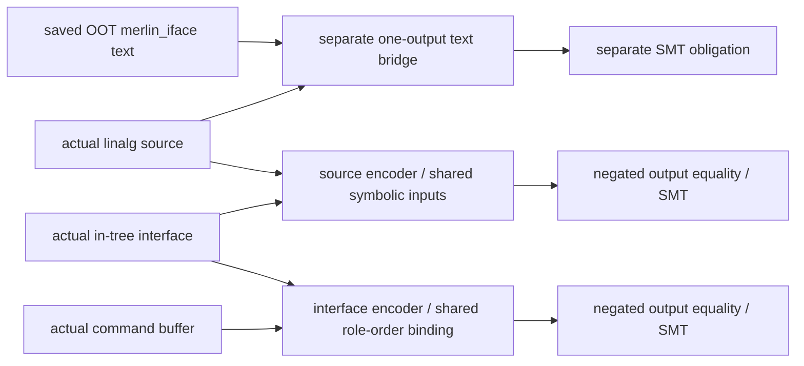

# Worked-example candidate — source/evidence audit, no observed SMT verdict

The retained test embeds one diagnostic OOT input/output text pair: source-original16.mlir and oot-original16.mlir. The source has two16×16 signed-i8 tensors, explicit i32 zero fill, exact matmul-shaped linalg.generic and one i32 tensor return. The captured merlin_iface target declares arg1 weight before arg0 input, packs arg1, multiplies arg0×packed arg1, commits one empty-epilogue i32 output named out, and evicts. Exact target SHAe772ca1071a5f4558088f66e04c4427319841cd31d8a6adea41b674282a096a5 matches the test's hardcoded original digest. EXAMPLE_INPUTS.json pins both original strings and exact derived2×2/mutation text.

Those are saved TEST-EMBEDDED diagnostic strings, with trial provenance asserted by test comments. No original compiler invocation log/receipt was located. Raw source string SHA is not automatically the receipt's xDSL generic source SHA: _source parses/verifies, then receipts.module_text would serialize the actual module, which this review did not do.

Three branches must remain separate:

1. OOT16×16: actual saved source string→actual saved merlin_iface UTF8 text. A defined test expects verified plus replay; its existence is not evidence it ran. No matching retained checker output/receipt/query/tool report found within bounded cited namespaces.
2. Small2×2: _source() reshapes the diagnostic text, _oot_text() reshapes OOT text for mutation tests. _target() separately invokes the in-tree repeated-RHS builder/lowering for an independently generated one-output interface. That is an encoder comparison, not the OOT compiler's saved output. No generated in-tree target bytes were retained here; they remain null rather than manufactured.
3. In-tree source/CB tests: _source_pair builds reuse2,2×2 quantized matmuls and INSERTS explicit zero fills before lowering. _backend_pair independently builds an interface and finishes target/runtime→command buffer under test-selected support. Tests expect both linalg_to_interface and interface_to_command_buffer receipts/replays, but serialize no permanent common intermediate for these two helper calls. They are not one exact matched chain, and the CLI accepts in-tree interface only. No OOT text→CB bridge is supplied by validate_compilation.

The legitimate candidate figure is a conditional pair of translation-validation boundaries, sharing the EXACT same retained intermediate only in a future actual capture:

The check encodes actual source operations, explicit fill and ordered returns; it does not call validate_interface_module's signature-derived replacement specification. Source creates own-width symbolic leaves once; target reuses the same terms, checks source/target shape and (for in-tree/OOT interface) width. Signed i8 extension/product and i32 wrap accumulation are explicit. Generic body/map/iterator/yield matching is structural, not prov tags/library_call. Quantized zero points come from actual constant operands, not an assumed zero. Source nonzero fill/zero-point changes are retained semantic differences; unsupported body/unsigned extension/maps/iterator or OOT unknown attribute/op/epilogue/extra commit are distinct unsupported expectations.

Method is SMT bitvector translation validation, not Lean. If an exact supported pair's fresh query is unsat under reviewed parser/encoder/exporter/solver contracts, it establishes modeled value equality for every input bit pattern at THAT concrete shape. Sat gives a modeled witness; unknown/unsupported/unavailable/error establish no value equivalence. This review observes none of these solver outcomes. Eleven mutation expectation inputs are preserved, with observed_status=null; test skip conditions/tools were never evaluated.

Domain: one function/block, positive concrete rank2 integer tensors; generic specifically signed i8 with i32 accumulator and exact contraction syntax. Named matmul/quantized paths have own width/shape constraints; not every i64 tensor is supported under default i32 accumulation. Bare tensor.empty init, unresolved runtime zero points, floats/BF16/FP8, unknown ops/regions/multiple functions/dynamic shapes and unsupported epilogues abstain or require new semantics. Poison, heap/alias/lifetime/UB, packed physical representation, DMA, target RTL and native ABI are outside this value model. CB has selected integer op/epilogue semantics and an overflow-free contraction bound to align its modeled wrap result with an unbounded-int reference engine; that is a trusted correspondence constraint, not hardware validation.

Source audit uncovered downstream binding/provenance gaps (FINDINGS.md): shared CB leaf dtype validation is bypassed; lexical commit/input name sorting is unsafe beyond single-digit indices; verifier digest omits imported contraction recognizer. These do not demonstrate an observed solver false acceptance for the saved one/two-output integer examples, but block broad fail-closed/type/general-output claims. No implementation was edited.

Strongest current sentence: “The repository retains a pinned16×16 integer linalg/merlin_iface diagnostic example and source code for fixed-shape SMT translation validation over shared symbolic inputs. This audit found no retained matching solver receipt in the bounded search; fresh checking and independent semantic review remain outstanding.”

Upstream linalg→SCF, bufferization, LLVM, panel/backend scheduling, hardware/performance and actual-model coverage are outside this candidate. These code examples are not qualified lowering evidence.
